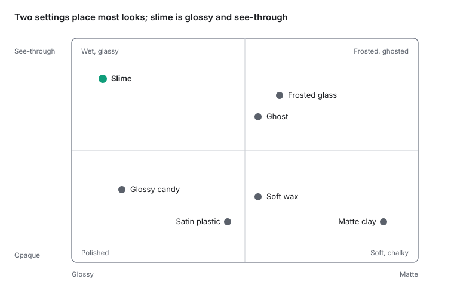

# Material recipes for molecular renders

Every look here is the same Principled BSDF shader with different settings. Roughness, and how light gets through the surface (Alpha, Transmission, Subsurface), do most of the work.

For a texture you can picture but cannot name, see [Designing a look from scratch](02-designing-a-look.md).

Materials only look as good as their light; the full course is in [Lighting](03-lighting.md).

Every shader node Blender has, and why the recipes start from the Principled BSDF, is in [Shaders: the whole menu, from zero](04-shaders.md).

How the maps and models themselves are built, and the tool the sticky-slime section uses, is in [Geometry Nodes, from zero](05-geometry-nodes.md).

## How to use this guide

Every section in every part follows one pattern: objectives, the material itself, one or more exercises to do in Blender, and a short self-check with answers. Do the exercises. The numbers in the tables only become intuition once you have moved the sliders and watched the render change.

Set up a lab bench once and reuse it for everything here: a new file containing a UV Sphere (Shift + A › Mesh › UV Sphere, right-click › Shade Smooth), a Cube, a Monkey (Shift + A › Mesh › Monkey, with a Subdivision Surface modifier at level 2 and Shade Smooth), and a copy of your map, all on a large plane, lit with the default rig from the [Lighting part](03-lighting.md), viewport in Rendered mode with Cycles. Save it as `material_lab.blend`. The sphere shows highlights and the shadow edge, the cube shows flat faces and sharp edges, the monkey shows cavities and thin parts, and the map shows real geometry.

## Why your render looks slimy

### Objectives

- Name the four settings that together produce a wet, gelatinous look.
- Predict what removing each one does before you try it.
- Recognize the same four ingredients in other people's renders.

### The four ingredients

Four things combine in that render: a mirror-smooth surface, a see-through surface, color that deepens with thickness, and a bumpy shape. None of them alone reads as slime. Together they are unmistakable.

- **Roughness near 0.** The two area lights reflect in the surface as sharp white streaks, one per ridge that happens to face a light at the mirror angle. Sharp, bright, white highlights are the single strongest cue for wetness, because dry surfaces almost never have them; a film of water is what gives a surface a polished skin.
- **Alpha below 1.** At 0.177 you see about 80% of what is behind each surface. On a folded map, what is behind is more map, then the tubes of the model, then more map again. The eye reads stacked translucent layers as gel.
- **Layered tint.** Every see-through layer multiplies its color into what is behind it and loses some brightness. Three layers of pale pink over a green ribbon add up to a dim olive. Thin edges have only one layer and stay pale, thick regions have several and go dark. That gradient from pale edge to dark body is exactly how jelly and thick syrup look.
- **The map's own bumps.** A density surface is a field of small lobes. Each lobe catches the lights from its own angle, so instead of one broad highlight you get hundreds of small ones. Smooth the geometry, or raise roughness, and the glitter becomes a single sheen.

To get slime on purpose, keep all four and add a thickness tint from a Volume Absorption node (the slime recipe below does this). To lose it, raise Roughness to 0.4 or higher first; that alone removes most of the wet look, and Alpha 1 removes the rest.

### Exercise 1.1: take the slime apart

1. In the Material tab, click the copy icon next to the material's name so you keep the original, and rename the copy `slime_ref`.
2. Raise Roughness from 0.05 to 0.4. Watch the viewport for a few seconds while it cleans up.
3. Put Roughness back and set Alpha to 1.
4. Put Alpha back, select the sphere from the lab bench, give it the same material, and compare it with the map.

What you should see: in step 2 the streaks spread into a soft sheen and the surface stops looking wet, even though it is still see-through. In step 3 the olive murk disappears and the pink returns, and the surface reads as solid pink plastic. In step 4 the sphere shows one or two clean highlights where the map showed hundreds, which tells you the glitter comes from the geometry rather than the material.

### Check yourself

1. Which single setting removes most of the wet look, and why does it work? *Roughness. Wetness is read from sharp specular highlights, and roughness spreads them until they stop reading as reflections.*
2. The material's Base Color is pink. Why does the render show olive? *Each translucent layer tints and darkens what is behind it; several pink layers over the green ribbon multiply to a dim olive.*
3. Two renders use the identical material. One glitters, one shows a single highlight. What differs? *The geometry. Many small bumps give many small highlights; a smooth surface gives one.*

## The controls that set a look

### Objectives

- Locate each of the eleven controls that matter on the Principled BSDF node and in its panels.
- Describe what the eye sees as each control moves from low to high.
- Know which three controls to touch first and which to leave alone.

### Where they are

In the Material tab, the Principled BSDF shows its main inputs at the top, Base Color through Alpha, and then a row of collapsible panels: Diffuse, Subsurface, Specular, Transmission, Coat, Sheen, Emission, Thin Film. In the Shader Editor the same panels fold open on the node itself. The table names the panel for each control so you can find it either way ([Principled BSDF manual](https://docs.blender.org/manual/en/latest/render/shader_nodes/shader/principled.html)).

Roughness, plus how light passes through the surface, sets most of the look; the other controls are finishing touches.

| Control | Panel | Low → high | Use it for |
| --- | --- | --- | --- |
| Roughness | Main | 0 mirror-sharp highlights → 1 no visible highlight | The biggest lever. 0.3 to 0.6 suits most figures. |
| IOR | Main | 1.0 no reflection → higher, more reflective | Keep 1.4 to 1.5. Most real materials sit between 1.0 and 4.0. |
| Alpha | Main | 0 invisible → 1 opaque | Ghosted overlays. Nothing bends, so the model inside stays undistorted. |
| Transmission Weight | Transmission | 0 opaque → 1 glass-like | Gel, glass, liquid. Light passes through and bends what is behind. |
| Subsurface Weight and Scale | Subsurface | 0 plain surface → 1 light glows inside | Wax, milk, soft tissue. Scale is how far light travels, in scene units. |
| Coat Weight and Roughness | Coat | 0 none → 1 full clear layer | Lacquer, candy, or a wet sheen on top of any other look. |
| Sheen Weight | Sheen | 0 none → 1 strong | A soft, velvety glow at the edges. |
| IOR Level | Specular | 0 no highlights → 0.5 default | Dims highlights without changing Roughness. |
| Emission Color and Strength | Emission | Strength 1 shows the exact color, unshaded | Flat, illustration-style color. |
| Thin Film Thickness | Thin Film | 0 none → a few hundred nm | Soap-bubble iridescence (Cycles). |
| Metallic | Main | 0 → 1 | Real metals only. Keep 0 for biology. |

### What each control looks like as it moves

- **Roughness** spreads the highlight. At 0 the lights are small, sharp mirror images; at 0.3 they are soft blobs; at 0.6 they are a faint wide sheen; at 1 the surface shows no highlight, only a lighter and a darker side. Between 0.3 and 0.6 a material reads as plastic, paint or skin, which is why that range suits most figures.
- **IOR** sets how strongly the surface reflects when seen head-on, through the Fresnel effect. Keep it near 1.5 for anything non-metal: 1.33 is water, 1.45 glass, 1.5 plastic. Values above 2 reflect so much that the color underneath disappears into mirrored surroundings, which is what happened at 71.4.
- **Alpha** fades the whole surface toward invisible without bending light. At 0.5 the object is half-transparent and anything behind it stays sharp. It is cheap, works in both engines, and is the right tool for ghosted overlays.
- **Transmission Weight** turns the surface into glass: light enters and refracts by the IOR. At 1 the Base Color becomes the tint of the glass and the object's diffuse color is gone. Roughness now controls frosting as well as highlights.
- **Subsurface Weight and Scale** let light wander below the surface before leaving. Thin parts glow when lit from behind, and the shadow edge softens. Scale is a distance in scene units; 1 to 2% of the object's width is a usual start, and the Radius sets how far each color channel travels, which is why skin defaults to a reddish radius.
- **Coat Weight and Roughness** add a clear layer with its own gloss. The body keeps its roughness; the coat adds a second, sharper highlight on top. It is how you make a matte body look wet or varnished without making the body itself glossy.
- **Sheen Weight** adds a pale glow at grazing angles, as fine fibers do. It brightens the silhouette and leaves the center alone.
- **IOR Level** scales the strength of the specular highlight without changing its size. 0.5 is physically correct for the given IOR; 0.2 mutes highlights for dusty looks; 0 removes them.
- **Emission Color and Strength** make the surface give off light. Strength 1 shows the color unshaded; 5 and above makes a visible lamp in Cycles.
- **Thin Film Thickness** adds the rainbow interference of a soap film at a few hundred nanometers, Cycles only.
- **Metallic** switches the surface to a metal model: the reflection takes on the Base Color and the diffuse color disappears. Biological surfaces stay at 0.

### Exercise 2.1: the roughness ladder

1. In `material_lab.blend`, duplicate the sphere four times (Shift + D, then X and a distance) so five spheres sit in a row.
2. Give each a separate material (click the number next to the material name to make it single-user), all with Base Color mid-blue and IOR 1.5.
3. Set Roughness to 0, 0.25, 0.5, 0.75 and 1 from left to right.
4. Render with F12 and save the image as `roughness_ladder.png`.

What you should see: the first sphere mirrors the lights and the room, the second shows soft bright blobs, the middle one a gentle sheen, and the last two differ only slightly from each other. Keep the image; it is your reference for reading roughness in other renders.

### Exercise 2.2: Alpha against Transmission

1. Two spheres, same blue material. Put a thin vertical cylinder behind them.
2. On the first set Alpha 0.3. On the second set Transmission Weight 1 and IOR 1.45.
3. Compare the cylinder seen through each.

What you should see: through the Alpha sphere the cylinder is faint but straight. Through the Transmission sphere it is bent, flipped and magnified, and the sphere's edges show a bright rim of reflected light. That difference is the whole choice between the two controls.

### Check yourself

1. A render looks like a plastic toy. Which control is most likely at its default, and what range would you try? *Roughness, sitting at a middle value with no variation. Try moving it, or adding a coat over a rougher body, or a little noise.*
2. You need the model to stay undistorted inside a translucent map. Alpha or Transmission? *Alpha. Transmission refracts.*
3. What does IOR Level change that Roughness does not? *The brightness of the highlight, not its size.*
4. Why does a transmissive material need a paler Base Color than you expect? *Base Color tints every pass of light through the glass, and light passes through more than once, so a mid color darkens to a deep one.*

## Recipes

### Objectives

- Build any of the eight looks from a fresh Principled BSDF in under a minute.
- Explain why each recipe uses the values it does, so you can bend it instead of copying it.
- Place a new look on the roughness and see-through map before building it.

### How to read a recipe

Start from a fresh Principled BSDF, change only the settings listed, and leave everything else at its default. Then adjust by eye in Rendered view. The map below places each look by its two most important properties, which is also the quickest way to decide where a look you have in mind belongs.

Slime and frosted glass both let light through; roughness is what separates them. The flat look is left off the map because it is unshaded, so roughness does not change it.

| Look | Roughness | Alpha | Transmission | Other changes | Good for |
| --- | --- | --- | --- | --- | --- |
| Matte clay | 0.9 | 1 | 0 | IOR Level 0.2 | Clean, illustration-like figures; pairs well with ambient occlusion |
| Satin plastic | 0.45 | 1 | 0 | None | The safe default for most figures |
| Glossy candy | 0.4 | 1 | 0 | Coat Weight 1, Coat Roughness 0.03 | Eye-catching, cover-style renders |
| Soft wax | 0.5 | 1 | 0 | Subsurface Weight 1, Subsurface Scale about 2% of the map's width | Organic surfaces that glow softly at thin edges |
| Ghost | 0.5 | 0.25 | 0 | IOR Level 0.2 | Map over model: the model stays sharp and undistorted |
| Frosted glass | 0.6 | 1 | 1 | IOR 1.45 | Milky see-through shells |
| Slime | 0.05 | 1 | 1 | IOR 1.35, Coat Weight 0.5, saturated Base Color | Wet, gelatinous surfaces (steps below) |
| Flat illustration | Any | 1 | 0 | Base Color black, IOR Level 0, Emission Color set to your color, Emission Strength 1 | Flat, unshaded color, like a 2D schematic |

To find the map's width for Subsurface Scale, select it and read N › Item › Dimensions. For the flat look, also set Color Management › View Transform to Standard so the color comes out exactly as picked.

Molecular Nodes also ships ready-made materials, including Ambient Occlusion, Flat and Squishy ([materials guide](https://bradyajohnston.github.io/MolecularNodes/api/materials.html)). Pick one in the style node's Material field, then open it in the Shader Editor to see how it is built.

### Why each recipe works

- **Matte clay** turns the highlight off with Roughness 0.9 and IOR Level 0.2, leaving pure shading. It looks best with ambient occlusion because, without highlights, cavities are the only remaining depth cue.
- **Satin plastic** is the Principled default with the roughness tuned. It is safe because a single medium highlight reads correctly on every shape and under every light.
- **Glossy candy** keeps a soft body (Roughness 0.4) and adds a mirror-smooth coat. The two highlights, one broad and one sharp, are what candy, ceramic glaze and car paint have in common.
- **Soft wax** lets light into the surface. Subsurface Scale at about 2% of the object's width is far enough to soften shading and light thin edges, not so far that the whole object glows.
- **Ghost** uses Alpha for see-through without refraction and dims the highlight with IOR Level 0.2 so the ghost does not sparkle over the model.
- **Frosted glass** is transmission with high roughness. The frosting is the same roughness that blurs the highlight; it blurs the view through the glass too.
- **Slime** is near-zero roughness, transmission with a water-like IOR, and a half-strength coat for a second glint; the section below adds the thickness tint.
- **Flat illustration** takes the shading out entirely: a black Base Color reflects nothing, IOR Level 0 removes highlights, and Emission at Strength 1 paints the color on unshaded.

### Exercise 3.1: three looks side by side

1. On three spheres from the lab bench, build Matte clay, Satin plastic and Glossy candy, all in the same mid-red.
2. Render once with the full rig, then once with the key light hidden (click its eye icon in the Outliner) and only the world light on.

What you should see: under the full rig the three are clearly different. With only world light they look nearly the same, because the differences are all in how they reflect a bright, well-placed light. Materials are only half of a look.

### Exercise 3.2: ghost against frosted glass on the map

1. Build Ghost and Frosted glass as two materials, and switch the map's style node between them.
2. Look at the model inside in each.

What you should see: through the Ghost the model is faint but exactly in place; through the frosted glass it is a blurred, slightly swimming shape. Ghost is for figures where position matters; frosted glass is for images where mood matters.

### Check yourself

1. Which two settings differ between Satin plastic and Glossy candy? *Coat Weight and Coat Roughness; the body roughness is nearly the same.*
2. Why is the flat illustration's Base Color black? *So that no diffuse shading is added to the emission; the color comes entirely from Emission.*
3. Why does Soft wax specify Subsurface Scale relative to the object's width rather than as a fixed number? *Scale is a distance in scene units, so the same number means different things on a 1 m sphere and a 20 m map.*

## Slime on purpose, step by step

### Objectives

- Build a wet, gelatinous material from scratch and know what each step contributes.
- Add color that deepens with thickness using a volume shader.
- Add ripples with a procedural bump without image textures.
- Turn the same recipe into water, honey or tar by changing three numbers.

### The build

Slime is a wet, see-through surface whose color deepens where it is thick. Build it in this order in the Shader Editor, checking Rendered view in Cycles after each step, because each step changes what the next one looks like.

1. **Surface.** A Principled BSDF in the Surface socket, nothing in Volume yet. If the material started on a volume object, remove the Principled Volume first.
2. **Wet glints.** Roughness 0.05. Coat Weight 0.5, Coat Roughness 0. The body gloss gives the broad wet sheen; the coat adds a second, sharper glint on top, which is what a thin water film over a soft gel looks like.
3. **See-through.** Transmission Weight 1, IOR 1.35. Water is 1.33 and most gels are a little above it. A lower IOR bends less and gives a thinner, watery look; 1.45 looks like glass.
4. **Color.** A saturated, mid-dark Base Color. Transmission tints the light passing through, and light passes through twice or more, so the color compounds; a strong color reads as jelly, a pale one as water.
5. **Color that deepens with thickness (optional).**
   - Set Base Color to near-white so the surface itself stops tinting.
   - Add Shift + A › Shader › Volume Absorption, set its Color to the slime color, and connect its Volume output to the Material Output's Volume input.
   - Density: start at 1 divided by the map's width in meters, then double or halve. Thick lobes go dark and saturated while thin edges stay clear, which is what distinguishes jelly from tinted glass.
6. **Ripples (optional).**
   - Add Shift + A › Input › Texture Coordinate and Shift + A › Texture › Noise Texture. Connect Object to the Noise Texture's Vector.
   - Noise Scale: about 30 divided by the map's width in meters, so roughly 30 ripples across. Detail 3.
   - Add Shift + A › Vector › Bump: Noise Fac into Height, Strength 0.15. Connect its Normal to both Normal and Coat Normal on the Principled BSDF so the film follows the ripples.
7. **Light for glints.** One fairly small, strong key light makes sharp streaks; a large one makes broad bands. A light behind the map makes the gel glow through, which is the single most convincing addition.

If the model inside looks warped, that is refraction from Transmission. For a figure, use Alpha 0.35 with Transmission 0 instead of step 3. You keep the glints and the see-through look, and the model stays undistorted; that is close to what your accidental render did.

### Variants

| Variant | Change from the recipe | Why |
| --- | --- | --- |
| Clean water | IOR 1.33, Base Color white, no absorption, Coat Weight 0 | Water has no body color and no second film |
| Honey | IOR 1.48, Absorption Color amber at double density, Roughness 0.02 | Thicker, more refractive, strongly colored |
| Tar | Absorption near black at high density, Roughness 0.1, Coat Weight 1 | Opaque in all but the thinnest edges, with a hard wet shine |
| Wet soap | Add Thin Film Thickness 400 nm | Rainbow interference on the surface film |

### Exercise 4.1: build and vary

1. Build the full recipe on the monkey head from the lab bench, including steps 5 and 6.
2. Render, then change only the three settings in the Honey row and render again.
3. Place a small area light behind the head, pointing at the camera, and render a third time.

What you should see: the first render is a green or pink jelly with dark ears and pale brows. Honey turns the thin parts amber and the thick parts almost brown. The backlight makes the ears and brow ridge glow, and the whole head suddenly reads as translucent rather than merely shiny.

### Check yourself

1. Why set Base Color to near-white when adding Volume Absorption? *So the color comes only from the absorption, which depends on thickness, instead of being applied evenly at the surface as well.*
2. What does Coat Normal do that Normal alone does not? *It makes the coat's highlight follow the bump; without it the film stays smooth over a rippled body.*
3. Which single light change does the most for a translucent material? *A light behind it, so that light passes through to the camera.*

## Sticky slime: where the tubes come out

### Objectives

- Make slime cling to whatever passes through it: a wet collar, a meniscus, strands and drips.
- Build each effect as a node chain you can reuse on any object.
- Keep all four reading as one substance.

### Why the exits matter

Tubes breaking through a translucent surface are what make it read as a substance rather than a shell. But real gel wets whatever leaves it, and a clean geometric intersection says "model placed inside map" instead of "model emerging from slime." Four things fix it, and the first two do most of the work. The node chains live in Geometry Nodes; the concepts behind them are in [Geometry Nodes, from zero](05-geometry-nodes.md), Chapter 7 of which walks the same chains with more explanation.

### 1. The wet collar

A tube that just left slime is glossy and darker for a short distance, then dry. Store a `wet` value on the model that is 1 at the surface and fades to 0 a short way out, then let the material read it.

In the model's Geometry Nodes tree, after the style node:

1. Object Info (Object: the map, Relative) › Geometry → Geometry Proximity (Target Element: Faces), Target input.
2. Geometry Proximity › Distance → Map Range (From Min 0, From Max 0.2, To Min 1, To Max 0, Clamp on). From Max is how far the wetness reaches; 0.2 m is about 2 nm at the Blender 5 world scale.
3. Map Range › Result → Store Named Attribute (Domain: Point, Data Type: Float, Name `wet`), with the style's geometry through the Geometry socket, then on to Group Output.

In the model's material:

4. Attribute (Name `wet`) › Fac → Coat Weight. Coat Roughness 0.02.
5. Attribute `wet` › Fac → Factor of a Mix Color whose A is the chain color (Attribute `Color`) and whose B is the same color through Hue/Saturation/Value at Value 0.5; the Mix result → Base Color. Wet surfaces are darker.
6. Attribute `wet` › Fac → Map Range (0 to 1 into 0.5 to 0.15) → Roughness.

### 2. The meniscus

Slime climbs a little way up anything that passes through it. Blender 5's SDF nodes make this a smooth union with a fillet, which is a meniscus in the mathematical sense.

In the map's tree, after the Density Style Surface:

1. Density Style Surface › Geometry → Mesh to SDF Grid (Voxel Size 0.02, Band Width 3).
2. Object Info (Object: the model, Relative) › Geometry → Mesh to SDF Grid with the same Voxel Size. The model must be outputting a mesh style (cartoon, ribbon or sticks), not points.
3. Both grids → SDF Grid Boolean (Union).
4. SDF Grid Boolean → SDF Grid Fillet (Iterations 3). This rounds the concave crease where tube meets surface into a curve that rises up the tube; each iteration rounds it a little further, and a coarser voxel size makes each step larger.
5. SDF Grid Fillet → Grid to Mesh (Threshold 0) → Set Material (the slime material) → Group Output.

The result includes the tubes themselves, now wrapped in slime. To show the model's own material on the tubes, keep the original model object visible as well; the slime skin over it is very thin and the model's material shows through where the tubes leave the slime, or use the Alpha-based ghost version of the slime on the union mesh. The quick alternative when the SDF chain is too heavy: lower the map threshold slightly so the surface swells around the tubes, then add a Metaball (Shift + A › Metaball › Ball) with the slime material at each exit. Metaballs merge smoothly into each other and into nothing else, so they fake a meniscus from the outside.

### 3. Strands

The stretchy threads between a tube and the surface are curves with a radius.

1. Shift + A › Curve › Bézier. In Edit Mode, place one end on the tube just outside the surface and the other on the slime surface a little way off, and pull the middle control handles downward so the curve sags.
2. Object Data Properties › Geometry › Bevel › Depth 0.01, Resolution 6, and the slime material.
3. For a pulled look rather than a hung one, taper the middle: in Geometry Nodes on the curve, Spline Parameter › Factor → Float Curve (a dip to 0.3 at the center, 1 at both ends) → Set Curve Radius, then Curve to Mesh with a Curve Circle profile.
4. Three or four strands per exit at different lengths read better than one. Duplicate with Shift + D and vary the sag.

### 4. Drips

Elongated metaballs hanging below the lowest exits: Shift + A › Metaball › Ellipsoid, scaled tall, with a small Ball metaball at the lower tip. Metaballs of one object merge, so the tip blends into the ellipsoid as a droplet. Give the metaball object the slime material. To animate a falling drop, keyframe the tip ball's position downward; the ellipsoid stretches with it until they separate.

### Keeping it one substance

Give the map, the union mesh, the strands and the drips the same slime material, including its Volume Absorption, so color deepens with thickness in all of them. Then put a light behind the scene: thin gel glows when lit from behind, and the strands and drips are where it shows.

### Exercise S.1: wet collar only

1. Build chain 1 on the model and render with the slime material on the map.
2. Set From Max to 0.05, then 1.0, and render each.

What you should see: at 0.05 only a thin dark gloss ring at each exit; at 0.2 a convincing wet collar that fades over a tube's length; at 1.0 the whole model looks dipped. The length of the collar is how recently the tube left the slime.

### Exercise S.2: the meniscus by SDF

1. Build chain 2 with Fillet Iterations 0, render, then 3, then 10.

What you should see: at 0 the surface meets the tubes at a sharp crease; at 0.05 the crease rounds into a small climbing curve; at 0.15 the slime mounds up around every tube. Somewhere between the last two is what wet gel does.

### Exercise S.3: one strand

1. Build one tapered strand from step 3 and render it with a backlight.

What you should see: a thread that glows where it is thin, which is the single most convincing detail in the whole effect.

### Check yourself

1. Which node measures how far each point of the model is from the map surface? *Geometry Proximity, with the map's geometry as its target.*
2. Why does a wet surface need to be darker as well as glossier? *Water on a surface reduces diffuse reflection, so wet things look darker; gloss alone reads as plastic.*
3. What does SDF Grid Fillet do to the union of two shapes? *Rounds the concave crease between them into a smooth curve, which is a meniscus.*
4. Why do metaballs suit slime? *They merge smoothly into each other, so drops and collars blend without seams.*

## Edge-glow ghost

### Objectives

- Drive a shader input with a node instead of a fixed number.
- Use the Layer Weight node to make a property depend on viewing angle.
- Build a see-through map that keeps a crisp outline.

### The idea

This makes the map nearly clear where it faces you and solid at its silhouette. The model reads through it, while the map keeps a crisp outline. It works because Alpha is a socket, not just a number: anything that outputs a value can drive it, and the Layer Weight node outputs a value that depends on the angle between the surface and the camera.

Facing is 0 where the surface points straight at the camera and rises to 1 where it turns edge-on. At the silhouette every surface is edge-on, so Facing is highest there. Feeding it to Alpha makes the faces transparent and the outline opaque.

### The build

1. Start from the Ghost recipe: Roughness 0.5, IOR Level 0.2.
2. Add Shift + A › Input › Layer Weight. Set Blend to 0.3. Blend controls how quickly Facing rises toward the edge: low values keep the center clear and make the rim narrow, high values widen the rim.
3. Add a Map Range node (Shift + A, then type Map Range). Set From Min 0, From Max 1, To Min 0.05, To Max 0.9. This rescales Facing so the faces are not fully invisible and the rim is not fully opaque.
4. Connect Layer Weight's Facing output to Map Range's Value, and Map Range's Result to the Principled BSDF's Alpha.
5. Tune by eye: raise To Max for a stronger outline, raise Blend for a wider rim, and raise To Min if the faces vanish completely.

For a glowing rim on a dark background, also connect Map Range's Result to Emission Strength and set Emission Color to the map's color. The rim then emits as well as reflects, which reads as an X-ray or a hologram.

### Exercise 5.1: watch Facing

1. Temporarily connect Layer Weight's Facing output straight to the Principled BSDF's Base Color.
2. Orbit the camera around the sphere and the map in Rendered view.

What you should see: black in the center of every surface, white at every edge, moving as you orbit. This is the value you are feeding to Alpha; seeing it directly makes the rest of the setup obvious. Reconnect Base Color afterwards.

### Exercise 5.2: invert it

1. Swap the Map Range's To Min and To Max so faces are opaque and edges fade out.

What you should see: the map's silhouette dissolves and only the surfaces facing you remain, the opposite effect. This is the same trick used to fade objects at their edges into a background.

### Check yourself

1. What value does Facing give at the exact silhouette? *1, because the surface is edge-on to the camera there.*
2. What would happen with Blend at 1? *Facing rises very slowly, so almost the whole surface stays near 0 and only the last sliver of the edge becomes opaque.*
3. Why use Map Range instead of connecting Facing directly to Alpha? *To set the lowest and highest alpha the surface reaches, so the faces never fully disappear and the rim never becomes a hard white line.*

## Setting up a recipe on a Molecular Nodes object

### Objectives

- Put any recipe onto a Molecular Nodes map or model through the style node.
- Keep the per-chain colors that Molecular Nodes computes while using your own material.
- Compare two materials on the same object without rebuilding either.

### How materials reach a Molecular Nodes object

A Molecular Nodes object is not a plain mesh with a material slot. Its geometry is generated by a node tree, and the style node at the end of that tree has a Material field; whatever material is in that field is applied to the geometry it generates. The material slots in the Material tab still exist, but the style node overrides them. So the workflow is: build the material in the Shader Editor, then choose it in the style node's Material field.

- **Use a surface material.** Principled BSDF in Surface, nothing in Volume. A map is a volume object, so Material › New starts with a Principled Volume, which renders as fog. Set Surface to Principled BSDF and the Volume field to Remove.
- **Assign it in the style node.** In the Geometry Nodes workspace, set the density style node's Material field to your material. The viewport updates immediately in Rendered mode.
- **Keep Molecular Nodes' colors.** The per-chain or per-atom colors live in a mesh attribute named `Color`, filled by the Color nodes in the Geometry Nodes tree. Add Shift + A › Input › Attribute, set its Name to `Color`, and connect its Color output to Base Color, or to Emission Color for the flat look. Without this, the style node's Color swatch and the color nodes before it have no effect, because your material sets Base Color to a constant.
- **Compare recipes.** Duplicate the material with the copy icon beside its name, rename the copy, change it, and switch between the two in the style node's Material field. Each switch takes a few seconds to resolve in Rendered view.
- **Find nodes fast.** In any node editor, press Shift + A and start typing a node's name.
- **Render engine.** Cycles renders Transmission, Subsurface, Coat, Thin Film and Volume Absorption accurately. EEVEE is faster but approximates them. If Alpha looks wrong in EEVEE, try the material's Settings › Render Method › Blended.
- **Preview.** Judge materials in Rendered view (Z › Rendered). Material Preview uses a built-in studio light, not your lights, and it hides most of what a material does under your actual rig.

### Exercise 6.1: chain colors through your own material

1. Load a model from the PDB tab with Cartoon style and the default coloring, so chains differ in color.
2. Build a Glossy candy material and assign it in the style node. The whole model turns one color.
3. Add the Attribute node with Name `Color` and connect its Color output to Base Color.

What you should see: the chain colors return, now with the candy coat on top. Change a color in the Geometry Nodes tree and it flows through to the render, because the material reads the attribute rather than a constant.

### Exercise 6.2: the fog mistake, on purpose

1. On the map, click Material › New and look at the Surface and Volume fields before changing anything.
2. Render once as is, then set Surface to Principled BSDF and remove the Volume, and render again.

What you should see: the first render is a cloud; the second is a surface. Knowing exactly what the fog looks like means you will recognize it instantly the next time a map renders wrong.

### Check yourself

1. You changed the color swatch on the Density Style Surface node and nothing happened. Why? *Your material sets Base Color to a constant; it needs an Attribute node reading `Color` for the swatch to reach it.*
2. Where is the one place a material must be chosen for a Molecular Nodes object? *The Material field on the style node in the Geometry Nodes tree.*
3. Why does a new material on a map start as fog? *The map is a volume object, so Blender creates a Principled Volume by default.*

## Sources

- [Principled BSDF](https://docs.blender.org/manual/en/latest/render/shader_nodes/shader/principled.html) (Blender Manual)
- [Materials](https://bradyajohnston.github.io/MolecularNodes/api/materials.html) (Molecular Nodes documentation)
