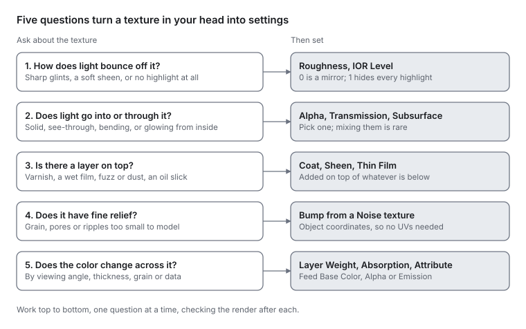

# Designing a look from scratch

The [Recipes part](01-material-recipes.md) gives fixed settings for named looks. This part covers the other case: a texture you can picture but cannot name. Describe what you see in five questions, each of which maps to one group of controls, then build the material in that order with the render open.

## Chapter 1. The method

### Objectives

- State the five questions from memory and name the control group each one sets.
- Describe a real material in a photo using the five questions.
- Explain why the questions are asked in this order.

### Five questions

Each question isolates one thing the eye reads: the highlight, what happens below the surface, what sits on top of it, the small-scale relief, and the color. They are asked in the order light meets the material: first how it bounces off, then whether it enters, then what lies over the surface, then the fine shape of that surface, then how color varies across it. Answer them in order and you have a material.

The tinted boxes are all on the Principled BSDF, except Absorption (a Volume Absorption node) and the Bump, Layer Weight and Attribute nodes, which plug into it.

The first two answers decide most looks. Questions 3 to 5 are refinements, and you can skip any that does not apply. Two habits make the method work. Judge from a reference, a photo of the real thing or a render you want to match, because the picture in memory is vaguer than it feels. And change one setting at a time with Rendered view open, so you can tie each change to what it did.

### Why the order matters

Each answer changes what the next one looks like. A coat (Question 3) over a rough body looks nothing like the same coat over a glossy one, so the body's roughness (Question 1) must be settled first. Bump (Question 4) multiplies whatever gloss is already there. Color variation (Question 5) is invisible until the shading that reveals it exists. Working out of order means tuning a layer, then changing the layer under it, then tuning the first layer again.

### Exercise 1.1: describe before you build

1. Find three photos: a wet stone, a block of cheese, and a frosted glass bottle.
2. For each, write one line per question: how light bounces, whether it goes in, what sits on top, what relief it has, how the color varies.
3. Only then open Blender and compare your lines with the [Recipes part](01-material-recipes.md) and the feeling-words table in Chapter 6.

What you should find: the stone is a soft body with a sharp film on top; the cheese has no highlight but a faint glow in thin slices, which is subsurface; the bottle is transmission with roughness. Writing the lines first turns a vague impression into a build list.

### Check yourself

1. Which two questions decide most of a look? *How light bounces off the surface, and whether it goes into or through it.*
2. Why is relief asked after the layer on top? *Because the bump has to be connected to the right normal input, and whether the coat follows the bump or stays smooth depends on the look of the coat.*
3. What is wrong with building from the picture in your head rather than a photo? *The memory is vaguer than it feels, so you cannot tell whether a change moved toward it or away.*

## Chapter 2. Questions 1 and 2: the base layer

### Objectives

- Read the roughness of a real surface from the edge of its highlight.
- Tell Alpha, Transmission and Subsurface apart from a photo, and pick one.
- Know the IOR of the four materials you will meet most.

These two answers set the body of the material. Get them right before touching anything else.

### Question 1. How does light bounce off it?

Find the brightest spot on the reference, where the light reflects, and look at its edge. The edge of the highlight is roughness made visible: a sharp edge means a smooth surface, a soft edge means a rough one.

- **Small, sharp, with the room reflected in it**: wet, glassy, polished. Roughness 0 to 0.15. You can often see the shape of the window or the lamp in the highlight.
- **A soft bloom that fades out**: satin, plastic, skin. Roughness 0.3 to 0.6. The highlight is a bright region, not a picture of anything.
- **No spot, only a lighter side and a darker side**: chalk, clay, paper. Roughness 0.8 to 1. The surface is lit, not reflective.

Two refinements. IOR Level (Specular panel) scales how bright the highlight is without changing its size; drop it to 0.2 for powdery surfaces whose highlights are faint even when smooth. And the highlight is white on everything except metal, so Metallic stays 0; a colored highlight in a photo means metal, nothing else.

On a bumpy surface such as a density map, low roughness becomes many tiny glints, the glitter from the [Recipes part](01-material-recipes.md). A single smooth glint needs a smooth mesh; otherwise raise Roughness or put the gloss in a Coat (Question 3), whose Coat Roughness can stay low because the coat's highlight is small relative to the body's.

### Question 2. Does light go into or through it?

Look at a thin edge, or at a part held against the light.

- **Nothing gets through**: solid. Alpha 1, Transmission 0, Subsurface 0.
- **You see through it and what is behind stays undistorted** (a ghost, a cutaway): Alpha below 1. The object is faded, not glassy.
- **You see through it and what is behind bends or swims** (glass, water, jelly): Transmission Weight 1 and an IOR. Water is 1.33, glass 1.45, plastic and most gels about 1.5. Roughness now also sets how frosted it is, because it blurs transmitted light as well as reflected light.
- **Nothing gets through, but thin parts glow and the shading is soft** (wax, milk, skin, grapes): Subsurface Weight 1, with Scale about 1 to 2% of the object's width. Hold a grape up to a lamp and the far side glows; that is the test.

Pick one of the three. Stacking them is rarely what you saw, and it is where murky renders come from: Alpha over Transmission doubles the see-through and halves the brightness, and Subsurface under Transmission has nothing to scatter.

### Exercise 2.1: read roughness from photos

1. Collect five product photos: a phone, a leather bag, a ceramic mug, a rubber tire, a sheet of paper.
2. For each, write a roughness number from the highlight's edge before checking.
3. Build each on a sphere and compare with the photo.

What you should find: the phone sits near 0.05, the mug near 0.15 (glaze), the bag around 0.4, the tire near 0.7, the paper near 1. If your guesses were within 0.15, you can read roughness.

### Exercise 2.2: three see-through spheres

1. Three spheres, one with Alpha 0.3, one with Transmission 1 at IOR 1.45, one with Subsurface Weight 1 and Scale 0.02 on a 1 m sphere.
2. Put a small area light behind them and a cylinder behind that.

What you should see: the Alpha sphere shows the cylinder faintly and straight; the Transmission sphere bends it and shows bright rims; the Subsurface sphere hides it but glows at its edges from the backlight. Those three images are the three answers to Question 2.

### Check yourself

1. A highlight shows a sharp reflection of a window. Roughness range? *0 to 0.15.*
2. A material shows the object behind it bent and flipped. Which control, and what else must be set? *Transmission Weight 1, plus an IOR; roughness then also controls frosting.*
3. What single observation separates subsurface from a solid matte surface? *Thin parts glow when lit from behind.*
4. Why not combine Alpha 0.5 with Transmission 1 for an extra-clear look? *Each adds see-through and removes brightness; together they make murk, not clarity.*

## Chapter 3. Questions 3 and 4: what sits on the surface

### Objectives

- Tell a highlight that belongs to a film from one that belongs to the body.
- Add a coat, a sheen or a thin film and know what each does to the base.
- Add procedural relief with a Noise Texture and a Bump node, and scale it to the object.
- Explain why molecular surfaces cannot take an image texture directly.

Many materials are two things, a body and a thin film over it, and many have texture too small to model. Both are added on top of the base from Chapter 2.

### Question 3. Is there a layer on top?

Look at whether the highlight sits on the color, like a film, or in it. A film shows a sharp, colorless reflection while the color under it stays soft; a glossy body shows one highlight that is part of the color.

- **Clear varnish or a wet film**: Coat Weight 1, or 0.5 for damp. Coat Roughness 0 to 0.1. The body keeps its own roughness underneath, so a matte body under a glossy coat reads as wet clay or candy. Coat IOR stays at 1.5 for water and lacquer. Coat Tint colors the film; leave it white unless the film is itself colored, like a varnish on wood.
- **Fuzz, dust, velvet**: Sheen Weight 0.5 to 1 with Sheen Roughness high. It shows as a pale glow along the edges, where fibers are seen side-on. Sheen Tint sets the glow's color; white reads as dust, the body color as velvet.
- **Oil slick or soap bubble**: Thin Film Thickness 300 to 600 nm, Cycles only. The rainbow comes from interference in a film a few hundred nanometers thick, which is why the number is in real nanometers.

A film changes the base in one way you should expect: the coat reflects a few percent of the light before it reaches the body, so the body color darkens slightly when a coat is added. Raise Base Color brightness a little to compensate.

### Question 4. Does it have fine relief?

Grain, pores and ripples are built into the material rather than modeled. Use a procedural texture, not a photo: molecular surfaces have no UV map, which is the 2D layout an image needs to be pinned to a 3D surface. Procedural textures are formulas evaluated at each point in space, so they need only a position, which every surface has.

1. Shift + A › Input › Texture Coordinate, and Shift + A › Texture › Noise Texture (Voronoi for a cellular pattern, Wave for stripes). Connect Object to Vector. Object coordinates follow the object if it moves and stay the same size if the scene scales.
2. Shift + A › Vector › Bump. Connect Noise Fac to Height, and Bump Normal to the Principled BSDF's Normal. Add Coat Normal too if the film should follow the grain; leave it off for a smooth film over a rough body.
3. Noise Scale sets how many ripples fit in one meter, so an object 0.2 m wide with Scale 100 gets about 20 across. Detail 2 to 5 adds finer ripples on top of the main ones. Bump Strength 0.05 to 0.3; above 0.5 the shading breaks into obvious artifacts because bump cannot cast shadows.

Bump changes the shading, not the outline. For relief that shows at the silhouette, use Displacement in the material's Settings panel (Cycles) and more geometry. Bump also feeds Question 1: a glossy surface over bump sparkles, so keep Roughness moderate when you add it, or let the coat carry the gloss while the body stays rough.

### Exercise 3.1: film or body?

1. Two spheres with Roughness 0.6 and a saturated color.
2. On the first, lower Roughness to 0.05. On the second, leave Roughness at 0.6 and set Coat Weight 1, Coat Roughness 0.02.
3. Render.

What you should see: both have a sharp highlight, but the first looks like glossy plastic and the second like wet clay or glazed ceramic. In the second the color under the highlight stays soft. That difference is what Question 3 asks you to spot in a photo.

### Exercise 3.2: scale the grain

1. On the monkey head, add the Noise into Bump chain with Strength 0.2.
2. Render at Noise Scale 5, 50 and 500.

What you should see: at 5 the head looks dented, at 50 it looks like orange peel, at 500 it looks sandy. The look of relief is its size relative to the object, which is why the chapter gives Scale as ripples per meter rather than a single number.

### Check yourself

1. What stays unchanged when you add a coat to a rough body? *The body's own roughness; the coat adds a second, sharper highlight over it.*
2. Why is Thin Film Thickness given in nanometers? *The colors come from interference in a real film of that thickness.*
3. Why can a map not take an image texture directly? *It has no UV map to pin the image to; procedural textures only need a position.*
4. What does bump never do, however strong? *Change the silhouette or cast shadows; that needs displacement.*

## Chapter 4. Question 5: does the color change across it?

### Objectives

- Recognize the four kinds of color variation on real surfaces.
- Build each with the Mix Color node and the right driver.
- Color a density map from the model inside it.

Flat, even color is rare on real things. Four kinds of variation come up, each with its own node, and all of them end in a Mix Color node (Shift + A › Color › Mix Color). The Mix node takes two colors, A and B, and a Factor from 0 to 1: at 0 it outputs A, at 1 it outputs B, in between a blend. Everything in this chapter is a way of producing that Factor.

- **By viewing angle** (rim light, velvet, pearl): Shift + A › Input › Layer Weight. Its Facing output is 0 where the surface points at you and 1 at the edges. Connect it to the Factor of a Mix between two colors, or straight to Alpha for the edge-glow ghost in the [Recipes part](01-material-recipes.md). Pearl is a light color in A and a tinted one in B; velvet is dark A and the body color in B.
- **By thickness** (gel, colored glass, deep water): Volume Absorption in the Material Output's Volume socket, as in the slime recipe. Thick parts go dark and saturated, thin edges stay clear. This needs no Mix node, because the renderer measures the thickness itself.
- **By grain** (mottling, marbling): the Noise Texture from Chapter 3 into a Mix with Factor 0.1 to 0.2, between the base color and a slightly darker or warmer one. Reusing the same noise ties the color speckle to the bump, so the dark flecks sit in the dents, which is how real grain looks. A Color Ramp between the noise and the Factor sharpens the pattern into patches.
- **By data** (chain, B-factor, map value): Shift + A › Input › Attribute, with the attribute's name, into a Color Ramp (Shift + A › Converter › Color Ramp) and then into Base Color. Molecular Nodes stores its per-atom colors in `Color`, ready to use without a ramp. Numeric attributes such as `b_factor` need the ramp to become colors. For a density map, the Sample Nearest Attribute node in Geometry Nodes transfers colors from the model onto the surface, so the map takes the chain colors of what it encloses ([CryoEM Maps tutorial](https://bradyajohnston.github.io/MolecularNodes/tutorials/cryoem.html)).

Variation is what separates a render from a plastic toy. Even a 10% noise mix or a slight angle shift makes a surface read as real, because real surfaces are never one color.

### Exercise 4.1: pearl

1. On a sphere with Roughness 0.3, add Layer Weight (Blend 0.4) and a Mix Color with pale pink in A and pale blue in B.
2. Connect Facing to Factor and the Mix result to Base Color. Set Coat Weight 1.

What you should see: pink in the center shifting to blue at the rim, moving as you orbit. Swap the colors and the shift reverses. This is the whole of iridescent paint.

### Exercise 4.2: color the map from the model

1. Follow the Sampling Colors section of the CryoEM Maps tutorial: duplicate the model, remove its style so it outputs atoms, and feed it to a Sample Nearest Attribute node in the map's tree.
2. In the map's material, read `Color` with an Attribute node into Base Color.

What you should see: the map surface takes the chain colors of the atoms beneath it, with soft boundaries where chains meet. Change the chain coloring on the model copy and the map follows.

### Check yourself

1. What does a Mix Color node output at Factor 0.25? *Mostly A, a quarter of the way toward B.*
2. Which kind of variation needs no Mix node at all, and why? *Thickness, via Volume Absorption; the renderer measures the path length itself.*
3. Why reuse the bump's noise for the color speckle? *So dark flecks and dents coincide, as they do on real grain.*

## Chapter 5. Build order and a test rig

### Objectives

- Set up a swatch scene that shows every property of a material at once.
- Follow a build order that never requires undoing a previous step.
- Keep material versions safely and render a final check.

Build the material in the order of the questions, on a sphere next to the real object, under the lights you will render with.

### The procedure

1. **Reference.** Find a photo of the thing you are picturing and write down three words for it (wet, dark, grainy, say). The words become your answers to the five questions. Keep the photo open beside Blender; you will look at it twenty times.
2. **Test sphere.** Shift + A › Mesh › UV Sphere, right-click › Shade Smooth, placed beside the map and given the same material. A sphere shows the highlight, the shadow edge and the rim at once; the map shows how the material behaves on real geometry. The monkey head from the lab bench adds cavities and thin parts, which matter for subsurface and occlusion.
3. **Rendered view, real lights.** Press Z › Rendered with the final lights on. Material Preview uses a built-in studio light that will mislead you on roughness and transparency, because its HDRI gives every surface something bright to reflect.
4. **Base first.** Base Color and Roughness only. Stop when the sphere's highlight matches the reference. Nothing after this step can fix a wrong roughness; it can only hide it.
5. **Then, in order:** Alpha, Transmission or Subsurface; Coat or Sheen; bump; color variation. Check after each. If a step does not improve the look, undo it rather than compensating elsewhere, because compensation is how materials end up with six settings fighting each other.
6. **Keep versions.** Duplicate the material with the copy icon beside its name and rename it, for example `map_wet_v2`. Click the shield icon on a material you are not using, or Blender discards it when you save the file, since it keeps only materials with a user.
7. **Final check.** Render with F12 at the output size. Fine bump and small glints change character with resolution and sample count, and the viewport preview is at a lower resolution than the final image.

### The material and its light

A material and its lighting are one thing. Gloss needs something to reflect: a large area light gives a broad highlight, a small one a sharp dot, and a lit world gives the reflections something to show. When a glossy material looks dead, the fix is usually the light, not the material. The [Lighting part](03-lighting.md) covers this in full; for material work, the default rig there is enough.

### Exercise 5.1: a complete build

1. Choose one feeling word from Chapter 6 that is not in the [Recipes part](01-material-recipes.md), for example rubbery.
2. Find a photo. Write the three words. Build on the sphere following steps 4 and 5, saving a version after each step.
3. Render the final version next to the photo.

What you should see: four or five saved versions, each one step further along, and a final sphere that matches the photo's highlight and body. If a later version looks worse than an earlier one, that step was the wrong answer to its question; go back to the earlier version and answer differently.

### Check yourself

1. Why is Material Preview the wrong place to judge roughness? *Its studio HDRI gives every surface a bright reflection, so even rough materials look lively.*
2. What happens to a material with no users when you save? *Blender discards it unless the shield (fake user) is set.*
3. If adding a coat made the material worse, what should you do? *Remove the coat, not adjust something else to compensate.*

## Chapter 6. Feeling words and the settings behind them

### Objectives

- Translate an adjective into a starting set of values.
- Combine two adjectives into one material.
- Spot which row a render you admire belongs to.

When the picture in your head comes with a word, this table turns the word into a starting point. The middle column is the important one: it says what the eye is reading, which is what you check against the reference. Words combine: wet clay is the chalky row plus the wet row, and dusty rubber is the rubbery row with the dry row's sheen.

| Feeling | What the eye is reading | Start from |
| --- | --- | --- |
| Wet | A sharp, bright highlight sitting on top of the body color | Coat Weight 1, Coat Roughness 0, body Roughness unchanged |
| Dry, dusty | No highlight, slightly pale edges | Roughness 0.9, IOR Level 0.2, Sheen Weight 0.3 |
| Chalky, clay | No highlight, soft shading | Roughness 1, IOR Level 0.1, or the Ambient Occlusion material |
| Plasticky | One medium highlight, perfectly even color | Roughness 0.4 and nothing else; this is the default look, which is why renders start out plastic |
| Rubbery | A broad dim highlight, a faint edge sheen | Roughness 0.6, IOR Level 0.3, Sheen Weight 0.2 |
| Waxy, soft | Light bleeds through thin parts; shadows soften | Subsurface Weight 1, Scale 1 to 2% of width |
| Glassy | See-through with sharp reflections; the background bends | Transmission 1, Roughness 0, IOR 1.45 |
| Frosted, milky | See-through but blurred | Transmission 1, Roughness 0.4 to 0.7 |
| Jelly, gummy | See-through, colored, deeper where thick, wet | Transmission 1, IOR 1.35, Roughness 0.05, Volume Absorption |
| Ghostly | See-through without bending, faint | Alpha 0.2 to 0.4, IOR Level 0.2 |
| Velvety | Dark in the middle, glowing at the rim | Sheen Weight 1, Roughness 0.8, Layer Weight into a Mix |
| Pearly, iridescent | Color shifts with angle | Coat Weight 1 with Thin Film 400 nm, or Layer Weight into a two-color Mix |
| Metallic | A colored highlight, dark reflections | Metallic 1, Roughness 0.3; rare in biology |
| Flat, diagrammatic | No shading at all | Emission Strength 1 with your color, Base Color black, IOR Level 0 |
| Grainy, mottled | Fine speckle in both shading and color | Noise into Bump at 0.1 to 0.3 and into a Mix at Factor 0.1 |

### Combining rows

Each row changes a different group of controls, so two rows rarely conflict. Add the second row's settings to the first's and resolve any overlap by asking which of the two the eye reads first. Wet velvet, for instance, keeps the velvet's sheen and high roughness and adds the wet row's coat; the coat's sharp highlight wins where the two overlap, which is also what a wet velvet looks like.

### Exercise 6.1: two-word materials

1. Build three materials from pairs of rows: wet clay, dusty plastic, frosted jelly.
2. For each, write down which row's settings you kept where the two overlapped.

What you should see: wet clay is a matte body with a sharp coat highlight; dusty plastic is a satin body with a pale rim; frosted jelly is a rough transmission with absorption. If any looks like a single row, the second row's settings were overwritten rather than added.

### Exercise 6.2: classify a render

1. Pick three renders from the Molecular Nodes examples page or any structural biology cover you admire.
2. Assign each to one or two rows of the table and name the settings you believe were used.

What you should find: most published renders are satin plastic or matte clay with ambient occlusion; the striking ones add one more row, usually wet or glassy, to one object only.

### Check yourself

1. Which column of the table should you compare with the photo? *What the eye is reading.*
2. Why do two rows rarely conflict? *Each changes a different group of controls.*
3. A render has colored highlights. Which row, and what does that tell you? *Metallic; colored highlights only come from metal.*

## Chapter 7. Worked examples

### Objectives

- Follow the five questions end to end on two different subjects.
- See how a single observation in the reference decides a single setting.
- Practice the method on your own subject.

### A wet river pebble

The picture: dark gray, smooth but not polished, one bright sharp glint, a little paler at grazing angles, a faint speckle.

1. **Bounce.** The glint is sharp, but the stone under it is only semi-gloss, so the glint belongs to a water film and not to the stone. Body Roughness 0.5; Coat Weight 1, Coat Roughness 0.02. If the stone were dry, there would be no coat and the roughness alone would set the look.
2. **Into or through.** Solid, and thin edges do not glow. Alpha 1, Transmission 0, Subsurface 0.
3. **Layer.** Already added in step 1, because the sharp glint told us about the film before the question came up. This happens often; the questions are a checklist, not a strict sequence of discoveries.
4. **Relief.** Faint speckle. Noise Texture with Scale 200 for a 0.2 m pebble, Detail 5, into Bump at Strength 0.05, connected to Normal only, so the water film stays smooth over the grain.
5. **Color.** Paler at grazing angles comes from the film reflecting the sky. Layer Weight with Blend 0.5, Facing into the Factor of a Mix between dark gray and mid gray, into Base Color. The same noise into a second Mix at Factor 0.1 adds the speckle to the color.

If the result looks like plastic, lower Coat Weight to 0.6. If it looks dusty, lower the body Roughness. If the speckle reads as dirt rather than grain, lower the second Mix's Factor.

### A map as a frosted sugar shell around the model

The picture: the model visible as a soft shape inside a milky, slightly glossy shell.

1. **Bounce.** A soft highlight: Roughness 0.4.
2. **Into or through.** See-through with blur: Transmission 1, IOR 1.45. The roughness from step 1 now also does the frosting; there is no separate frosting control.
3. **Layer.** None. Sugar has no film.
4. **Relief.** The map's own surface already has it; adding bump would double it.
5. **Color.** Milkier where the shell is thick: Volume Absorption with a pale version of the shell color, Density 2. A pale color is important; a saturated one turns the shell into colored glass rather than sugar.

The model inside will be refracted. If it needs to stay sharp for the figure, swap step 2 for Alpha 0.4 and accept a flatter shell.

### A dry chalk cast

The picture: a plaster model, matte white, slightly warmer in the hollows, no highlight anywhere.

1. **Bounce.** No highlight: Roughness 1, IOR Level 0.1.
2. **Into or through.** Solid, but very thin edges of plaster do glow faintly: Subsurface Weight 0.3, Scale 1% of width. A small weight is enough.
3. **Layer.** Faint chalk dust on the surfaces: Sheen Weight 0.3, white tint.
4. **Relief.** Fine, even grain: Noise Scale 400 per meter, Bump Strength 0.1.
5. **Color.** Warmer in the hollows: an Ambient Occlusion node's Color output into the Factor of a Mix between white and a warm gray, into Base Color.

This is a good default for figure panels where color is carried by labels rather than the surface.

### Exercise 7.1: your own subject

1. Choose an object within reach: a mug, a piece of fruit, a key.
2. Write the five answers as in the examples, with a number or a node for each.
3. Build it on the sphere and the monkey head, and photograph the object under a desk lamp for comparison.

What you should find: the fruit will need subsurface and a sheen; the mug a coat over a matte body; the key a metallic base. Every object you can hold is one of the rows in Chapter 6 plus one or two refinements.

### Check yourself

1. In the pebble, why does the coat get the sharp roughness and not the body? *The glint belongs to the water film; the stone under it is semi-gloss.*
2. In the sugar shell, what controls the frosting? *The same Roughness that blurs the highlight, since roughness blurs transmission too.*
3. Why does the chalk cast use a small Subsurface Weight rather than 1? *Plaster only glows at its thinnest edges; full subsurface would make it look like wax.*

## Chapter 8. When it looks wrong

### Objectives

- Diagnose a bad render from its symptom rather than by trial and error.
- Separate material problems from lighting problems.

Most failures trace back to one of the five questions answered twice, or to the light rather than the material. Before changing anything, decide which: put the material on the test sphere under the lab-bench rig, and if the sphere looks right, the problem is the geometry or the lighting of the real scene.

| Symptom | Likely cause | Fix |
| --- | --- | --- |
| Glitter, pinpoint sparkles | Roughness near 0 on a bumpy mesh | Roughness 0.3 or more, or move the gloss into a Coat with Coat Roughness 0.1 |
| Looks like a plastic toy | Even roughness and color, one medium highlight | Bump at 0.1, noise into a Mix on Base Color at 0.1, or a coat over a rougher body |
| Dull and lifeless | Roughness too high, weak key light, nothing for reflections to show | Roughness 0.5, a larger and brighter key light, World Strength 0.3 |
| Murky, dark | Two see-through effects stacked, or a dark Base Color on a transmissive material | Pick one of Alpha, Transmission, Subsurface; lighten Base Color (transmissive materials need a paler color than you expect) |
| Fog or smoke instead of a surface | A volume shader on a surface object | Surface: Principled BSDF; Volume: Remove |
| Colors washed out or shifted | AgX view transform, or highlights too strong | View Transform Standard, IOR Level down |
| No depth, parts look pasted on | Light from every direction, no occlusion | Lower World Strength, add a key light, or use the Ambient Occlusion material |
| Black object | No material in the style node, a misspelled Attribute name, or black Base Color with Emission 0 | Assign the material; check the Attribute name is `Color`; set a color |
| Edits change nothing | Solid viewport, or editing a different material than the one in the style node | Z › Rendered; check the style node's Material field |
| Noise and white speckles in the render | Glossy surface, small bright light, transmission | A larger light, more samples with Denoise on, and Render › Light Paths › Clamping › Indirect Light 10 |
| The model inside is warped | Transmission refracts | Alpha instead, or Transmission with IOR 1.0, which passes light without bending it |

### Exercise 8.1: break it on purpose

1. Take a working satin plastic sphere and, one at a time, produce five of the symptoms in the table: glitter, plastic toy, murk, fog, black object.
2. For each, write down the one setting you changed, then undo it.

What you should find: every symptom has a single cause you can name. Once you have made each mistake deliberately, you will recognize it in a render within seconds.

### Check yourself

1. A render is grainy with white speckles. Material or lighting? *Usually lighting: small bright lights on glossy surfaces. Enlarge the lights, then raise samples.*
2. The map renders as smoke. Which socket is wrong? *The Volume socket holds a volume shader; the Surface socket is empty or should hold the Principled BSDF.*
3. The sphere looks fine but the map looks wrong with the same material. Where is the problem? *In the geometry or the scene lighting, not the material.*
