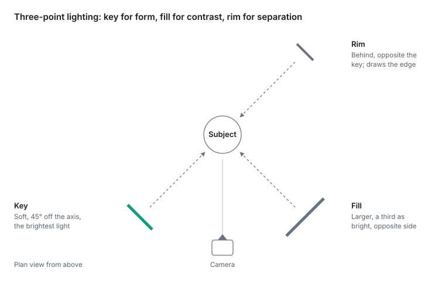

# Lighting, from zero to designing your own setups

Named setups like three-point and clamshell are answers to a few underlying questions about direction, softness and contrast. This part teaches the questions first, then the named answers, then how to invent an answer of your own, such as a glowing ribbon wrapped around the subject.

## Chapter 1. How light behaves in a render

### Objectives

- List the five properties of any light and say what each one changes in the image.
- Explain why the same lamp can be a hard light or a soft light.
- Tell shading from reflection on a surface, and know which properties each one shows.

Every light, whatever its name, is five properties, and every surface shows those properties in two ways. Once you can see a photo in these terms, you can rebuild its lighting.

### The five properties of any light

1. **Direction.** Where the light sits relative to the camera and the subject, measured as an angle around the subject (front, side, back) and an angle above it. Direction decides where shadows fall and which planes are bright, which is how the eye reads shape. A surface facing the light is bright; one turned 60° from it receives half as much; one turned 90° receives none. That falloff across a curved surface is the shading gradient.
2. **Size, relative to distance.** A light that looks large from the subject's position wraps around it: shadows have soft edges and highlights are broad. A light that looks small gives crisp shadows and small, sharp highlights. The same lamp is soft up close and hard far away, because what matters is the angle it covers as seen from the subject. A 1 m panel at 1 m covers about 53°; at 10 m it covers about 6°. The sun is enormous but far, so it covers half a degree and is a hard light; an overcast sky covers the whole dome and is the softest light there is.
3. **Intensity.** How bright it is at the subject. For a point, spot or area light this falls with the square of distance: twice as far, a quarter of the light. That is why 500 W at 50 m rendered black in your scene. Intensity on its own changes only brightness; everything else about the image stays the same, which is why exposure can be set last.
4. **Color.** Warm or cool, and how saturated. Two lights of different colors on the same object split it into a warm side and a cool side, which is a cheap way to add depth. For figures, color in the lights competes with color in the data, so lights stay white.
5. **Shape.** A disk, a long strip, a ring, a window. The shape is invisible in diffuse shading, but it is exactly what glossy surfaces reflect, and it decides what highlights look like.

### The two ways a surface shows light

- **Shading.** Matte surfaces scatter light in every direction, so each part of the surface is bright in proportion to how squarely it faces the light. Shading carries the form: the gradient from lit side to shadow side is what tells the eye a sphere is round. Shading sees direction, size and intensity, but not shape, because every direction from the light arrives mixed together.
- **Reflection.** Glossy surfaces return a picture of the light. The highlight on a wet pebble is a small image of the lamp, and the long streak along a glass bottle is the image of a strip light. Reflection sees shape and size above all. A glossy object in a scene with a single tiny light and nothing else shows a single pinpoint and looks dead, however bright the light is, because there is nothing else for it to reflect.

The practical rule that follows: light matte things by thinking about shadows, and light glossy things by thinking about what the surface will reflect. Most subjects are both, so a good setup does both. A density map with a satin material needs a soft key for its form and a large, well-placed bright shape for its sheen.

### Adding and moving things, while you learn

Every exercise in this part places objects and lights. Each move below is a key pressed with the mouse over the viewport; then move the mouse, or type a number for an exact amount.

| To do this | Press | Notes |
| --- | --- | --- |
| Add an object or light | Shift + A | It appears at the 3D cursor. The Adjust Last Operation panel, bottom left, sets its size and place right after |
| Put the 3D cursor back at the center | Shift + S › Cursor to World Origin | Shift + right-click places it anywhere |
| Move, rotate, scale | G, R, S | Click or Enter keeps the change; right-click or Esc cancels it |
| Lock to one axis | G, R or S, then X, Y or Z | G Z moves only up and down; G Shift + Z moves in X and Y but never in Z |
| An exact amount | type a number, then Enter | G Z 2 Enter is 2 m up; R X 90 Enter is 90° about X; a minus sign reverses |
| Fine control, snapping | hold Shift, or Ctrl, while moving | Shift slows the mouse; Ctrl snaps to grid steps |
| Type the values | N › Item | Location, Rotation and Scale fields for the selected object |
| Reset | Option + G, Option + R, Option + S | Clears location, rotation or scale |
| Duplicate | Shift + D | Then move it; right-click leaves the copy in place |
| Select | click; Shift + click; A; Option + A | One; add or remove one; all; none |
| Frame the selection | numpad period, or View › Frame Selected | Home frames everything |
| Front, side, top, camera | numpad 1, 3, 7, 0 | No numpad: the \` key left of 1 opens a view menu, or click the X, Y, Z balls of the gizmo |
| Isolate | numpad slash, or View › Local View | Shows only the selection until you press it again |
| Undo, redo | Cmd + Z, Shift + Cmd + Z |  |

On a MacBook trackpad, two fingers orbit, Shift and two fingers pan, and a pinch zooms. Preferences › Input › Emulate Numpad makes the number row act as the numpad keys above.

### Exercise 1.1: the softness test

1. In the lab bench, keep one area light (Disk) 2 m from the sphere and set Size to 0.1 m. Look at the edge of the sphere's shadow on the plane. To build it from an empty scene, first Shift + S › Cursor to World Origin. Then Shift + A › Mesh › Plane and S 10 Enter; Shift + A › Mesh › UV Sphere, G Z 1 Enter, and right-click › Shade Smooth; Shift + A › Light › Area, Shape set to Disk in the Light properties, then G X 1.2 Enter and G Z 2.6 Enter. That puts the light 2 m from the sphere's center, off to one side, so its shadow falls beside the sphere where you can see it.
2. Set Size to 1 m, then 3 m, watching the shadow edge and the highlight each time.
3. Put Size back to 1 m and move the light to 6 m away, raising Power until the sphere is as bright as before. To move it along the same line, open the sidebar (N) › Item and type Location X 3.6 and Z 5.8: that is 6 m from the sphere's center in the same direction. Expect about 9 times the Power, since light falls off with the square of distance (Chapter 8).

What you should see: at 0.1 m the shadow edge is a sharp line and the highlight is a dot. At 3 m the shadow fades over a wide band and the highlight is a broad patch. At 6 m away with Size 1 m the shadow is nearly as sharp as with the 0.1 m light up close: softness is size divided by distance.

### Exercise 1.2: shading against reflection

1. Two spheres: one with Roughness 1, one with Roughness 0.05. One area light.
2. Change the light's Shape from Disk to Rectangle 2 m by 0.1 m, then back.

What you should see: the matte sphere does not change. The glossy one shows a disk, then a long bar, in its surface. The matte sphere reads direction and size; the glossy one reads shape.

### Check yourself

1. Which property of a light does a matte surface never reveal? *Shape.*
2. A light is moved from 2 m to 4 m from the subject. What happens to its brightness at the subject, and to its softness? *Brightness drops to a quarter; the light becomes harder, because it covers a smaller angle.*
3. Why does a glossy sphere lit by one tiny bright light look dead? *It shows one pinpoint and nothing else, because there is nothing else bright to reflect.*

## Chapter 2. Blender's light sources

### Objectives

- Choose the right light object for a job and set its three or four important parameters.
- Turn any mesh into a light and hide it from the camera.
- Restrict a light to specific objects with light linking.

Blender has four light objects, a world background, and any mesh with an Emission shader. Each is a different trade of control against realism ([Light Objects](https://docs.blender.org/manual/en/latest/render/lights/light_object.html)). Add a light with Shift + A › Light; its settings live in the Object Data Properties tab, the green bulb icon.

| Source | What it models | Key settings | Best for |
| --- | --- | --- | --- |
| Point | A bulb radiating in all directions | Power (W), Radius (bigger is softer), Soft Falloff | Bare bulbs, candles, quick fills; rarely a key light |
| Sun | Parallel light from infinitely far; position does not matter, only rotation | Strength (W/m², 1000 for clear sky), Angle (0.5° is the real sun; larger is softer) | Even light over a whole scene, orthographic figures, a cheap hard key |
| Spot | A point light with a cone | Power, Radius, Spot Size (cone angle), Blend (edge softness), Show Cone | Pools of light, gobos, picking out one domain |
| Area | A glowing panel: the softbox of 3D | Power, Shape (Rectangle, Square, Disk, Ellipse), Size, Spread (narrower is more directional) | Nearly all key, fill and rim lights for still images |
| World | Light from every direction: a color or an HDRI photo of a real environment | Color, Strength; an Environment Texture for HDRIs | Ambient fill, realistic reflections on glossy surfaces |
| Emissive mesh | Any object with an Emission shader | Emission Strength and Color in its material; any shape you can model | Shaped highlights: strips, rings, ribbons, logos reflected in the subject |

### Settings shared by all light objects

- **Power is radiant power, not bulb wattage.** The manual's reference points: an 800-lumen LED bulb is about 2 W, a fluorescent tube 4.5 W as a rectangle area light. Studio renders use far higher values than these because the lights sit far from the subject. Chapter 8 gives the arithmetic.
- **Exposure** on each light multiplies its power by 2 to that value, so +1 doubles it, +3 is eight times, and −2 quarters it. It is a convenient coarse dial when Power would need large numbers.
- **Temperature** sets a natural color by blackbody temperature in kelvin: 3200 K is warm tungsten, 5600 K is daylight, 7000 K is bluish shade. Color multiplies on top for tints that are not natural light.
- **Normalize** keeps total power constant when you resize a light, so a bigger light becomes softer but not brighter. Turn it off if you want a bigger light to also be brighter, the way a real softbox is.
- **Radius or Size** is softness. Size is relative to distance: an area light 1 m wide at 1 m from the subject is soft; the same light at 10 m is hard.
- **Cast Shadow** and the Cycles-only **Multiple Importance** and **Cast Shadow** options are left on; turning shadows off makes a light pass through objects, which is occasionally useful for a fill that must not add a second shadow.

### The area light in detail

The area light is the one you will use for nearly everything, so its extra settings deserve a closer look. Shape sets what glossy surfaces will see: Disk and Square reflect as a soft blob, Rectangle and Ellipse as a bar whose aspect you choose. Size, or Size X and Y, sets both softness and the shape of the reflection. Spread, from 180° down to 1°, narrows the cone the light emits into: at 180° it is a bare panel, at 30° it behaves like a softbox with a grid, lighting the subject without spilling onto the backdrop. The viewport shows the panel as an outline with a line indicating its direction; the yellow dot at the end of that line can be dragged to aim it.

### Emissive meshes

An Emission shader on any mesh turns it into a light. This is how shaped highlights are made: a long thin plane becomes a strip, a torus becomes a ring, a bent curve with Bevel Depth becomes a glowing ribbon. Three things to know. Cycles samples them as real lights, with soft shadows and reflections, and treats their Strength exactly like Power on a light object spread over the mesh's area. EEVEE shows them as glowing surfaces and reflects them in glossy materials, but does not use them to cast shadows or light diffuse surfaces unless an Irradiance Volume light probe is baked, so for EEVEE pair each emissive mesh with a real light. And they appear in the render unless you hide them from the camera: Object Properties › Visibility › Ray Visibility, untick Camera, leaving Glossy on so the reflection survives (Cycles).

### Light linking

In Cycles and EEVEE, a light can be told to affect only certain objects, and shadow linking which objects block it ([Light Linking](https://docs.blender.org/manual/en/latest/render/lights/light_linking.html)). Select the light, open the Shading panel in its Object Properties, create a light linking collection, and drag objects into it from the Outliner. Included objects are the only ones the light touches; excluded objects are the only ones it skips. A rim light that touches only the map, not the model, is one click away; emissive meshes support this in Cycles only. It breaks physics on purpose, which is why it is powerful: a fill for the model that does not flatten the map, a rim for the map that does not flare on the model.

### Exercise 2.1: the same light four ways

1. Light the sphere with one Point light at 2 m, Radius 0, Power 100 W.
2. Change its type to Spot and set Spot Size 30°, Blend 0.2. Then to Sun, Strength 3, Angle 0.5°. Then to Area, Disk, Size 1 m, Power 100 W.
3. Render each.

What you should see: the point gives a hard shadow and a dot highlight; the spot gives the same with a pool of light on the plane; the sun gives parallel shadows that do not change if you move the light; the area gives a soft shadow and a broad highlight. Those four images are the four light objects.

### Exercise 2.2: an emissive strip

1. Add a Plane, scale it to 3 m by 0.2 m, and give it an Emission material with Strength 20.
2. Stand it beside the glossy sphere, untick Camera under Ray Visibility, and render in Cycles.

What you should see: a long bright bar reflected in the sphere, with the plane itself absent from the image. Rotate the plane and the bar moves. This is the basis of Chapter 5.

### Check yourself

1. Which light object's position does not matter? *Sun; only its rotation counts.*
2. What does Spread do on an area light? *Narrows the cone it emits into, like a grid on a softbox, so light reaches the subject without spilling.*
3. Why pair an emissive mesh with a real light in EEVEE? *EEVEE reflects emissive meshes but does not use them to cast shadows or light diffuse surfaces.*
4. A rim light is flaring on the model but is wanted on the map. What feature solves it without moving the light? *Light linking: include only the map.*

## Chapter 3. The three decisions behind every setup

### Objectives

- Place a key light by what it should reveal, not by habit.
- Set softness and contrast on purpose, and name the mood each choice gives.
- Check separation and reflections before calling a setup finished.

Strip any named setup down and it is three choices about the main light, plus two about everything else. Make these deliberately and the names take care of themselves.

### Decision 1: where the key light comes from

The key is the one light that defines the form. Its direction is the single most important choice in the image, because it decides which planes are bright and where the shadows fall, and those two things are what the eye uses to reconstruct shape.

- **Front** (near the camera): flat, few shadows, shows color and detail but hides form. Fine for a documentation figure, dull for anything else. Camera flash is front light.
- **45° to the side and 45° above**: the classic portrait angle, because it puts a shadow on every plane that turns away and leaves the rest lit. Shape reads immediately. This is the default for a reason, and the starting point for nearly every setup in Chapter 4.
- **90° to the side**: half lit, half dark. Dramatic and very revealing of surface texture; every bump casts a shadow, so it is also how photographers check a surface for flaws.
- **Behind** (back light or rim): the subject goes dark with a bright edge. Shows outline and separation, not form. Used as a second light, rarely alone.
- **Above or below**: top light reads as natural sun or an overhead lamp and makes deep eye-socket shadows on faces; light from below reads as unnatural, because nothing in nature lights from below, which is why horror films use it.

In Blender, set this by placing the key and giving it a Track To constraint aimed at the subject, then move it until the shadows fall where you want them. The angle above matters as much as the angle around: a key at 45° around but level with the subject gives long horizontal shadows that confuse the shape.

### Decision 2: how soft

Softness is size relative to distance, and it sets the mood more than any other choice.

- **Hard** (small or distant light): crisp shadow edges, small bright highlights, a sunny or theatrical feel, and every surface flaw on display. Hard light is honest and unflattering.
- **Soft** (large or close light): shadow edges fade over a wide band, highlights are broad and gentle, the look is calm and flattering. Most product and portrait photography is soft, which is why softboxes exist.

To change softness without changing brightness, resize the area light with Normalize on. To judge it, look at the edge of the subject's shadow on a backdrop, or at the edge of the terminator, the line where a sphere turns from lit to shadow. A soft light also fills its own shadows a little, because light from the far edge of a large panel reaches around the subject.

### Decision 3: how much contrast

Contrast is the ratio between the lit side and the shadow side, and it is controlled by how much fill light reaches the shadows.

- **Low contrast** (shadows nearly as bright as the lit side, a ratio near 2:1): open, clean, informational. High-key images live here.
- **Medium** (shadows about a third of the lit side, near 3:1, the usual starting point): natural, dimensional.
- **High contrast** (shadows nearly black, 8:1 and beyond): moody, dramatic, low-key.

Fill comes from a second, larger, dimmer light on the opposite side, from the world background, or from a bright surface that bounces the key light back. Fill should never cast a visible second shadow; if it does, it is too small or too strong. The cleanest fill is the largest: the world light, or an area light several times the key's size at a fraction of its power.

### Two more: separation and reflections

- **Separation.** A subject the same brightness as its background disappears into it. Either light the subject brighter than the background, or add a rim light from behind to draw a bright edge. With a transparent background, separation is still a question of whether the far edges of the subject are visible against whatever it will sit on; a dark rim edge on a white poster reads as a line, a bright rim on a dark slide reads as a glow.
- **Reflections.** Decide what the glossy parts will reflect: a big soft panel gives one broad sheen, a strip gives a line that traces the contour, a dark world gives nothing. Chapter 5 builds on this.

### Exercise 3.1: the key around the clock

1. One area light on the monkey head, Track To constraint on, at 45° above.
2. Render with the light at 0°, 45°, 90°, 135° and 180° around the head, measured from the camera.

What you should see: at 0° a flat, detailed face; at 45° a clearly shaped one; at 90° a half-moon; at 135° a dark face with one lit cheek; at 180° a silhouette with a bright outline. Label the five renders and keep them.

### Exercise 3.2: contrast ladder

1. Key at 45°/45°, Power fixed. Add a fill at twice the key's size on the opposite side.
2. Render with the fill at 0, a quarter, a half and equal to the key's power.

What you should see: the shadow side rises from black to nearly as bright as the lit side, and the image moves from dramatic to flat. Somewhere between a quarter and a half is where a figure usually wants to sit.

### Check yourself

1. Which direction of key light reveals surface texture most? *90° to the side.*
2. Why does the angle above the subject matter as much as the angle around it? *It sets whether shadows fall down and across or straight sideways; level light confuses shape.*
3. A fill light casts a second shadow. What are the two fixes? *Make it larger, or make it dimmer; both make its shadow disappear.*
4. What is the cheapest fill in Blender? *The world light: large, even and free.*

## Chapter 4. The named setups

### Objectives

- Build three-point, clamshell and studio product lighting from the description alone.
- Say what each named setup does to the image and pick one for a given job.
- Recognize the setups in photographs and in other people's renders.

Each name is a fixed answer to the three decisions of Chapter 3. The table gives the geometry, what it does to the image, and when to reach for it. Angles are measured from the camera's line of sight; "above" means the light sits higher than the subject.

The key is the only light that decides the form. Everything else in the plan modifies its result: the fill lifts the shadows it makes, and the rim adds the edge it cannot reach.

| Setup | Geometry | Effect | Use when |
| --- | --- | --- | --- |
| Single key, 45/45 (Rembrandt in portraits) | One soft area light 45° to the side, 45° above, a little world light | Strong form, one clean shadow side, a classic look | You want shape to read and have one subject |
| Split | One key at 90° to the side | Half lit, half dark; texture jumps out | Showing surface detail; dramatic cover-style images |
| Butterfly (Paramount) | Key directly in front, high, pointing down | Symmetric, a shadow directly below features; flattering, glamorous | Symmetric subjects seen from the front |
| Three-point | Key at 45/45; fill opposite, larger, a third as bright; rim behind, opposite the key, aimed at the edge | Form from the key, open shadows from the fill, a bright outline from the rim | The default for anything that must look finished; the setup from the [Recipes part](01-material-recipes.md) |
| Clamshell | Two soft lights stacked on the camera axis, one above pointing down, one below pointing up, the lower one weaker | Nearly shadowless, even, glowing; highlights top and bottom | Beauty and product shots; smooth, glossy subjects; when you want no mood, only polish |
| High key | Soft key, strong fill, bright background, low contrast everywhere | Clean, open, bright; nothing hidden | Documentation figures, white-background posters |
| Low key | Hard or narrow key, little or no fill, dark background | Mostly shadow, a few lit planes; dramatic | Hero images, title slides, cover art |
| Studio product | Two or three large area lights (a big top softbox plus side strips) around a gradient backdrop; the lights are placed for reflections more than for shading | Long clean highlights tracing the edges, controlled reflections | Glossy or glassy subjects; the "advertising" look |
| Rim or kicker only | One or two lights behind and to the sides, nothing in front | A glowing outline on a dark body | Silhouettes, showing the overall shape of a complex, a dramatic second panel |
| HDRI | No lights; an environment photo in the World | Real-world reflections and soft ambient light; the sun in the photo acts as a key | Fast realistic reflections on metal and glass; a natural base to add one light to |
| Sun and sky | A Sun light plus a Sky Texture in the World | Hard shadows, blue fill from the sky, outdoor look | Scenes meant to feel outdoors; rarely for molecules |

### Reading the table

- The names come from portrait and film work, where the subject is a face. For a molecule, read "subject" as the part of the structure you want the viewer to look at first, and aim the key there.
- Fill ratios are a starting point. A fill at a third of the key's power is "medium contrast" in Chapter 3; halve it for drama, double it for a documentation figure.
- Studio product lighting is the one that most people mean by "looks professional": large lights, placed where their reflections land on the subject's edges, and a backdrop that fades from light to dark so the subject separates on both sides.

### Three setups built step by step

**Three-point.** Key: Area Disk, Size equal to the subject's width, 45° left of the camera and 45° above, Track To the subject, Power until the lit side is just under white. Fill: Area Disk, twice the size, 45° right, slightly below the camera height, a third of the key's power. Rim: Area Rectangle, narrow and tall, behind the subject and to the right, aimed at the subject's edge, roughly the key's power. World gray at 0.2.

**Clamshell.** Remove the fill and rim. Move the key to directly in front, 30° above the camera, pointing down. Add a second Area Disk directly in front, 30° below the camera, pointing up, at half the key's power. Both large, both close. The subject glows with almost no shadow; highlights appear above and below every rounded form.

**Studio product.** Three Area lights: a large Rectangle above the subject pointing down (the top softbox), and two tall narrow Rectangles to the left and right, slightly behind the subject, pointing inward (the edge strips). Set Spread to 60° on each so they do not spill onto the backdrop. A large plane behind the subject with a Gradient Texture into its Emission, bright at the bottom and dark at the top, as the backdrop. Then move the strips while watching the glossy parts until each edge shows one clean line of reflection.

### Exercise 4.1: build all three

1. On the glossy candy sphere and the map, build three-point, then clamshell, then studio product, saving each as a collection (`Rig_ThreePoint`, `Rig_Clamshell`, `Rig_Studio`). A collection is a folder of objects in the Outliner: select a rig's lights and their aim Empty, press M › New Collection, and type the name. The checkbox beside the collection then switches the whole rig on or off, and once the file is saved, File › Append › that file › Collection brings the rig into any other file.
2. Render each. Switch between them by hiding and showing the collections.

What you should see: three-point gives a shaped subject with an edge; clamshell gives a soft, glowing, nearly shadowless subject; studio gives long clean highlights along the edges of the glossy parts and a graded background. You now own three rigs you can append into any file.

### Exercise 4.2: identify setups

1. Find five product photos and five portraits online.
2. For each, name the setup from the position of the highlights in the eyes or on the product, and the shape of the shadows.

What you should find: catchlights in the eyes show the number and shape of the lights directly, one above and one below for clamshell, one at 45° for the classic single key. Product highlights show the strips and softboxes as bars and blobs. You are reading the lighting plan off the image.

### Check yourself

1. Which setup is nearly shadowless, and what geometry gives it that? *Clamshell: two soft lights stacked on the camera axis, so every shadow is filled by the other light.*
2. In studio product lighting, what are the lights placed for? *Their reflections on the subject's edges, more than for shading.*
3. How do catchlights tell you a setup? *Each light appears as a reflection in the eye at the position it occupies.*

## Chapter 5. Inventing a setup

### Objectives

- Design lighting by deciding what each glossy surface will reflect.
- Build a glowing ribbon and other shaped lights, and hide them from the camera.
- Use black cards and flags to take light away.
- Start a reference habit that turns admired images into reusable setups.

People who make striking product renders are not choosing from a list of named setups. They are placing reflections. Once you see lighting that way, the glowing ribbon stops being a trick and becomes an obvious move.

### Think in reflections, not lamps

A glossy surface is a curved mirror. Every bright shape in the scene appears on it, stretched by the curvature, and every dark region appears as a dark patch. So the question a product photographer asks is not "where should the lamp go?" but "what do I want to see reflected in each part of the object, and where must a bright shape sit so that it lands there?"

The geometry is the law of reflection: a highlight appears where the surface normal points halfway between the camera and the light. On a sphere that puts the reflection of a light at a fixed spot for each light position, which is why moving a light slides the highlight across the sphere. On a long cylinder, a strip light parallel to the axis reflects as a line down its whole length, because every point along that line has the same halfway normal.

- A long strip light beside a bottle reflects as a thin bright line that runs the full height of the bottle, which is why bottles in advertisements have those clean vertical highlights.
- A large softbox above a car reflects as a broad bright band across the roof and hood, which is what makes the paint read as glossy.
- A dark card held near a chrome object reflects as a dark patch that gives the chrome contrast, and a chrome object in a uniformly bright room looks white, not metallic.

The working method is to put the camera in place, switch the viewport to Rendered, put a glossy test material on the subject, then move lights while watching the reflections, not the shading. A light that is right for the reflection is often a bad angle for shading, which is why product setups use several lights and why light linking exists.

### The glowing ribbon

The ribbon wrapped around a product is a shaped light: an emissive mesh whose reflection traces the product's contour, often animated so the highlight sweeps along the surface. To build one:

1. Shift + A › Curve › Bézier. Tab into Edit Mode and shape the curve around the subject at the height where you want the highlight; select an end point and press E to extrude more points. Keep the curve a little larger than the subject so it does not intersect it.
2. In the curve's Object Data Properties › Geometry › Bevel, set Depth to a few centimeters so the curve becomes a tube. Resolution 8 keeps it round. A flat ribbon instead of a tube: add a Plane, scale it long and thin, and give it a Curve modifier pointing at the Bézier.
3. Give it a material: Surface › Emission, with a color and a Strength of 10 to 50. Emission alone, not Principled, so it does not catch light from elsewhere and so it has no shading of its own.
4. Object Properties › Visibility › Ray Visibility: untick Camera if the ribbon itself should not appear, and leave Glossy on so its reflection does. In EEVEE, add a thin area light alongside it, because EEVEE does not treat emissive meshes as real lights.
5. Dial Strength until the reflection is clearly brighter than the surroundings without blowing out to white; check in Rendered view with Film › Transparent off so you can see what the object reflects.
6. To animate, keyframe the curve's rotation (hover over the Rotation field and press I) at frame 1 and again, rotated 360°, at frame 120. Or move an Empty along the curve with a Follow Path constraint and parent a short emissive segment to it, so a single bright spot travels the ribbon.

The same idea in other shapes: a ring light reflects as a circular halo in anything spherical; two strips on opposite sides give a symmetric pair of edge lines; a gradient panel (an emissive plane with a Gradient Texture into Emission Color) reflects as a soft fade across a flat surface, which is how car paint is made to look deep.

### Negative fill, flags and gobos

Lighting is also about taking light away. A black plane placed beside the subject (any mesh with a black diffuse material) reflects darkness into glossy parts and blocks fill from reaching matte parts, which restores contrast under a soft setup. Photographers call it negative fill. A flag is the same plane placed between a light and the part of the subject it should not reach, which is how a key is kept off the background. A gobo is a plane with holes, or a spot light with a Blend of 0 shining through a cutout, that projects patterns of light and shadow. Both are ordinary meshes in Blender; there is nothing to enable, and they can be hidden from the camera with Ray Visibility like the ribbon.

### Where ideas come from

The designs you see on YouTube come from product photography, where strip lights, ring lights and gradient backdrops have been standard for decades. Looking at advertisements for watches, bottles and cars, and tracing where each highlight must come from, teaches more than any list of setups. Three habits make this work:

- Collect reference renders and photos you like, and for each one name the key direction, softness and what the glossy parts reflect, using Chapters 1 and 3.
- Rebuild one reference per week in a scratch file with a sphere, a cube and a torus. The setups transfer to any subject.
- Change one light at a time and watch what it does; a setup you understand is one you can modify, which a downloaded preset is not.

### Exercise 5.1: place a reflection

1. Glossy candy sphere, camera fixed. Decide where on the sphere you want a highlight: say, upper left, a third of the way in from the edge.
2. Add an area light and move it until the highlight sits exactly there. Then change the light to a Rectangle 2 m by 0.1 m and rotate it until the reflection is a vertical bar.

What you should see: the highlight lands where you decided, and then becomes a bar. You placed a reflection by moving its source, which is the whole skill.

### Exercise 5.2: the ribbon

1. Build the ribbon from the steps above around the map, hide it from the camera, and render in Cycles.
2. Animate it one full turn over 120 frames and render a few frames.

What you should see: a bright line tracing the map's contour, moving along it as the ribbon turns, with the ribbon itself invisible.

### Exercise 5.3: steal a setup

1. Find a watch advertisement. Count the highlights on the bezel and the glass.
2. Rebuild them on a torus and a disk using strips and a softbox.

What you should find: usually one large soft source above and two thin strips to the sides; the "expensive" look is three well-placed reflections and a dark surround, nothing more.

### Check yourself

1. Where does a highlight appear on a glossy surface? *Where the surface normal points halfway between the camera and the light.*
2. Why use Emission rather than Principled on the ribbon? *So it emits only and does not pick up shading or reflections of its own.*
3. What does negative fill do? *Takes light away: reflects darkness into glossy parts and blocks fill from matte parts, restoring contrast.*
4. Why do product setups often use several lights when one would shade the object well? *Each light is placed for one reflection; the shading is a side effect.*

## Chapter 6. Lighting for scientific figures

### Objectives

- State the five priorities that separate figure lighting from cinematic lighting.
- Build and save a figure rig that gives identical light in every panel.
- Aim a rig at the part of a structure the figure is about.

A figure has a different job from an advertisement: the reader must be able to see every domain, compare panels, and trust the colors. That rules out most of the drama in Chapter 4 and leaves a small set of priorities.

### The priorities

1. **Shape must read everywhere.** No part of the structure should fall into black shadow. Medium contrast at most, with a fill at half the key rather than a third, and World Strength around 0.3 so cavities stay visible. A domain hidden in shadow is a domain the reader cannot check.
2. **No color cast.** Lights stay white (Temperature 5600 K or Color pure white), the world light neutral gray. Colored lights change the chain colors the legend depends on, and a warm key over a blue chain makes a purple that is in neither the legend nor the data.
3. **Same light in every panel.** Build the rig once, save it, and append it into each figure file, so two structures side by side differ only in the structure. Light the structure, not the camera: if the rig is parented to the camera, every panel is lit from the same screen direction, which is what you usually want for comparisons; if it is parented to the structure, rotating the structure rotates the light with it and the shading stays fixed to the molecule.
4. **Depth without darkness.** Ambient occlusion, a soft contact shadow, and a slight rim do the work that deep shadows do in cinematic images. The Ambient Occlusion material in Molecular Nodes gives this at almost no cost, and the Fast GI option in Cycles' Light Paths adds occlusion to any material.
5. **Transparent background.** Film › Transparent, so the figure sits on the page without a box. Remember that whatever the world color is still lights and reflects in the subject, so keep it neutral.

### A default rig

- Key: Area, Disk, Size equal to the width of the subject, 45° to the camera's left and 45° above, Track To the subject.
- Fill: Area, Disk, twice the key's size, 45° to the right, slightly below the camera's height, half the key's power.
- Rim: Area, Rectangle, narrow and tall, behind the subject on the key side, at about the key's power, light-linked to the subject if the model and map should get different edges.
- World: neutral gray, Strength 0.3.
- Power: whatever makes the brightest part of the subject just short of white, found with Film › Exposure rather than by editing all three lights.

For orthographic panels and schematic styles, a single Sun light from the camera's upper left with Angle 10° plus the world light is simpler and gives identical shading at every scale, because a sun's brightness does not depend on distance.

### Rigs that follow the camera

Parent the three lights and their target Empty to the camera (select the lights, then the camera last, Ctrl + P › Object). Now every camera angle gets the same lighting from the viewer's point of view: the key always comes from the upper left of the frame. This is the right choice for a multi-panel figure with different orientations, because the reader's eye expects light from a consistent direction across the page.

### What to show first

Aim the key at the part of the structure the figure is about: the epitope, the interface, the ligand. The eye goes to the brightest, highest-contrast region, so if the interesting part sits in fill light while a loop on the far side catches the key, the figure points the wrong way. Rotate the rig, not the structure, so that the orientation stays consistent with the other panels. A second, subtle way to point: a slightly stronger rim on the far side of the region of interest draws its outline against the rest.

### Exercise 6.1: build and save the figure rig

1. Build the default rig around the map, parent it to the camera, and put the lights and the Empty in a collection named `Lights_Figure`.
2. Save the file. Open a new file, import a different structure, and File › Append › your file › Collection › `Lights_Figure`.
3. Render both.

What you should see: identical lighting on two different structures, from the same screen direction. That is what consistency across panels means in practice.

### Exercise 6.2: point the figure

1. On a two-chain structure, render with the key aimed at chain A, then at chain B, without moving the camera.

What you should see: the chain that catches the key is the one the eye goes to first. The figure's subject changed without any change to the structure or the camera.

### Check yourself

1. Why do figure lights stay white? *Colored light shifts the chain colors the legend depends on.*
2. What does parenting the rig to the camera guarantee? *That every panel is lit from the same screen direction regardless of the structure's orientation.*
3. Where do depth cues come from when deep shadows are not allowed? *Ambient occlusion, a soft contact shadow and a light rim.*

## Chapter 7. A build procedure

### Objectives

- Light a scene one source at a time so every light's contribution is known.
- Use clay override, solo viewing and exposure as diagnostic tools.
- Save a rig so the next project starts lit.

Light one source at a time, on a neutral material, and judge each addition before the next. Lights added all at once cannot be told apart afterwards, and the usual result of adding four lights together is three of them fighting.

### The procedure

1. **Lock the camera first.** Lighting depends on the viewpoint; a rim that works from one angle is a flare from another. Frame the shot, then do not touch the camera until the lights are done. Pin the view with N › View › Lock Camera to View unticked, so an accidental orbit does not move it.
2. **Start in the dark.** World Strength 0, every existing light disabled (the eye icon in the Outliner for the viewport, the camera icon for renders). Rendered view should be black. If it is not, something is emitting; find it before continuing.
3. **Use a clay material while placing lights.** Put a mid-gray Principled BSDF with Roughness 0.5 on everything, or set Material Override in View Layer Properties (Cycles). Color and gloss hide lighting mistakes; gray clay shows them. The override is one dropdown and leaves your real materials untouched.
4. **Add the key.** Area, Disk. Give it a Track To constraint aimed at an Empty on the subject (Ctrl + T › Track To with the Empty selected last), then move the light with G and watch the shadow side. Set its size for the softness you want, then its Power until the brightest part is just below white. Everything after this is relative to the key.
5. **Judge, then add the fill.** Only if the shadow side needs opening. Larger than the key, opposite it, start at half the key's Power. If a second shadow appears, enlarge the fill or move it closer to the camera axis.
6. **Add the rim.** Behind the subject, opposite the key. Hide the fill and key for a moment (click their eye icons) to see exactly what the rim alone draws, then bring them back. A rim that draws a line wider than a few percent of the subject is too strong or too far forward.
7. **Now turn on the world** at 0.2 to 0.3. It lifts everything a little and gives glossy parts something to reflect.
8. **Switch to the real materials** and revisit the reflections: move the key or add a strip until the glossy parts show a bright shape where you want it. This is the step where the material and the light are tuned together.
9. **Set exposure once.** Render Properties › Film › Exposure moves everything together; use it instead of editing three powers.
10. **Render a test at half resolution** (Output Properties › Resolution % at 50) with 64 samples. Noise, fireflies and over-bright highlights show up here before you commit to a full render.
11. **Save the rig.** Put the lights and their target Empty in a collection named `Lights_Figure`, save the file, and append that collection into later projects (File › Append › the .blend › Collection).

### Viewport habits

Dragging the yellow dot at the end of a light's direction line aims it without a constraint. N › View › Lock Camera to View, with the viewport in camera view, lets you orbit the camera to check that a rim is not flaring into the lens; untick it afterwards. The Outliner's eye icons solo a light in the viewport, which is faster than editing powers to see one light's contribution. And the Viewport Shading popover in Rendered view has Scene Lights and Scene World toggles: turning them off shows the materials under Blender's studio light, which tells you whether a problem is in the rig or in the materials.

### Exercise 7.1: light the map from black

1. Follow the eleven steps on the map with the clay override on, taking a screenshot after steps 4, 5, 6 and 7.
2. Lay the four screenshots side by side.

What you should see: form appears at step 4, the shadows open at step 5, an edge appears at step 6, and the whole image lifts slightly at step 7. If any step made the image worse, that light is wrong; fix it before the next.

### Exercise 7.2: the override test

1. On a finished scene, switch Material Override on and off.

What you should see: if the clay version looks well lit and the real version does not, the materials need work. If the clay version looks badly lit, the rig needs work. The test separates the two in one click.

### Check yourself

1. Why start from a black scene? *So that each light's contribution is seen alone as it is added.*
2. What is the purpose of the clay material? *Color and gloss hide lighting mistakes; neutral gray shows shading and shadows plainly.*
3. When should Film › Exposure be set? *Last, after the ratios between lights are right; it scales everything together.*

## Chapter 8. Units, exposure and color

### Objectives

- Convert between light power, distance and brightness at the subject.
- Use Film › Exposure correctly and know what it does not change.
- Choose a color temperature and a view transform for figures.

Blender's lights are physical, which makes their numbers feel arbitrary until you know what they measure.

### Watts and the inverse square

Point, spot and area lights are set in watts of radiant power, the energy they emit as visible light, not the electrical rating printed on a bulb ([Light Objects](https://docs.blender.org/manual/en/latest/render/lights/light_object.html)). A bright household bulb is about 2 to 3 W in these units. Studio renders use 100 to 5,000 W because the lights are large and far away, and because the light reaching the subject falls with the square of the distance:

| Distance from subject | Light reaching it, relative to 1 m |
| --- | --- |
| 1 m | 1 |
| 2 m | 1/4 |
| 5 m | 1/25 |
| 10 m | 1/100 |
| 50 m | 1/2,500 |

Moving a light twice as far needs four times the power for the same brightness. Sun lights escape this: their Strength is in W/m² at the subject, 1000 for clear sky and 500 for overcast, and distance does not matter. Area lights also spread their power over their surface, so with Normalize on, doubling the size keeps the total the same and makes each part of the panel dimmer.

Molecular Nodes imports at 1 nm per meter, so a 20 nm structure is 20 m across. Lights that fit the scene end up 20 to 50 m away and need thousands of watts, or an Exposure of +5 to +8 on each light. Neither is wrong; it is the arithmetic above. A quick rule: multiply the power you would use at 1 m by the square of the distance in meters.

### Exposure

Render Properties › Film › Exposure scales the whole image by 2 to that value, the way a camera's exposure does. Set the light ratios first, then use exposure to place the brightest part of the subject just below white. Changing exposure does not change noise or the balance between lights, and it does not change which highlights clip, because clipping is decided by the view transform after exposure is applied. Per-light Exposure, by contrast, changes one light's share of the ratio.

### Color temperature

A light's Temperature setting gives natural colors without picking them by hand: 2700 K candle-warm, 3200 K tungsten, 5600 K daylight, 6500 K overcast, 8000 K blue shade. A warm key with a cool fill is a standard way to separate planes, but for figures keep both at 5600 K so the material colors stay true. The world light's color counts too; a bluish world is a cool fill.

### Color management

The View Transform in Render Properties › Color Management decides how bright values become pixels. AgX, the default, compresses highlights gracefully and desaturates bright colors, which makes glossy surfaces look natural but shifts saturated chain colors. Standard maps values directly, keeps colors exact, and clips highlights to white. For figures where the legend colors must match, use Standard and control highlights with light power. The Look setting adds contrast curves on top; leave it at None for figures. Filmic, the older transform, is still available and sits between the two.

The World's Strength also matters more than its small number suggests, because it arrives from every direction at once. At Strength 1 with a light gray color it alone lights a scene adequately; 0.2 to 0.3 is a fill, not a key.

### Exercise 8.1: the inverse square by hand

1. One point light at 1 m from the sphere, Power 10 W. Note how bright the sphere is.
2. Move the light to 2 m. Raise Power until the sphere matches. Then 4 m.

What you should find: about 40 W at 2 m and about 160 W at 4 m. The numbers quadruple each time the distance doubles.

### Exercise 8.2: AgX against Standard

1. Render a chain-colored model under the figure rig with View Transform AgX, then Standard.
2. Use the eyedropper in the Image Editor (right-click and hold on a pixel) to read the color of a chain in each.

What you should see: under AgX the chain is paler and slightly shifted from the color set in the material; under Standard it matches, and the brightest highlights are clipped flat white. For a legend, Standard is right; for a cover, AgX.

### Check yourself

1. A light at 3 m needs how much more power than at 1 m for the same brightness? *Nine times.*
2. What does Film › Exposure leave unchanged? *The ratios between lights and the amount of noise.*
3. Which view transform preserves the material's colors exactly? *Standard.*
4. Why is the world light stronger than its number suggests? *It arrives from every direction at once rather than from one panel.*

## Chapter 9. Troubleshooting

### Objectives

- Match a lighting symptom to its cause without trial and error.
- Know which problems are fixed by moving a light, which by resizing it, and which by changing a setting.

Most lighting problems are one of three kinds: a light in the wrong place, a light the wrong size for its distance, or a setting such as visibility, exposure or view transform. The table sorts the common symptoms into those kinds.

| Symptom | Likely cause | Fix |
| --- | --- | --- |
| Everything is dark | Lights too far for their power; world at 0 | Raise light Exposure by +3 at a time, or move lights closer; then set Film › Exposure |
| Flat, no shape | Key too close to the camera axis, or fill as strong as the key | Move the key to 45°/45°; halve the fill |
| Harsh, every bump casts a shadow | Key too small or too far | Enlarge the key (Normalize on) or move it closer |
| Two shadows | Fill too strong or too small | Enlarge the fill, lower its power, move it nearer the camera axis |
| Shadow side is black | No fill, world at 0 | World Strength 0.3 or a large fill at half the key |
| Glossy parts look dead or black | Nothing bright for them to reflect | Add a large area light or a strip where its reflection lands; raise World Strength |
| Highlights blow out to white | Light too strong or too small for the gloss | Lower Power, enlarge the light, or switch View Transform to AgX |
| Grainy render, bright speckles | Small bright lights with glossy surfaces | Enlarge lights, raise Max Samples, keep Denoise on, set Light Paths › Clamping › Indirect Light to 10 |
| Rim light flares the image | Rim aimed into the lens | Move it further behind the subject, narrow it, or light-link it to the subject only |
| Colors look wrong | A colored light or world, or AgX desaturation | Lights white at 5600 K, world gray, View Transform Standard |
| Changes do nothing | Viewport in Solid or Material Preview; light hidden for render | Z › Rendered; check the camera icon in the Outliner |
| Emissive ribbon shows no reflection in EEVEE | EEVEE does not sample emissive meshes as lights | Add a thin area light along the ribbon, or render in Cycles |
| Emissive ribbon appears in the frame | Ray Visibility › Camera still on | Untick Camera in Object Properties › Visibility (Cycles) |
| Lighting differs between panels | Rig rebuilt per file | Append one saved `Lights_Figure` collection into every file |

### Exercise 9.1: diagnose from screenshots

1. Take the four screenshots from Exercise 7.1 and, for each, cover the lights in the viewport and look only at the render.
2. Write down which lights are on and where they are, from the shadows and highlights alone, then uncover and check.

What you should find: by the fourth screenshot you can name every light from its evidence. Reading a render this way is the same skill as diagnosing a bad one.

### Exercise 9.2: make the mistakes

1. Starting from a correct figure rig, produce five rows of the table on purpose: flat, two shadows, dead gloss, blown highlights, flaring rim.
2. Fix each using only the fix in the table.

What you should see: each fix returns the image to the correct version with one change. Mistakes you have made deliberately are the ones you recognize fastest.

### Check yourself

1. The image is too dark and raising Film › Exposure makes it grainy. What is wrong? *The lights are too weak for their distance; raise their power or move them closer, so the renderer has more light to sample.*
2. Everything looks flat. Which decision from Chapter 3 is most likely wrong? *The key direction: too close to the camera axis, or the fill as strong as the key.*
3. The glossy map shows no sheen under a strong key. What is missing? *Something large and bright for it to reflect: a bigger key or a brighter world.*

### Sources

- [Light Objects](https://docs.blender.org/manual/en/latest/render/lights/light_object.html), [Light Linking](https://docs.blender.org/manual/en/latest/render/lights/light_linking.html) (Blender Manual)
