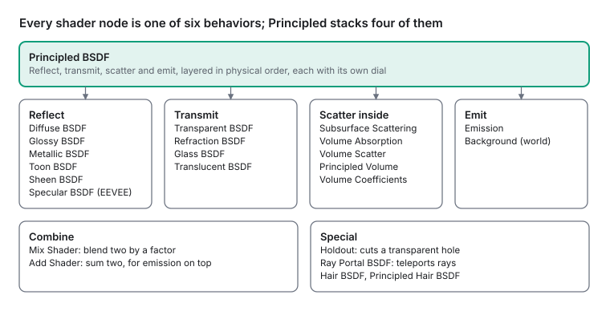

# Shaders: the whole menu, from zero

This part is a short book. Chapters 1 and 2 explain what a shader is and the handful of things light can do at a surface. Chapters 3 to 6 go through every shader node Blender offers and how they combine. Chapter 7 explains why the Principled BSDF is where to start, and the rest covers what feeds a shader, the engines, stylized looks, and a chooser.

## Chapter 1. What a shader is

### Objectives

- Use the words material, shader and texture correctly and know which one you are editing.
- Name the three sockets of the Material Output and what plugs into each.
- Describe, in one paragraph, how a renderer turns a shader into pixels and why renders start noisy.

A shader is a rule that tells the renderer what a surface does with the light that reaches it. Everything else in this part is detail on that one sentence.

### Three words that get mixed up

- **Material** is what you assign to an object. It is a container: a node tree plus a few settings. One object can carry several materials in slots, one per face region. In the Outliner, materials appear under the mesh data, and in the Blender File view they are listed as data-blocks that exist independently of any object.
- **Shader** is a node inside that tree that outputs a shader socket, the green one. It describes a way of scattering light. Most are named BSDF, for bidirectional scattering distribution function: given a direction light arrives from and a direction it leaves in, the function says how much goes that way. "Bidirectional" means it works the same backwards, which is what lets a renderer trace rays from the camera instead of from the lights. Diffuse, Glossy and Principled are all BSDFs.
- **Texture** is a pattern of values across the surface, from an image or a formula. Textures feed numbers and colors into shader inputs; they do not scatter light themselves. A Noise Texture into Roughness is a texture driving a shader.

So a material is a tree whose last node is a shader, and whose other nodes supply the shader's inputs. When someone says "the texture looks wrong" they usually mean the material; when they say "change the shader" they mean swapping the final node.

### The Material Output node

Every material ends at a Material Output node with three sockets:

- **Surface** takes a shader and describes the skin of the object. This is where almost all work happens.
- **Volume** takes a volume shader and describes the inside: fog, smoke, or the colored interior of a gel. It is evaluated along the path light takes through the object, so it has no effect on a flat plane with no interior.
- **Displacement** takes a vector that moves the surface itself, for relief that changes the silhouette. Nothing happens unless the material's Settings allow displacement (Chapter 9).

The node also has a Target menu (All, Cycles, EEVEE) that lets one material carry different trees for different engines. Only one output node is active at a time; the active one has a highlighted header.

### How the renderer uses it

In Cycles, the renderer fires rays from the camera into the scene. Where a ray hits a surface, it asks the material's shader: what fraction of light from each direction reaches this ray? The shader answers by sampling, that is, by picking one plausible direction for the incoming light according to its own distribution, and the renderer follows a new ray that way to find what light arrives from there. One sample is one guess. Thousands of such samples per pixel average into the final color, which is why renders start noisy and clean up over time, and why materials whose distributions are narrow and bright, like a glossy surface under a small light, are the noisiest: most samples miss the light.

EEVEE instead draws the surface the way a game does, in one pass with approximations: shadows from shadow maps, reflections from screen-space data and probes, subsurface as a blur. It asks the shader the same question but takes shortcuts in the answer. The shader nodes are the same; only the honesty of the answer differs (Chapter 10).

Two consequences shape how you work. First, a shader is evaluated per sample at a specific point, so any input can vary across the surface: plug a texture into Roughness and each point gets its own. Second, the renderer trusts the shader. If a shader says a surface reflects 150% of the light it receives, Cycles renders that, and the image glows unphysically. The built-in shaders are written to conserve energy; combining them badly (Chapter 6) is how you break that.

### Exercise 1.1: find the three words in the interface

1. Select the sphere, open the Material tab, and name the material `lab_sphere`.
2. Open the Shader Editor (Shading workspace). Identify the Material Output, the shader node connected to Surface, and add a Noise Texture connected to Roughness.
3. Switch the Material Output's Target to EEVEE and back to All.

What you should see: the material name at the top of the tab, the node tree below it, and the Noise Texture driving only roughness while the color stays constant. You have edited a material, a shader and a texture, and you know which was which.

### Exercise 1.2: watch sampling

1. In Rendered view with Cycles, set Render Properties › Sampling › Viewport › Max Samples to 1, then 16, then 256.

What you should see: at 1 sample the image is a field of noise with the shapes barely visible; at 16 it is recognizable but grainy; at 256 it is clean. Each pixel is averaging more guesses.

### Check yourself

1. What does the Volume socket do on an object with no interior, like a single plane? *Nothing; volume shaders act along the path through the inside.*
2. Why does a glossy surface under a small light render noisier than a matte one? *Its distribution is narrow, so most samples miss the light and only a few are bright.*
3. Which word names a node that outputs the green socket? *Shader.*

## Chapter 2. Six things light can do at a surface

### Objectives

- Name the six behaviors and give a real-world example of each.
- Explain energy conservation and why a physically based shader cannot be "too bright".
- Read any shader node's name as a combination of the six.

Every shader node is a combination of six behaviors. Learn the six and the node list in the next chapters becomes a set of labels rather than a list to memorize.

### The six

1. **Diffuse reflection.** Light enters the top layer, bounces around among pigment particles, and leaves in a random direction. The result is the flat, matte color of chalk, paper and clay. It depends on how squarely the surface faces the light and not at all on where the viewer stands: walk around a sheet of paper and its brightness does not change. This view-independence is why diffuse surfaces are the easiest to render and the hardest to make look interesting.
2. **Specular reflection.** Light bounces off the surface like a mirror. On a perfectly smooth surface it leaves at exactly the mirror angle; on a rough one the surface is a field of tiny mirrors (microfacets) at slightly different tilts, so the reflection spreads into a blurred highlight. Roughness is the width of that spread: 0 is a mirror, 1 is so scattered that no highlight is visible. Unlike diffuse, specular depends on where you stand, which is why highlights move when you move.
3. **Fresnel.** How much light reflects specularly depends on the angle you look from. Glass reflects about 4% head-on and nearly 100% at a grazing angle, which is why a lake mirrors the far shore but not the stones at your feet. The index of refraction (IOR) sets the head-on value: 1.33 for water, 1.45 for glass, 1.5 for most plastics, and the head-on reflectance is ((n−1)/(n+1))², which for 1.5 is 4%. Every physically based shader has Fresnel built in; it is what makes edges brighter than centers and what makes a plastic sphere's rim catch the light.
4. **Transmission.** Light passes into the object. If the object is clear it is refracted, bending at the surface by an amount set by the IOR, which is why a straw looks broken in a glass of water. Roughness applies here too: rough transmission is frosted glass. Light that enters must also leave, through a second surface, so a transmissive object needs a closed mesh with correct normals to render properly.
5. **Scattering inside.** Light enters, bounces around below the surface, and leaves somewhere else. Over a short distance that is subsurface scattering, the soft glow of wax, milk and skin. Over a long distance, through a thin medium, it is a volume: fog, smoke, colored liquid. Absorption, where the medium swallows some wavelengths along the way, is what makes thick jelly darker than thin jelly, and it is why red wine is pink in a thin glass and nearly black in a bottle.
6. **Emission.** The surface gives off its own light. It needs no lamp, and in Cycles it lights other objects. Emission is the only behavior that adds energy; the other five only redistribute what arrived.

### Two rules that bind them

- **Energy conservation.** What reflects, transmits and absorbs must add up to what arrived. A real surface cannot reflect 60% diffusely and 60% specularly at the same time. Physically based shaders divide the light between behaviors, so raising one lowers the others. That is why the Principled BSDF's Metallic input removes the diffuse color as it rises, why Transmission at 1 leaves no diffuse at all, and why a white Base Color at 1.0 is slightly unrealistic: nothing in nature reflects 100%, and fresh snow manages about 90%.
- **Layering.** Behaviors stack in a definite order. A clear coat sits over the base; sheen sits over the coat; the base is one of diffuse, metal, subsurface or transmission, or a blend. Light that the top layer reflects never reaches the layer below, so a strong coat slightly darkens the body. The Principled BSDF is exactly this stack with a dial on each layer (Chapter 7).

With these six words, read any node name: Glossy is behavior 2 alone, Glass is 2 plus 4 with Fresnel deciding the split, Subsurface Scattering is 5, Emission is 6, and Principled is all of them in their correct order.

The four behavior groups under the Principled bar are what it contains. Combine and Special sit apart because they do not scatter light themselves: they route it.

### Exercise 2.1: see the six on real objects

1. Gather a sheet of paper, a spoon, a glass of water, a candle, a bar of soap, and a phone screen that is on.
2. Assign each to the behavior it shows most, and look for the second behavior in each (the paper's faint sheen, the spoon's slight diffuse color where it is scratched).

What you should find: paper is diffuse, the spoon is specular with metal tint, the water is transmission with Fresnel at the rim, the candle is subsurface, the soap is subsurface with a weak coat, the screen is emission. Nothing shows only one behavior.

### Exercise 2.2: Fresnel on a sphere

1. Sphere with a Glossy BSDF at Roughness 0.1, white, and Shade Smooth on (in Object Mode, right-click the sphere in the viewport › Shade Smooth). Add a Diffuse BSDF (Shift + A › Shader › Diffuse BSDF) with a dark Color, and a Mix Shader (Shift + A › Shader › Mix Shader). Wire Diffuse BSDF › BSDF → the Mix Shader's first Shader input, Glossy BSDF › BSDF → its second, and Mix Shader › Shader → Material Output › Surface. Then add Shift + A › Input › Fresnel and connect Fresnel › Factor to the Mix Shader's Factor.
2. Render, then set the Fresnel node's IOR to 1.1, then 2.5.

What you should see: at 1.5 a bright rim and a dark center with a small highlight; at 1.1 almost no reflection anywhere; at 2.5 strong reflection across the whole sphere. IOR sets how far in from the edge the reflection reaches.

### Check yourself

1. Which behavior does not depend on where the viewer stands? *Diffuse reflection.*
2. What is the head-on reflectance of a surface with IOR 1.5? *About 4%.*
3. Why does raising Metallic on the Principled BSDF make the diffuse color disappear? *Energy conservation: the light claimed by the metal reflection is no longer available for diffuse.*
4. Which behavior adds energy to the scene rather than redistributing it? *Emission.*

## Chapter 3. The reflection shaders

### Objectives

- Describe what each reflection shader models, what its inputs do, and when it beats the Principled BSDF.
- Build a plastic by hand from Diffuse and Glossy and understand why it matches the Principled default.
- Pick the right microfacet distribution and know when anisotropy applies.

These nodes do one thing each: send light back out without entering the object. They are the atoms that the Principled BSDF is built from, and they are what you reach for when you want exactly one behavior, cheaply and under full control ([Shader nodes](https://docs.blender.org/manual/en/latest/render/shader_nodes/shader/index.html)).

### Diffuse BSDF

Matte reflection only: behavior 1 from Chapter 2, nothing else. Inputs are Color, Roughness and Normal. Roughness here is not the specular roughness of other nodes: at 0 the node is the standard Lambert model, and higher values switch to the Oren-Nayar model, which flattens the shading the way rough materials like clay and concrete do, brightening the terminator slightly. There is no highlight, no Fresnel and no edge brightening, so a Diffuse surface looks like chalk under any light. It renders faster than any other shader and converges with less noise, which makes it the right choice for large background objects, for clay test renders while lighting, and as one half of a Mix when you want to add gloss separately with a Glossy node.

### Glossy BSDF

Specular reflection only: a mirror blurred by Roughness. Color tints the reflection, which is what a metal does and a plastic does not; a plastic's highlight is white, so Glossy with a colored tint is already halfway to a metal. Distribution chooses the microfacet model: GGX is the default and has long highlight tails that look natural; Multiscatter GGX adds the light that bounces between microfacets, which plain GGX loses, so rough surfaces stay bright instead of darkening; Beckmann has tighter highlights; Ashikhmin-Shirley is an older model kept for compatibility. Anisotropy stretches the highlight along a direction, as on brushed metal, a vinyl record or a cooking pot, and Rotation turns that direction; it needs a Tangent input or a UV map to know which way the brushing runs. On its own, Glossy with a white color at Roughness 0 is a perfect mirror; mixed with Diffuse by a Fresnel factor, it is the classic hand-built plastic.

### Metallic BSDF

A conductor model: specular reflection with the physically correct way metals tint their reflections. Metals reflect their color most strongly at normal incidence and shift toward white at grazing angles, the opposite of the colored-edge behavior of a Glossy node with a tint. The node offers either artist-friendly Base Color plus Edge Tint, or the physical n and k constants published for real metals (gold, copper, aluminium have tables). It replaces the Glossy-with-color habit for real metals. For biology it is a curiosity; for gold nanoparticles or an electrode it is the right node.

### Toon BSDF

A diffuse or glossy reflection with a hard edge: Size sets how wide the lit region is and Smooth how soft its boundary. In Diffuse mode it gives a flat lit zone and a flat shadow zone; in Glossy mode it gives a hard-edged highlight disc. It gives cel-shaded, flat-banded lighting without any node tricks, in both engines, and it reacts to your real lights, so moving the key moves the band. It ignores Fresnel and is not energy-conserving in the physical sense, which is the point. Chapter 11 uses it.

### Sheen BSDF

The reflection of fine fibers standing up from a surface, which catch light at grazing angles: velvet, felt, peach fuzz, and dust on anything. It is bright at the edges and dark in the middle, the opposite of Glossy. Roughness sets how soft the rim is; Distribution offers Ashikhmin for the classic velvet look and Microfiber for a more physically based one. It is rarely used alone; usually it rides on top of another shader through a Mix, or through the Sheen panel of the Principled BSDF. Earlier Blender versions called it Velvet.

### Specular BSDF (EEVEE only)

An alternative to the Principled BSDF that takes a Specular Color instead of an IOR, matching the specular-glossiness workflow of some game engines and older texture sets. Cycles ignores it and renders the object black. Unless you are matching a texture set authored for that workflow, there is no reason to use it, and the Principled BSDF's IOR Level and Tint inputs cover the same ground.

### Reading the family

Diffuse and Glossy are the two halves of almost every non-metal in the world; a Mix of the two with a Fresnel or Layer Weight factor was how every material was built before the Principled BSDF existed, and seeing it built that way once makes the Principled node's inputs obvious. Metallic is the conductor version of Glossy. Toon and Sheen are the stylized and the fuzzy special cases, and Specular is a compatibility node. The Add menu lists only the shaders the current render engine supports: Toon, Sheen and the two hair shaders appear only while the engine (Render tab › Render Engine) is Cycles, and Specular only while it is EEVEE.

### Exercise 3.1: plastic by hand

1. On a sphere: Diffuse BSDF (Color mid-red, Roughness 0) into the first socket of a Mix Shader; Glossy BSDF (Color white, Roughness 0.3, GGX) into the second; Fresnel (IOR 1.5) into Fac; Mix into Surface.
2. On a second sphere: a Principled BSDF with the same red, Roughness 0.3, IOR 1.5.
3. Render them side by side, then set the Glossy's Distribution to Multiscatter GGX and its Roughness to 0.8.

What you should see: the two spheres are nearly identical, which tells you what the Principled default contains. At Roughness 0.8 the plain GGX version goes visibly darker than the Multiscatter one, which is the lost inter-facet light.

### Exercise 3.2: brushed metal

1. A Metallic BSDF on the cube, Base Color gold, Roughness 0.3. Then a Glossy BSDF with gold Color, Anisotropy 0.8, Rotation 0 and 0.25.

What you should see: the Metallic cube has gold centers and whiter edges; the Glossy cube has gold throughout; and the anisotropic version stretches each highlight into a streak that turns 90° when Rotation changes by 0.25.

### Check yourself

1. Which shader's Roughness input does not control a highlight, and what does it do instead? *Diffuse BSDF; it flattens the shading toward the Oren-Nayar model.*
2. Why does a Glossy node with a colored tint look wrong for most metals? *Real metals go whiter at grazing angles; a tinted Glossy stays colored everywhere.*
3. What is wrong with using Specular BSDF in a scene that will be rendered in Cycles? *Cycles does not support it; the object renders black.*
4. Which distribution keeps rough surfaces from darkening? *Multiscatter GGX.*

## Chapter 4. The transmission, scattering and special shaders

### Objectives

- Tell Transparent, Refraction, Glass and Translucent apart and choose the right one.
- Set up subsurface scattering with the right method and scale.
- Use Emission as a light, Holdout as a mask, and know what the remaining nodes are for.

These nodes let light into the object, or do something other than scatter it.

### Transparent BSDF

Light passes straight through without bending or tinting, as if the surface were not there. Color multiplies what passes, so a red Transparent acts like a colored gel. It is not glass: no reflection, no refraction, no Fresnel rim. Its uses are cutouts (a leaf texture's alpha into a Mix between Transparent and the leaf material), ghosted overlays, and fading objects in and out. Because the ray continues undisturbed, Cycles counts transparent surfaces separately from other bounces: Light Paths › Max Bounces › Transparent sets how many layers a ray may pass through, and a stack of ghosted maps can hit that limit and turn black. The Principled BSDF's Alpha input is a built-in Mix with Transparent, so you rarely add this node by hand any more.

### Refraction BSDF

Transmission only: light enters and bends by the IOR, with Roughness frosting it. There is no reflection at all, so a Refraction surface alone looks wrong, like glass with its highlights erased. It exists as a building block, to be mixed with Glossy by a Fresnel factor, and it is useful on its own in one case: an object seen from inside, or a flat window pane where the reflection is handled by a separate surface.

### Glass BSDF

Refraction plus Glossy, with Fresnel deciding the split automatically: reflective at grazing angles, transmissive head-on. This is real glass, water and clear plastic in one node, with Color, Roughness and IOR. It is the node to use for a glass object when you do not need the Principled BSDF's other layers, and it converges a little faster. Glass needs a closed mesh with outward normals: a single plane with Glass is seen as entering an infinitely thick slab and renders dark. Thin-walled glass, like a bubble or a window, is available through the Thin Wall option of the Principled node rather than here.

### Translucent BSDF

Diffuse transmission: light enters, scatters, and exits the far side with no memory of its direction, as through paper, a leaf or a lampshade. It is like Diffuse but for the back face: the side away from the light glows evenly. A Mix of Diffuse and Translucent is the standard leaf and curtain material. It differs from subsurface scattering in that light does not travel sideways inside the object, so a Translucent sphere lit from the left glows on its right side but shows no softening of the shadow edge.

### Subsurface Scattering

Light enters, wanders below the surface over a distance set by Radius and Scale, and leaves somewhere nearby. This softens shading, lets thin parts glow when lit from behind, and gives wax, marble, milk and skin their look. Radius is three numbers, one per color channel, which is how skin gets its reddish glow: red travels further than green and blue. Scale multiplies all three. Random Walk is the accurate method and the default; it traces real paths inside the mesh and needs a closed mesh. Christensen-Burley is a faster approximation that can be less noisy in dense media and tolerates open meshes. The Principled BSDF contains the same model in its Subsurface panel; the standalone node is for mixing by hand. IOR and Anisotropy refine the Random Walk model; the defaults are right for most organic materials.

### Emission

The surface gives off light of a Color at a Strength. Strength 1 means the surface shows exactly its color regardless of lighting, which is the flat-illustration look. Higher strengths make it a lamp: in Cycles an emissive mesh lights its surroundings and reflects in glossy objects, which is the basis of the glowing-ribbon technique in the [Lighting part](03-lighting.md). Strength is per unit area, so a large emissive plane at Strength 1 can light a room while a small one at Strength 1 is barely a glow. Emission is the one shader you can legitimately Add to another, since it contributes light rather than redistributing it.

### Background

The shader of the World, not of objects: a Color and Strength that fill the environment, or an Environment Texture for an HDRI. You meet it in the World tab's node tree. It is where the ambient light and the reflections of the surroundings come from, and it can be made to show one thing to the camera and another to reflections with a Light Path node (Chapter 6).

### Holdout

Renders as a transparent hole in the image, with the alpha channel cut out, as if the object masked the film. It is used for compositing: an object that will be replaced by live footage, or a shape to punch out of a render so something else can be placed there in Illustrator. With Film › Transparent off, a holdout renders black; with it on, the hole is transparent.

### Ray Portal BSDF

A Cycles-only effect: a ray that hits the surface continues from a different position and direction that you supply. It makes portals, mirrors that show another room, and impossible spaces. For scientific work it has no use, but it explains why the list is longer than you expected.

### Hair BSDF and Principled Hair BSDF

Shaders for hair strands: a cylinder model with separate reflection and transmission lobes, and a principled version that takes melanin values to color the hair. They apply to curve objects rendered as hair. Molecules have no hair, but ribbon and tube representations are meshes, not curves, so these are not involved.

### Exercise 4.1: the four see-throughs

1. Four spheres over a checkered plane, lit by the figure rig: Transparent (white), Refraction (IOR 1.45), Glass (IOR 1.45), Translucent (white).
2. Render.

What you should see: the Transparent sphere is invisible except for its shadow; the Refraction sphere shows the checkerboard bent and flipped but has no highlights and a dull rim; the Glass sphere shows the same bend plus bright highlights and a reflective rim; the Translucent sphere is a soft white ball glowing on the side away from the light. Four nodes, four distinct answers to Question 2 of the design method.

### Exercise 4.2: scatter on the monkey

1. Subsurface Scattering on the monkey head, Random Walk, Radius 1, 0.2, 0.1, Scale 0.02, with a small area light behind the head.
2. Render at Scale 0.02, 0.1 and 0.5.

What you should see: at 0.02 the ears glow red at their thin edges; at 0.1 the whole head looks like wax; at 0.5 it looks like a lamp shade with the shape nearly lost. Scale is the distance light travels, and the look is that distance relative to the object.

### Exercise 4.3: a holdout mask

1. Put a Holdout material on the cube, place it in front of the map, and render with Film › Transparent on.
2. Open the PNG in an image editor.

What you should see: a cube-shaped transparent hole cut through the map, which is how a figure element is reserved for an overlay drawn elsewhere.

### Check yourself

1. Which node bends light but has no reflection? *Refraction BSDF.*
2. Why does a single plane with a Glass BSDF render dark? *Glass expects a closed mesh; a lone plane is seen as the entry into an infinite slab.*
3. What distinguishes Translucent from Subsurface Scattering in a render? *Translucent glows on the far side only; subsurface also softens the shadow edge and lets light travel sideways.*
4. Why can Emission be added to another shader when Diffuse cannot? *Emission creates light; Diffuse redistributes it, and adding two redistributions reflects more than arrived.*

## Chapter 5. Volume shaders

### Objectives

- Explain what a volume shader does differently from a surface shader and where it plugs in.
- Set Density by the size of the object, using the units it is measured in.
- Render a density map as a cloud and as a tinted solid, and know when each is appropriate.

Surface shaders describe a skin. Volume shaders describe what happens to light while it travels through the inside of an object, and they plug into the Material Output's Volume socket instead of Surface. An object can have both: a glass surface and an absorbing interior is colored glass. A volume needs an inside, which means a closed mesh; the renderer steps through the interior along each ray, which is why volumes are slower and why Render Properties › Volumes has its own Step Rate and Max Steps.

### Volume Absorption

The medium swallows light as it passes, by Color and Density. The further light travels, the more is lost, so thick regions go dark and thin ones stay clear. Color here is the color that is kept, not the color absorbed: a green Volume Absorption makes a green liquid, because it absorbs red and blue. This is the node for tinted gels, colored glass, and the slime recipe's thickness-dependent color. It is cheap to render because it never scatters: each ray simply dims as it crosses the object.

### Volume Scatter

The medium bounces light sideways, which is what makes fog, smoke and milk visible from the side and gives them their glow. Density sets how much; Anisotropy sets whether light continues forward (positive, like mist lit from behind that glows around the sun) or scatters evenly (0) or back toward the light (negative). Scattering is expensive to render, because every bounce is another path to follow, and it is the main source of noise in volumetric renders. Cycles limits volume bounces separately under Light Paths › Max Bounces › Volume; the default is 0, which means single scattering only and is usually enough.

### Principled Volume

Absorption and scattering together, plus emission and blackbody color for fire, with inputs named for simulation attributes (density, temperature, flame). It is the all-in-one for smoke and fire caches, and it is what Blender assigns by default when you click New on a volume object, which is why a density map first renders as fog. For a map you want as a surface, remove it and use a surface shader (Chapter 9); for a map you want shown as a true cloud, keep it and set Density Attribute to the name of the map's grid so brightness follows the data.

### Volume Coefficients

The same physics as Absorption and Scatter expressed directly as the coefficients scientists use: absorption, scattering and emission per unit length, as a color each. It is the node for matching measured optical properties of a medium, and for building a volume from literature values rather than by eye.

### Density and units

Density is per meter of travel. A density of 1 means that over one meter about 63% of the light is absorbed or scattered, because the fraction that survives is e to the minus density times distance. Over two meters 86% is gone; over 0.1 m only 10%. Molecular Nodes scenes use 1 m per nanometer, so an object 20 m across needs densities around 0.1 to 0.5 for a visible gradient, and a density of 2 makes it nearly opaque. When a volume looks solid black, the density is too high for the object's size; when it is invisible, too low. A good first guess is 2 divided by the object's width in meters, which makes the thickest part lose about 86%.

### Volumes and density maps

A cryo-EM map is itself a volume, a grid of values. Molecular Nodes gives you three ways to show it. The style nodes turn it into a surface at a threshold, which is the usual figure and the most honest, because the threshold is stated. A Principled Volume with Density driven by the map renders it as a cloud whose brightness follows the map value, which shows the whole density distribution at once without a cutoff; it is good for showing where density is weak or ambiguous. And a surface shader plus a Volume Absorption inside gives a solid shell that darkens with thickness, which is an aesthetic choice rather than a representation of the data. All three are legitimate; the first is what reviewers expect, and the other two need a sentence in the legend.

### Exercise 5.1: density by size

1. A cube 1 m across with a Glass surface and Volume Absorption, Color blue, Density 1. Render.
2. Scale the cube to 5 m and render again. Then set Density to 0.2 and render once more.

What you should see: the 1 m cube is a clear blue; the 5 m cube at Density 1 is nearly black; at 0.2 it matches the first. Density times size is what the eye sees.

### Exercise 5.2: the map three ways

1. Render the map with the Density Style Surface at its usual threshold.
2. Replace the style with the raw volume: in the Geometry Nodes tree connect Group Input straight to Group Output, and give the object a Principled Volume with Density Attribute set to the grid name (check the Spreadsheet's Volume Grids list) and Density 5.
3. Return to the surface style, and add Volume Absorption to its material at Density 0.1.

What you should see: a solid surface; a glowing cloud brightest where the map is dense; and a surface with darker thick regions. Keep the three images with a note of which is which; they are three different claims about the data.

### Check yourself

1. What fraction of light survives 1 m of travel at Density 1? *About 37%.*
2. A volume renders solid black. First change? *Lower the density; it is too high for the object's size.*
3. Which volume node is cheap and which is expensive to render, and why? *Absorption is cheap, since rays only dim; Scatter is expensive, since every bounce spawns new paths.*
4. Why does a density map start as fog when you click New? *It is a volume object, so Blender gives it a Principled Volume by default.*

## Chapter 6. Combining shaders

### Objectives

- Use Mix Shader with a varying factor to blend two materials by angle, pattern or data.
- Know the one legitimate use of Add Shader and why the others break energy conservation.
- Use Light Path to show different things to the camera and to reflections.

Two nodes combine shaders, and the whole craft of hand-built materials is in what you feed their factor.

### Mix Shader

Takes two shaders and a Fac between 0 and 1, and blends them: at 0.3 the surface behaves like the first shader 70% of the time and the second 30%. Energy is conserved, because the two are weighted, not added. A constant Fac is a crude blend; the interesting cases drive Fac with something that varies:

- **Fresnel node** (Shift + A › Input › Fresnel) with an IOR: 0 head-on rising to 1 at the edges, in the physically correct curve. Diffuse into the first socket, Glossy into the second, Fresnel into Fac, and you have rebuilt a plastic by hand. Its one weakness is on rough surfaces, where a true Fresnel is too strong; the Principled BSDF corrects for that internally.
- **Layer Weight** gives the same idea with an artist's Blend slider instead of an IOR, plus a Facing output that is the simpler linear version. It is easier to tune and good enough for most looks. Blend 0.5 is roughly an IOR of 1.5.
- **A texture**: a Noise Texture's Fac blends two materials in patches; an image's alpha cuts one material out of another; a Color Ramp between either sharpens or softens the boundary. A Color Ramp set to Constant interpolation turns a soft noise into hard-edged islands of the second material.
- **An attribute**: a Named Attribute or Attribute node, such as a per-atom value from Molecular Nodes, blends shaders by data, so one chain can be glossy and another matte on the same object. A boolean selection stored in Geometry Nodes becomes a 0 or 1 factor directly.
- **Light Path**: its Is Camera Ray output is 1 only for rays coming directly from the camera. Mix a Transparent shader in when Is Camera Ray is 0 and an object becomes invisible to reflections and shadows while still visible to the camera, or the reverse, which is how emissive ribbons are hidden from the lens while their reflections stay. Is Shadow Ray does the same for shadows, and Is Glossy Ray for what mirrors see.

Mixes nest. A Mix of a Mix is a three-layer material, and the Principled BSDF is, internally, exactly such a nest. Nesting order follows the physical order: the outermost Mix is the top layer.

### Add Shader

Sums two shaders with no weighting. This breaks energy conservation whenever both redistribute incoming light: Diffuse plus Glossy added together reflects more than arrives and renders too bright, with a glow that no exposure setting can fix because the material itself is producing it. The legitimate use is adding Emission to any shader, because emission creates light rather than redistributing it, and adding Transparent to a volume-like effect. If you find yourself reaching for Add to make a surface look richer, use Mix and raise a light instead.

### Order and layering

In a Mix, order does not matter beyond which socket gets Fac 0 and which gets 1. But physically, layers do have an order: a coat sits on top of a body, and light the coat reflects never reaches the body. A hand-built Mix cannot express that; it only interpolates, so a 50% mix of coat and body sends half the light to each as if they sat side by side. That is one reason to prefer the Principled BSDF when you want a coat, a sheen or a thin film over a base: its layers are stacked in the physical order and the energy passed down is reduced correctly.

### Shader to RGB (EEVEE only)

Converts the result of a shader back into a color, so you can post-process the shading: push it through a Color Ramp to get cel-shading bands, or multiply it with a texture. Cycles cannot do this, because a Cycles shader is sampled rather than evaluated to one color. It is the main tool for stylized looks in Chapter 11.

### A worked hand-built material

To see all of this once: Diffuse BSDF (Color gray, Roughness 0.4) into Mix Shader socket 1, Glossy BSDF (Color white, Roughness 0.3) into socket 2, Layer Weight Facing into Fac with Blend 0.5, Mix into Surface. Render it next to a Principled BSDF with the same gray and Roughness 0.4. They look nearly identical, and every input you then discover on the Principled node, Coat, Sheen, Subsurface, Transmission, is one more Mix layer in this same pattern.

### Exercise 6.1: two materials by data

1. On a two-chain model, build a material with Mix Shader: a matte Principled in socket 1, a glossy candy Principled in socket 2.
2. Add an Attribute node reading `chain_id` into a Math node (Compare, Equal to 1) and connect its output to Fac.

What you should see: one chain matte, the other candy, on the same object with one material. Change the compared value and the other chain switches.

### Exercise 6.2: visible but not reflected

1. On a bright red sphere beside a glossy black sphere, build a Mix Shader: Transparent in socket 1, the red Principled in socket 2, Light Path › Is Camera Ray into Fac.
2. Render, then swap the two sockets.

What you should see: first, the red sphere is visible to the camera but absent from the black sphere's reflection and casts no shadow; then the reverse, a reflection and a shadow of a sphere that is not there. This is the trick behind invisible ribbons and invisible flags.

### Exercise 6.3: break energy conservation

1. Add Shader with Diffuse white and Glossy white at Roughness 0.3. Render next to a Mix of the same two at Fac 0.5.

What you should see: the Add version glows brighter than any white object under the same light could, and a plane of the same material would be brighter than the light reaching it. The Mix version looks like ordinary white plastic.

### Check yourself

1. What does a Mix Shader output at Fac 1? *Entirely the second shader.*
2. Why can a hand-built Mix not reproduce a coat correctly? *It interpolates side by side; a real coat sits on top and removes light before it reaches the body.*
3. Name the one shader you can Add without breaking energy conservation. *Emission.*
4. Which Light Path output lets an object appear only in reflections? *Is Camera Ray, used to mix in Transparent for camera rays.*

## Chapter 7. Principled BSDF: the assembled stack

### Objectives

- Draw the Principled BSDF's layer stack from memory and say which input controls each layer.
- Give four reasons to start every material from it.
- Name the cases where a different node is the better tool.

The Principled BSDF is Chapters 3, 4 and 6 pre-wired: the single-behavior shaders stacked in physical order, with one input per layer and energy conservation handled for you ([Principled BSDF](https://docs.blender.org/manual/en/latest/render/shader_nodes/shader/principled.html)). It follows the design that Disney introduced for film production in 2012 and that most renderers and file formats now share, which is why its inputs look the same in Blender, Substance, Unreal and glTF.

### The layers, bottom to top

1. **Base.** A blend of four bases: diffuse, metal, subsurface and transmission. Metallic, Subsurface Weight and Transmission Weight are the dials that shift the base between them; whatever is not claimed by those three is diffuse. Base Color feeds all four. The Diffuse panel's Roughness is the Oren-Nayar flattening from Chapter 3.
2. **Specular.** The Fresnel-controlled gloss over the base, with IOR setting the head-on strength, Roughness its blur, IOR Level a scale on the strength, Tint a color for the reflection, and Anisotropic for stretched highlights. Metals use this same layer for their colored reflection.
3. **Emission.** Light added from the base, under the coat, so a lit screen behind a varnish is modeled correctly: the varnish still reflects the room over the glowing screen.
4. **Coat.** A second clear specular layer over everything, with its own Roughness, IOR, Tint and Normal, so a wet film can be smooth over a rough body. Coat Weight 0 removes it entirely, which keeps the default material cheap.
5. **Sheen.** Fibers and dust on the very top, bright at grazing angles.
6. **Thin Film** over the specular layers, for iridescence; it modifies the specular reflection's color by wavelength rather than adding a layer of its own.

Alpha is applied outside the stack: it mixes the whole thing with a Transparent shader. Thin Wall switches the stack to a two-sided slab with no thickness, for leaves and paper, which makes transmission and subsurface behave as if the object were a sheet.

### Why to start here

- **One node covers nearly everything.** Plastic, metal, glass, skin, wax, rubber, paint, frosted and clear, flat and iridescent are all reachable by moving dials, which means one habit to learn instead of twenty, and one node to read in anyone else's file.
- **It cannot break physics by accident.** Raising one layer lowers the others, so a Principled material never reflects more light than it receives. A hand-built Add network can, and a hand-built Mix cannot stack layers correctly.
- **The defaults are a believable material.** A fresh Principled node at Roughness 0.5 and IOR 1.5 is an ordinary matte plastic that renders sensibly under any light, which is the right starting point for Question 1 in the design method.
- **It is the industry's shared language.** The same inputs exist in glTF, USD, Substance, Unreal and most renderers, so textures, tutorials and exported assets line up with it. A material built from it survives export to another program; a hand-built tree does not.
- **It works in both engines.** Cycles renders every layer accurately; EEVEE renders all of them with approximations. Hand-built trees often include nodes one engine ignores.

### When to leave it

- **Flat or cel-shaded figures.** Emission alone, or Toon, or Shader to RGB in EEVEE give the look directly (Chapter 11).
- **Speed on large, simple objects.** Diffuse alone converges faster for backgrounds and clay tests, because Cycles has fewer lobes to sample.
- **Effects that are not materials.** Holdout, Ray Portal and Background are their own nodes by necessity.
- **Hair.** Principled Hair BSDF, on curve objects.
- **Fully custom layering.** When a coat must be rough and a body smooth, Principled does it; when you need three coats of different colors, or a blend that depends on data per atom in ways the dials do not express, a Mix network with the atoms from Chapters 3 and 4 is the honest tool, and you will understand it because it is the same stack built by hand.

The practical rule across the whole guide follows from this: start every material as a Principled BSDF, answer the five questions of the [Designing a look part](02-designing-a-look.md) on its dials, and add other shader nodes only when a dial does not exist for what you see.

### Exercise 7.1: one dial at a time

1. A fresh Principled BSDF on the sphere, mid-green. Render it.
2. Change one input at a time, rendering after each and resetting before the next: Metallic 1; Transmission 1; Subsurface Weight 1 with Scale 0.02; Coat Weight 1; Sheen Weight 1; Emission Strength 2 with the same green; Thin Film Thickness 400; Alpha 0.3.

What you should see: eight distinct materials from one node, and in each case the rest of the look unchanged. Keep the eight renders as a contact sheet; it is the Principled BSDF in one image.

### Exercise 7.2: find the layer in the stack

1. Base Color black, Roughness 0.2, Coat Weight 1, Coat Tint deep red, Emission white at Strength 1.

What you should see: a white glow seen through a red-tinted gloss, with white highlights on top. Emission sits under the coat, and the coat's tint colors it; the coat's own highlight stays white. The order of the layers is visible in a single render.

### Check yourself

1. Which three inputs decide what the base layer is made of? *Metallic, Subsurface Weight and Transmission Weight; the remainder is diffuse.*
2. Where does Emission sit in the stack, and why does it matter? *Under the coat, so a varnish still reflects over a glowing surface.*
3. Which input is applied outside the stack? *Alpha, as a mix with Transparent.*
4. Give one case where a hand-built Mix network is the better choice. *Several differently colored coats, or layer logic driven by per-atom data that the dials cannot express.*

## Chapter 8. What feeds a shader

### Objectives

- Choose the right coordinate system for a texture on a molecular surface.
- Turn any value, procedural, image or attribute, into a usable input with Color Ramp, Math and Map Range.
- Read an unfamiliar node tree by following links backward from the output.

A shader's inputs are sockets, and anything that outputs a number, color or vector can drive one. The Shift + A menu in the Shader Editor groups those sources into Input, Texture, Color, Vector and Converter. This chapter is a guided tour of the ones that matter. Socket colors tell you the type: gray is a number, yellow a color, blue a vector, green a shader. Connecting mismatched types converts automatically (a color into a number takes its brightness), which is convenient and occasionally surprising.

### Input nodes: facts about the point being shaded

- **Texture Coordinate** gives positions to feed textures: Generated (0 to 1 across the object's bounding box, so a texture stretches to fit any object), Object (the object's own axes, in meters, unaffected by scale changes elsewhere, so a pattern stays the same physical size), UV (the unwrapped layout, which molecular meshes do not have), Normal, Camera (relative to the camera, for effects fixed to the view) and Window (screen space). For procedural textures on molecules, use Object.
- **Attribute** reads a named attribute from the mesh: `Color` from Molecular Nodes, or any value stored by its Geometry Nodes tree. The Type menu chooses whether the name refers to a mesh attribute, an object property or an instancer attribute; Geometry is right for Molecular Nodes data.
- **Geometry** gives the Normal, the Position, whether this is a Backfacing side, and Pointiness (a cheap curvature that darkens crevices and highlights ridges, useful for edge wear and for making cavities read).
- **Fresnel** and **Layer Weight** give view-angle factors (Chapter 6).
- **Ambient Occlusion** returns how enclosed a point is, for darkening cavities without lighting changes; this is what the Molecular Nodes AO material uses. Distance sets how far it looks for occluders; Inside and Only Local change what counts.
- **Light Path** tells which kind of ray is asking: camera, shadow, reflection, transmission, and how many bounces deep. It is the basis of "visible but not reflective" tricks.
- **Object Info** gives the object's Color, Location, Random (a different number per object, for varying copies) and Index.
- **Wireframe** is 1 on edges and 0 elsewhere, for rendering a mesh's wire as a material; Size sets the line width.
- **Camera Data** gives the view distance, for depth cueing (Chapter 11).

### Textures: patterns across the surface

- **Procedural textures** are formulas: Noise (cloudy variation at any scale, with Detail for octaves, Roughness for how much the fine detail contributes, Lacunarity for the gap between octaves and Distortion for swirl), Voronoi (cells, for scales and crackle; the Feature menu picks the cell centers, edges or distances), Wave (stripes and rings, bent by Distortion), Musgrave and Gabor (terrain-like and oriented noise), Checker, Brick, Gradient, Magic, White Noise. They have no resolution and no seams, and they need only a coordinate vector, which is why they suit molecules. They can also be evaluated in 4D, with a W input that lets you animate them without moving them.
- **Image Texture** samples a picture and needs UV coordinates, or a projection (Box projection in the node's Projection menu tiles the image from six directions without UVs, with a Blend across the seams). Environment Texture is the same for HDRI backgrounds. IES Texture gives a light a measured real-world beam profile. Sky Texture generates a sky. Point Density renders points as a volume.

A texture's output is usually a Fac (grayscale) and a Color. Fac feeds Roughness, Fac of a Mix, Bump Height, Alpha; Color feeds Base Color. The Color output of a Noise is three different noises in the three channels, which is handy when you want three independent variations from one node.

### Color utilities

- **Color Ramp** maps a 0 to 1 value to a gradient you draw: it is the way a data attribute becomes a color scale, and the way noise becomes two sharply divided colors (set Interpolation to Constant). Drag the stops to set thresholds; the Color Mode menu lets you interpolate through HSV for rainbow scales.
- **Mix Color** blends two colors by a factor, in any blend mode (Mix, Multiply, Screen, Overlay) as an image editor would. Multiply is how a chain color is applied over a grayscale pattern.
- **Hue/Saturation/Value**, **RGB Curves**, **Bright/Contrast**, **Gamma**, **Invert** adjust a color in place, which saves rebuilding a ramp when a scale is nearly right.

### Converters: numbers

- **Math** does arithmetic on a value: multiply a noise by 0.3 before it drives Roughness, or clamp it, or compare it to a threshold to get a 0 or 1 mask.
- **Map Range** rescales one range to another, the clean way to turn 0 to 1 into 0.2 to 0.6, with a Clamp option and smooth-step modes for soft thresholds.
- **Separate Color** and **Combine Color** split a color into channels and rebuild it, useful for using one channel of an attribute as a factor.
- **Clamp**, **Float Curve**, **Vector Math** and the rest follow the same pattern; Float Curve is a drawable transfer function, useful for tuning a data scale by eye.

### Bump and Displacement

- **Bump** takes a Height value and produces a Normal that makes the surface shade as if it had that relief. Strength scales it, Distance sets how tall a unit of height is, and Invert flips it. It changes shading only. Chain a second Bump into the first's Normal input to add two scales of relief.
- **Normal Map** does the same from a tangent-space normal image, the game-asset workflow, which needs UVs.
- **Displacement** (Vector › Displacement) makes a vector for the Material Output's Displacement socket, which in Cycles can move the geometry itself when the material's Displacement setting is Displacement and Bump or Displacement Only (Chapter 9). Real displacement needs dense geometry to show, which is what Adaptive Subdivision provides.

### Reading a complex tree

Follow the green shader links backward from the Material Output to find the shader, then follow each of its inputs leftward to its source. Most impressive materials are one Principled BSDF with five or six of these feeder chains, each a texture or attribute, through a Math or Color Ramp, into one dial. Ctrl + Shift + click on any node (with the Node Wrangler add-on enabled) previews that node's output on the surface, which is the fastest way to see what a chain is producing.

### Exercise 8.1: three coordinate systems

1. A Checker Texture into Base Color on the cube, with Scale 4. Connect Texture Coordinate › Generated, render; then Object, render; then scale the cube to twice its size and render both again.

What you should see: with Generated, 4 checks fit the cube at both sizes, so they double in size with it; with Object, the checks stay the same physical size and there are twice as many on the larger cube. Object is what you want when a texture represents a physical pattern.

### Exercise 8.2: a data color scale

1. On a model with the `b_factor` attribute, Attribute (Geometry type, Name `b_factor`) › Fac into a Map Range (From Min and Max set to the attribute's range, read from the Spreadsheet) into a Color Ramp (blue to red) into Base Color.

What you should see: a B-factor coloring like ChimeraX's, built from three nodes, with the ramp's stops under your control.

### Exercise 8.3: preview a chain

1. Enable Node Wrangler in Preferences › Add-ons. Build a Noise into Color Ramp (Constant) into a Mix, and Ctrl + Shift + click each node in turn.

What you should see: the noise as gray clouds, then as hard islands, then as two colors. Previewing each stage is how you debug a tree that is not doing what you expect.

### Check yourself

1. Which coordinate system keeps a texture the same physical size when the object is scaled? *Object.*
2. What does the Fac output of a Noise Texture feed, typically? *Roughness, Bump Height, Alpha or a Mix factor.*
3. How do you turn a soft noise into hard-edged patches? *A Color Ramp with Constant interpolation.*
4. What is the difference between Bump and Displacement in the final image? *Bump changes shading only; displacement moves the geometry and changes the silhouette.*

## Chapter 9. The Material Output and material settings

### Objectives

- Manage material slots, users and single-user copies without losing work.
- Set the material settings that decide transparency, backfaces and displacement.
- Give one material different trees for Cycles and EEVEE.

Beyond the node tree, a material has a settings panel and a place in the object's slot list. These decide how the tree is applied.

### Material slots

An object holds a list of materials in the Material Properties tab, and each face is assigned to one slot. In Edit Mode, select faces, pick a slot and click Assign to put them on it; Select and Deselect find the faces of a slot. For a Molecular Nodes object the style node's Material field supplies the material for the geometry it generates, so set it there rather than in the slot list; the slot list is for meshes you model yourself. Clicking New makes a fresh material for the active slot; the dropdown reuses an existing one; the number next to the name is how many objects share it, and clicking it makes a single-user copy so edits stop affecting the others. A material with zero users is discarded when the file is saved unless its shield icon (fake user) is set; the Blender File view in the Outliner lists every material and its user count.

### Surface, Volume, Displacement

The three sockets of the Material Output (Chapter 1). A volume object given a new material gets a Principled Volume in Volume and nothing in Surface. A mesh gets a Principled BSDF in Surface and nothing in Volume. For a density map rendered as a surface, the material must have the Surface filled and the Volume empty; the style node turns the map into a mesh, and the volume shader would otherwise render it as fog. Displacement is ignored until the Settings panel enables it.

### Settings panel

- **Render Method** (EEVEE): Dithered renders transparency as a noise pattern that resolves with samples and sorts correctly whatever the overlap; Blended renders it as true blending, smoother for glass and ghosts but prone to sorting errors where transparent surfaces overlap, because EEVEE must guess their order. If Alpha looks wrong in EEVEE, switch this.
- **Backface Culling**: hides the back side of faces in the viewport and render. Useful for a cutaway shell seen from outside; harmful on a map, whose inside you often see through holes. Backface Culling Shadow does the same for shadows only.
- **Transparent Shadows** (EEVEE): whether an Alpha surface casts a lighter shadow or a solid one.
- **Displacement** (Cycles): Bump Only uses the Displacement socket as a bump map; Displacement Only moves the geometry; Displacement and Bump does both, which is the usual choice since bump adds the fine detail that the displaced mesh is too coarse to show. Real displacement needs a Subdivision Surface modifier set to Adaptive in the object's Modifier properties (available when Feature Set is Experimental) for enough geometry.
- **Pass Index**: a number that a Material Index compositor pass can read to mask this material in post-processing, for example to recolor only the map in Photoshop. The object has a separate Pass Index for the Object Index pass.
- **Light Probe and Shadow settings** (EEVEE): how the material interacts with EEVEE's approximations; leave at defaults unless a shadow looks wrong.

### Viewport Display

The color, metallic and roughness shown in Solid view, independent of the node tree. Setting these lets Solid mode show chain colors while you work, without the cost of Rendered view. Solid view's shading popover must be set to Material color for them to show; Attribute color shows the mesh's own color attribute instead, which for a Molecular Nodes object is the `Color` attribute, so Solid mode can show chain colors with no material at all.

### The Target menu

On the Material Output, Target lets a material carry two trees, one tagged for Cycles and one for EEVEE, for materials that use engine-specific nodes (Shader to RGB in EEVEE, Ray Portal in Cycles). Add two Material Output nodes, set each one's Target, and the renderer picks the one that matches. Nodes that one engine cannot evaluate are simply skipped there, so a Shader to RGB chain renders black in Cycles unless a Cycles-targeted output exists.

### Exercise 9.1: slots and users

1. Give the cube two slots: in Edit Mode select the top face, add a slot, assign a red material to it, and leave the rest gray.
2. Duplicate the cube. On the copy, change the red material's color.
3. Undo, click the user-count number next to the material's name on the copy, and change the color again.

What you should see: the first change recolors both cubes, because they share the material; after making it single-user, only the copy changes. This is the cause of most "I changed one object and another changed too" surprises.

### Exercise 9.2: EEVEE transparency sorting

1. Two overlapping planes with Alpha 0.5 materials, one red, one blue, in EEVEE. Render with Render Method Blended, then Dithered.

What you should see: with Blended, the overlap may show the wrong plane in front as you orbit; with Dithered, the order is always right but the surfaces look grainy until the samples accumulate.

### Check yourself

1. Why is a material you built sometimes gone when you reopen a file? *It had no users and no fake user, so Blender discarded it on save.*
2. Which Displacement setting is usual for real relief, and what modifier does it need? *Displacement and Bump, with an Adaptive Subdivision Surface modifier.*
3. How can Solid mode show chain colors with no material at all? *Set its color mode to Attribute, which shows the mesh's `Color` attribute.*

## Chapter 10. Render engines

### Objectives

- Explain how a path tracer and a rasterizer differ in what they do with a shader.
- List what EEVEE approximates and what only Cycles can do.
- Choose an engine for a task and set its two or three important settings.

The same material renders differently in Blender's three engines, because each answers the shader's question with a different amount of honesty.

### Cycles

A path tracer: it follows light physically, with real reflections, refraction, soft shadows, subsurface scattering and volumes, and it converges toward the correct image as samples accumulate. Every shader in this part works in Cycles, and Ray Portal, Thin Film, light linking for emissive meshes and true caustics exist only here. The cost is time and noise: a clean still needs hundreds of samples, and glossy or transmissive materials under small lights need more. Denoising hides most of the noise. The settings that matter: Device (GPU), Max Samples (256 for drafts, 1024 for finals with hard materials), Denoise (on, OpenImageDenoise), and Light Paths › Max Bounces, where Transparent must exceed the number of ghosted layers a ray can cross and Glossy affects how deep reflections of reflections go. For a figure that will be printed, Cycles is the default.

### EEVEE

A rasterizer, in the family of game engines, rewritten for Blender 4.2 with ray-traced reflections, virtual shadow maps and a new shadow and light system. It renders in seconds and the viewport is interactive, which makes it ideal for designing materials and lighting even when the final render is Cycles. Its approximations matter in a few places: subsurface scattering is a screen-space blur rather than real transport; refraction looks through a screen-space copy of the scene, so objects behind glass can vanish at the frame edge; transparency needs the Render Method choice of Chapter 9; emissive meshes glow but do not cast light unless a probe or a real light helps; Shader to RGB and Specular BSDF work only here. Its settings that matter: Sampling › Render samples (64 is plenty), Raytracing on for reflections, Shadows › Resolution Scale, and Film › Transparent. For a presentation animation or a quick draft, EEVEE is the right engine; for a figure with glass or jelly, check it in Cycles before trusting it.

### Workbench

The Solid viewport's renderer, available as a final engine. It ignores node trees entirely and uses the Viewport Display color or an attribute color, a studio light or flat lighting, cavity shading and outlines. For a schematic figure where every chain is a flat color with an outline, Workbench with Flat lighting, Cavity on and Outline on produces it in a fraction of a second, with no materials to build. It also renders the `Color` attribute of a Molecular Nodes object directly when Color is set to Attribute.

### Choosing

| Need | Engine |
| --- | --- |
| Publication still, any material | Cycles |
| Glass, gel, subsurface, volumes shown accurately | Cycles |
| Interactive material and lighting design | EEVEE in the viewport, then Cycles |
| Animation for a talk | EEVEE |
| Flat, outlined schematic | Workbench, or EEVEE with Shader to RGB |
| Cel shading with Color Ramp bands | EEVEE |

The engine is set in Render Properties, and the viewport's Rendered mode uses whichever engine is selected, so switching to EEVEE while working and back to Cycles to finish is one dropdown. Materials built with the Principled BSDF carry over without change; materials with engine-specific nodes need the Target menu of Chapter 9.

### Exercise 10.1: the same scene three ways

1. The lab bench with the frosted-glass sphere and the subsurface monkey. Render in Cycles (256 samples, denoised), EEVEE (64 samples, Raytracing on) and Workbench (Flat, Cavity, Outline).
2. Note the render time of each.

What you should see: Cycles and EEVEE agree on the satin objects and disagree on the glass and the subsurface, where EEVEE is smoother but less convincing; Workbench shows flat colors with outlines and no materials at all. Times should differ by orders of magnitude.

### Exercise 10.2: find the bounce limit

1. Stack five ghost-material planes (Alpha 0.3) in front of the map in Cycles. Set Light Paths › Max Bounces › Transparent to 2 and render, then 8.

What you should see: at 2, the back planes and the map go black where more than two transparent surfaces overlap; at 8 everything shows. Every black patch in a ghosted render is a bounce limit.

### Check yourself

1. Which engine evaluates a shader by sampling, and which by approximation in one pass? *Cycles samples; EEVEE rasterizes with approximations.*
2. Name two effects that exist only in Cycles. *Any two of: Ray Portal, Thin Film, light linking for emissive meshes, true caustics.*
3. A ghosted map shows black patches in Cycles. Which setting? *Light Paths › Max Bounces › Transparent.*
4. When is Workbench the right final engine? *For flat, outlined schematic figures with no materials needed.*

## Chapter 11. Stylized and flat shading for figures

### Objectives

- Build flat, banded and outlined looks and know which engine each needs.
- Shade with ambient occlusion alone, with no lights in the scene.
- Add depth cueing in the compositor or in the material.

Photorealism is one choice. Many of the best structure figures are deliberately not realistic: flat colors, soft bands, dark outlines, no highlights. Each of those looks is a specific shader setup, and most of them render faster than realism because there is less light to simulate.

### Flat color

An Emission shader at Strength 1 shows the exact color with no shading at all. Combine it with Freestyle or Line Art outlines (below) and you have a 2D-illustration style. On a Principled BSDF the same thing is Base Color black, IOR Level 0, Emission Color set to the color, Emission Strength 1, which keeps the option of adding a little shading back by raising Base Color. With View Transform set to Standard, the rendered pixel is exactly the color you typed, which matters when a legend must match.

### Toon BSDF bands

The Toon BSDF gives two-tone lighting directly: Size sets the width of the lit zone and Smooth the softness of its edge. Mix a Toon Diffuse with a Toon Glossy for a cel-shaded highlight. It works in both engines and reacts to your real lights, so moving the key moves the band. A Size of 0.3 and Smooth of 0.05 gives a classic comic look; Smooth 0 gives a hard edge that may alias, so keep it slightly above 0.

### Shader to RGB cel shading (EEVEE)

The most controllable stylized look. Diffuse BSDF into Shader to RGB, into a Color Ramp set to Constant interpolation with two or three stops, into Emission, into the Material Output. The shading is quantized into the bands you draw on the ramp, and the colors of the bands are yours. Add the chain color by multiplying it in with a Mix Color (Multiply) before Emission, so the ramp sets brightness and the attribute sets hue. This only renders in EEVEE; give the material a Cycles-targeted Material Output with a plain Principled BSDF if the file might be rendered there.

### Outlines

- **Freestyle** (Render Properties › Freestyle) draws lines on silhouettes and creases at render time in either engine, with thickness and color set in View Layer Properties › Freestyle Line Style. Its Edge Types let you choose silhouettes only, or add creases and borders. It is the simplest way to a comic outline around every chain.
- **Grease Pencil Line Art** (Shift + A › Grease Pencil › Scene Line Art) builds the same lines as editable strokes, which can be styled further, thinned at the ends, or kept while the 3D view changes.
- **Inverted hull**: a Solidify modifier with Flip Normals and a black Emission material in its material slot, with Backface Culling on, gives a thick outline that works in EEVEE at interactive speed. Thickness is the Solidify modifier's Thickness, negative so it grows outward.
- **Layer Weight into Emission** gives a soft glowing rim rather than a hard line, as in the edge-glow ghost of the [Recipes part](01-material-recipes.md).

### Ambient occlusion as the only shading

A favorite for structure figures: a flat color darkened only where the surface is enclosed, so grooves and interfaces read without any directional light. Ambient Occlusion node › Color into Emission, or simply the Molecular Nodes Ambient Occlusion material, whose Distance input sets how deep the darkening reaches. Multiply the chain color in with a Mix Color. Pair it with Film › Transparent and a white background, and the figure needs no lights at all; the whole render is a few seconds.

### Depth cueing

Fading distant parts toward the background, as ChimeraX and PyMOL do, is not a shader setting in Blender. It is a compositor step: enable the Z or Mist pass in View Layer Properties, and in the Compositor mix the image toward the background color by that pass. Mist has a Start and Depth in World Properties › Mist Pass that set where the fade begins and how far it runs. The same result in the material is possible with Camera Data › View Z Depth into a Map Range into a Mix with the background color, which keeps it per-material and lets the map fade while the model does not.

All of these looks can be combined with realistic ones in the same image: a photoreal map with a flat, outlined model inside it, or a cel-shaded protein against a realistic membrane. Materials are per object, so the choice is per object too.

### Exercise 11.1: four looks on one model

1. On a chain-colored model, render four times: flat Emission, Toon bands, Shader to RGB cel shading (EEVEE) with three bands, and ambient-occlusion-only. Add Freestyle outlines to the last two.

What you should see: four figure styles from one structure, each a different claim about what matters, from pure color map to shape with depth. Keep the four as references for choosing a style per figure.

### Exercise 11.2: depth cue the map only

1. Put the Camera Data › View Z Depth › Map Range › Mix chain into the map's material, fading toward white, and leave the model's material alone.

What you should see: the far side of the map fades into the background while the model stays crisp, which draws the eye to the model without hiding the map.

### Check yourself

1. Which stylized technique works in Cycles and which only in EEVEE? *Toon and Emission work in both; Shader to RGB only in EEVEE.*
2. How is chain color combined with an occlusion or band pattern? *A Mix Color in Multiply mode: the pattern sets brightness, the attribute sets hue.*
3. Where does depth cueing live in Blender? *The compositor, using the Mist or Z pass, or a Camera Data chain in the material.*

## Chapter 12. The chooser, a capstone, and a glossary

### Objectives

- Go from a stated need to a node or setting in one lookup.
- Build one complete, publication-ready render that uses material from every chapter.

### I want this; use that

| I want | Use | Note |
| --- | --- | --- |
| An ordinary solid material of any kind | Principled BSDF | Set Base Color and Roughness first |
| Real glass or water | Principled with Transmission 1, or Glass BSDF | Glass BSDF is simpler and a little faster |
| A see-through overlay that does not bend what is behind | Principled with Alpha below 1 | Or Transparent BSDF in a Mix |
| Wax, milk, skin, a soft glow in thin parts | Principled with Subsurface Weight 1 | Scale about 1 to 2% of object width |
| A wet or lacquered finish over any body | Principled Coat panel | Coat Roughness 0 to 0.1 |
| Velvet, fuzz, dust | Principled Sheen panel, or Sheen BSDF | Bright edges, dark center |
| Gold, silver, copper | Metallic BSDF, or Principled with Metallic 1 | Base Color sets the metal's tint |
| A colored interior that darkens with thickness | Volume Absorption in the Volume socket | Plus a surface shader in Surface |
| Fog, smoke, a cloud rendering of a map | Principled Volume, Density from the map | Cycles; expensive |
| A flat, unshaded color | Emission at Strength 1 | Exact color, no lights needed |
| A light source shaped like an object | Emission at Strength 10 to 50 | Hide from camera with Ray Visibility |
| Cel-shaded bands | Toon BSDF, or Shader to RGB into a Color Ramp (EEVEE) |  |
| An outline around every object | Freestyle, Line Art, or an inverted hull | Not a shader; a render or modifier setting |
| Shading only in crevices, no directional light | Ambient Occlusion into Emission, or the MN AO material |  |
| A mask or a hole in the image | Holdout | For compositing |
| Chain or data colors on any shader | Attribute node (`Color`) into Base Color, optionally through a Color Ramp |  |
| Two materials on one object by region | Mix Shader with a texture or attribute as Fac |  |
| Fast clay for lighting tests | Diffuse BSDF, gray | Or Material Override in Cycles |

### Capstone exercise: one figure from every chapter

Build a single figure of your EGFR map and model that uses, and that you can point to in the file:

1. A material on the model built from a Principled BSDF with chain colors read from the `Color` attribute (Chapters 7 and 8).
2. A material on the map built from the five questions, with a surface shader, no volume shader, and one procedural bump (Chapters 1, 4 and 8, and the [Designing a look part](02-designing-a-look.md)).
3. One hand-built Mix: a rim glow on the map driven by Layer Weight (Chapter 6).
4. The figure rig from the [Lighting part](03-lighting.md), parented to the camera, with one emissive strip hidden from the camera that adds a reflection on the model ([Lighting part](03-lighting.md), Chapters 4 and 6 here).
5. Film › Transparent, View Transform Standard, rendered in Cycles at 256 samples with Denoise on (Chapters 9 and 10).
6. A second version of the same file rendered as a flat, outlined schematic in Workbench or EEVEE (Chapters 10 and 11).

What you should have at the end: two renders of the same scene, one realistic and one schematic, and a .blend file in which every material, light and setting is something you built on purpose and can explain. If a reviewer asks why the map looks the way it does, every answer is a chapter in this guide.

### Check yourself: the whole part

1. A colleague's material renders black in Cycles and fine in EEVEE. Three possible causes? *Specular BSDF, Shader to RGB, or a Material Output targeted to EEVEE with no Cycles output.*
2. You want the map colored by the model inside it, glossy, with a thickness tint. Which nodes? *Sample Nearest Attribute in Geometry Nodes, Attribute into Base Color, Principled with a coat, Volume Absorption in the Volume socket.*
3. Why does the guide say to start every material from the Principled BSDF? *It stacks the six behaviors in physical order with energy conservation handled, its defaults are believable, it works in both engines, and it is the shared language of other tools.*
4. What two things must be true of a mesh for Glass or Random Walk subsurface to render correctly? *Closed, with outward-facing normals.*

### Glossary

- **Albedo**: the fraction of light a surface reflects diffusely; Base Color in practice.
- **Alpha**: opacity, 1 opaque, 0 invisible, applied without refraction.
- **Anisotropy**: a highlight stretched along a direction, as on brushed metal; in volumes, a preference for forward scattering.
- **BSDF**: bidirectional scattering distribution function, the rule a shader node encodes for how light leaving in one direction depends on light arriving from another.
- **Coat**: a clear glossy layer over the base material.
- **Diffuse**: reflection scattered in all directions, giving matte color.
- **Fresnel**: the increase in specular reflection toward grazing angles, governed by IOR.
- **IOR**: index of refraction, which sets both how light bends on entering a material and how strongly it reflects head-on; 1.33 water, 1.45 glass, 1.5 plastic.
- **Microfacet**: the model of a rough surface as many tiny mirrors; Roughness is the spread of their angles.
- **Normal**: the direction a surface faces at a point; Bump and Normal Map alter it to fake relief.
- **Roughness**: the blur of specular reflection and transmission, 0 sharp, 1 fully scattered.
- **Sheen**: reflection from surface fibers, bright at grazing angles.
- **Specular**: mirror-like reflection, blurred by roughness.
- **Subsurface scattering (SSS)**: light that enters, travels below the surface, and exits nearby.
- **Transmission**: light passing through the material, bending by the IOR.
- **Volume**: a medium that absorbs or scatters light along its path, described per meter.

### Sources

- [Shader nodes](https://docs.blender.org/manual/en/latest/render/shader_nodes/shader/index.html), [Principled BSDF](https://docs.blender.org/manual/en/latest/render/shader_nodes/shader/principled.html) (Blender Manual)
- [Light Objects](https://docs.blender.org/manual/en/latest/render/lights/light_object.html), [Light Linking](https://docs.blender.org/manual/en/latest/render/lights/light_linking.html) (Blender Manual)
- [Materials](https://bradyajohnston.github.io/MolecularNodes/api/materials.html) (Molecular Nodes documentation)
