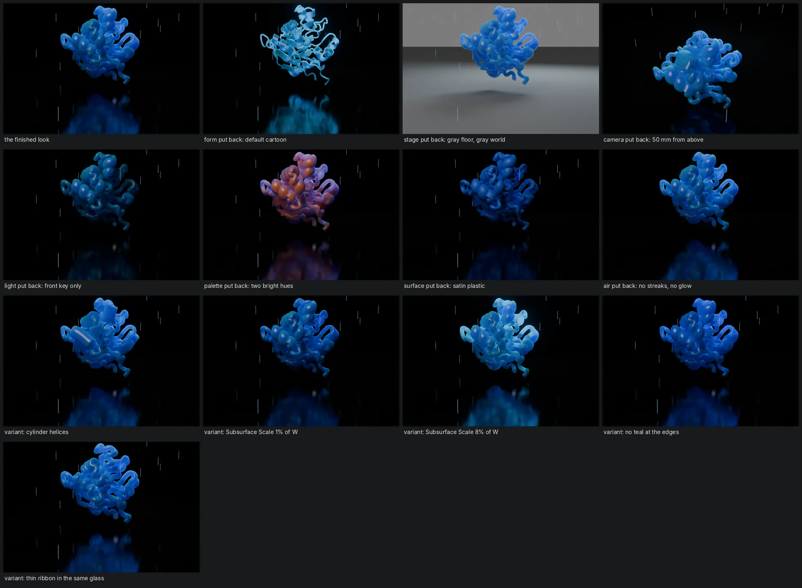
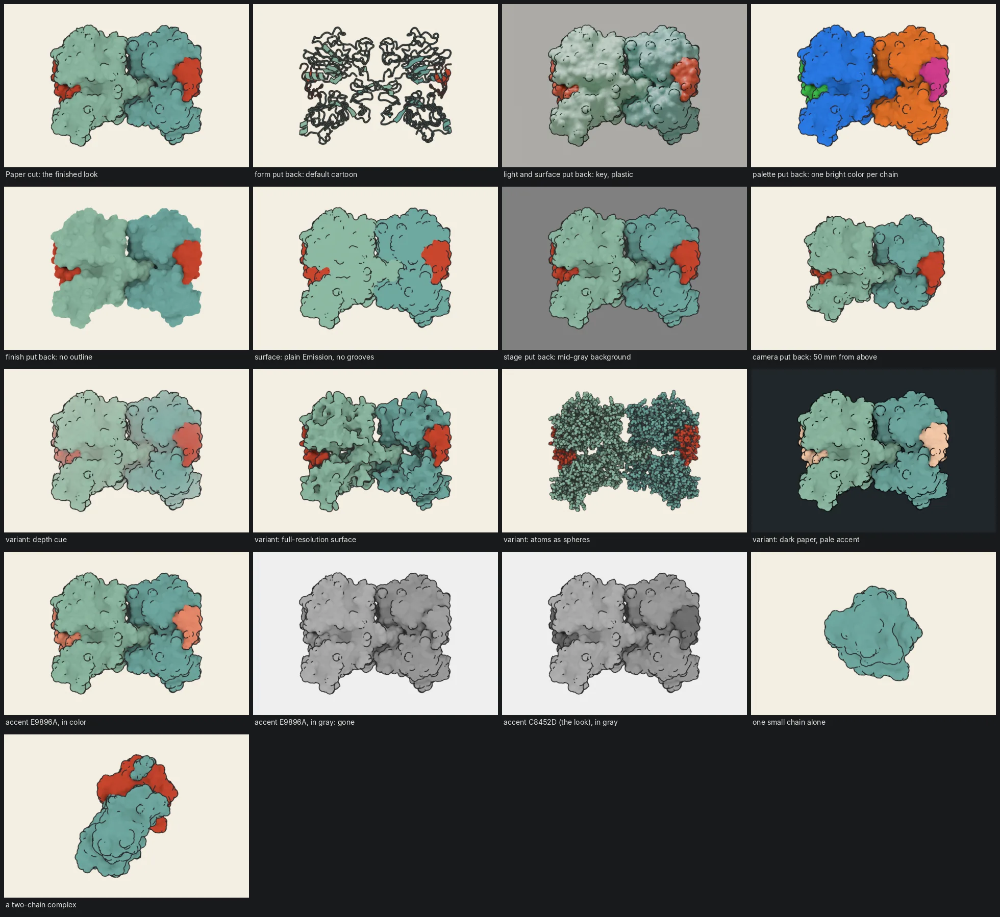
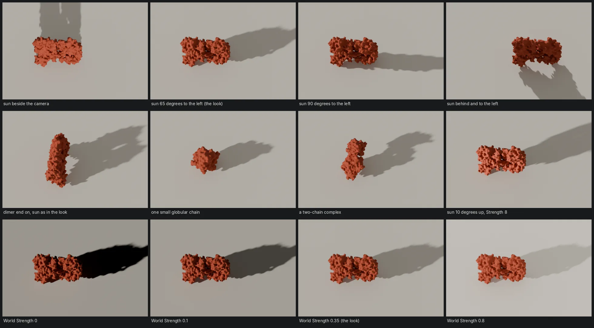
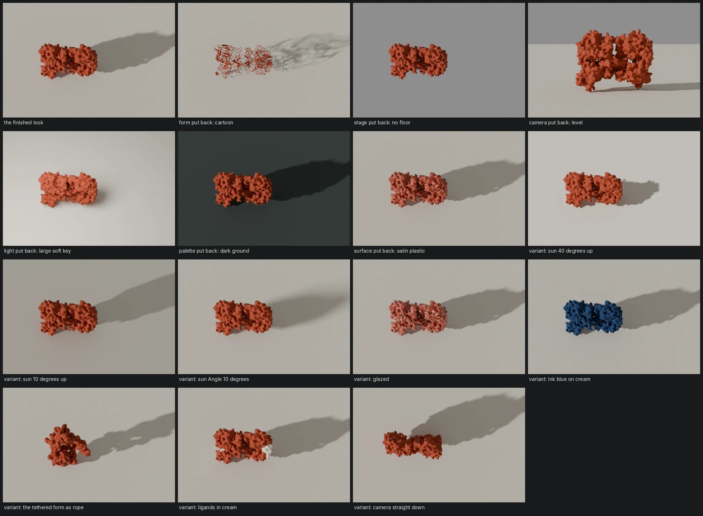
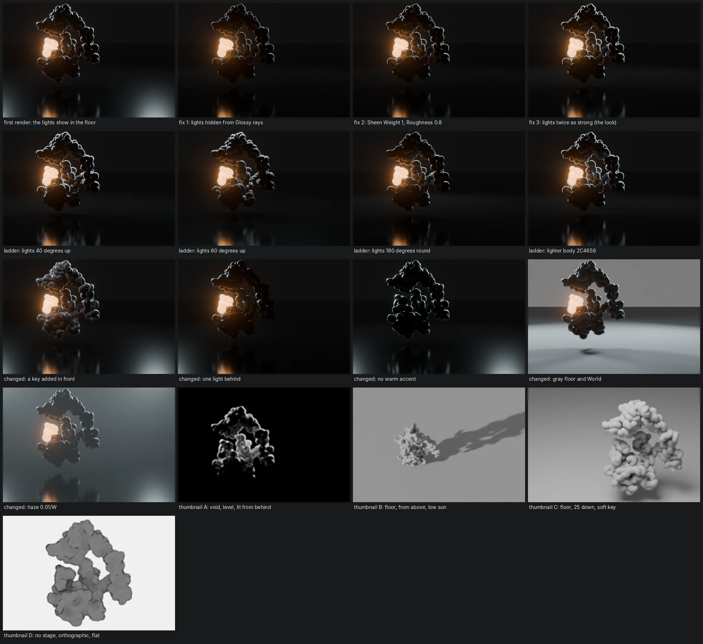

# Art direction: the whole picture

The earlier parts each teach one group of controls: the [Recipes part](01-material-recipes.md) and the [Designing a look part](02-designing-a-look.md) a material, the [Lighting part](03-lighting.md) a rig, the [Objects part](08-objects-and-modeling.md) a camera. A picture uses all of them at once, and it looks designed only when they were chosen together. This part teaches that choice.

In those parts a look meant one material. From here on it means the whole frame: what the molecule is made of, what it sits on, where the camera stands, how it is lit, which colors are allowed, what the surface feels like, and what hangs in the air.

Chapters 1 to 3 are the method: the seven decisions, one look built and taken apart, and how to tell whether a look fits your molecule. Chapters 4 to 8 take the five decisions the earlier parts leave open, one at a time. Chapters 9 to 11 build three more complete looks. Chapters 12 and 13 are about inventing a look of your own and practicing without a recipe. Chapter 14 is a chooser, a glossary and the sources.

**Notation.** W is the width of your model in meters, read from N › Item › Dimensions. Sizes are given as multiples of W because Molecular Nodes' scale has changed between versions (Chapter 2 of the [Geometry Nodes part](05-geometry-nodes.md)). Colors are six-character codes for the Hex field of the color picker. Numbers marked tested come from renders made in Blender 5.2 with Molecular Nodes, on models 5 to 12 m wide.

## Chapter 1. One sentence, seven decisions

### Objectives

- Name the seven decisions that make up a look, and the answer each one falls back to when nobody decides.
- Write a one-sentence brief that every decision can be tested against.
- Read the seven decisions off a finished picture.

### Why a render looks regular

A regular figure is not a badly made one. It is a figure in which nothing was decided. The molecule keeps the style the import gave it and the import's colors. It is lit evenly, made of satin plastic, floating in front of a flat background, centered, and sharp from front to back. Each of those is a sensible default, chosen by someone else to be clear in every situation, and together they are the picture everyone has already seen.

A designed picture differs in one way: its maker replaced the defaults with choices, and the choices agree with each other. That is why copying a picture you admire is easy and inventing one is hard. Copying hands you the choices. The skill is in making them.

### The sentence

Before any setting, write one sentence with two halves: what the viewer should look at first, and what the picture should feel like. "The antibody, on a receptor carved from pale stone under museum light." "The small subunits of a heavy, quiet enzyme resting in still water." The first half is the focus and the second is the mood.

The sentence is the test for every decision that follows. A choice that serves neither half goes back to something quiet. It also tells you when to stop, which settings never do.

The mood half works like the three words in Chapter 5 of the [Designing a look part](02-designing-a-look.md), one level up: those words described a surface, and these describe the room it is in.

### The seven decisions

| Decision | The question | A regular figure's answer | Where the controls are |
| --- | --- | --- | --- |
| 1. Form | What is the molecule made of, and how much of its detail survives? | The style the import gave it, every helix and strand | Chapter 4, and the [Molecular Nodes part](07-molecular-nodes.md), Chapter 6 |
| 2. Stage | What does the subject sit in or on? | Nothing: it floats in front of a flat color | Chapter 6 |
| 3. Camera | Which lens, from how high, with the subject where in the frame, and what is sharp? | 50 mm, level, dead center, everything sharp | Chapter 7, and the [Objects part](08-objects-and-modeling.md), Chapter 6 |
| 4. Light | Where does the key come from, how soft is it, and how much contrast is there? | Even light from everywhere | [Lighting part](03-lighting.md), Chapter 3 |
| 5. Palette | How many colors, which area is lightest, and what color is everything that is not the molecule? | One saturated color per chain, on white or black | Chapter 5 |
| 6. Surface | What would it feel like to touch? | Satin plastic | [Recipes part](01-material-recipes.md) and [Designing a look part](02-designing-a-look.md) |
| 7. Air and finish | What hangs between the camera and the subject, and what is done to the image afterwards? | Nothing | Chapter 8 |

The earlier parts cover light and surface in full, and they hold the controls for form and the camera. Chapters 4 to 8 take the five decisions those parts leave open as choices. The whole part is about making all seven for one reason.

### Why this order

The first three decisions settle what is in the frame, and they are made in gray, in Solid view, before any light exists: form changes the outline, the stage adds a floor or leaves a void, and the camera crops both. Light comes fourth because it can only be judged on shapes that have stopped moving. Palette comes fifth because the same color is a different color under a different light. Surface comes sixth for the reason given in Chapter 5 of the [Designing a look part](02-designing-a-look.md): a material and its light are one thing, and the light has to be there first. Air and finish come last because blur, haze and glow hide problems in everything before them. A finish laid over six defaults is a regular figure in fog.

The order is for deciding, and you will loop back. What it rules out is polishing a late decision while an early one is still a default.

### Reading a picture

Each decision leaves evidence in a finished picture, and reading that evidence is how other people's pictures become your vocabulary.

- **Form.** Squint until the detail goes and look at the outline. Count the kinds of shape: tubes only, or helices and arrows, or a skin with nothing inside. Compare their thickness with the size of the molecule.
- **Stage.** Look under the subject: a shadow, a reflection, or nothing. Then look at the corners of the frame: the same color as the middle, darker, or a different color.
- **Camera.** Say where the subject's center is in the frame and which side the empty space is on. Compare the near and far ends of the molecule: about the same size means a long lens. Find what is blurred.
- **Light.** Find the brightest side and the edge of the shadow, as in Chapter 3 of the [Lighting part](03-lighting.md): direction, softness, contrast.
- **Palette.** Count the hues, ignoring grays. Find the lightest area and the darkest. Say what color the background is relative to the subject: the same hue grayed down, its opposite, or none.
- **Surface.** Find a highlight and look at its edge, as in Chapter 2 of the [Designing a look part](02-designing-a-look.md).
- **Air and finish.** Look for specks, haze, a halo around bright parts, grain, dark corners.

Two readings, as examples. The first picture is an enzyme of sixteen chains drawn as thick rope, dark green with four cream chains on top, hanging just above a gray-green floor with small specks around it.

| Decision | Reading |
| --- | --- |
| Form | Tubes only, about as thick as a helix is wide. No helices, strands or side chains |
| Stage | A floor that fills the frame, with a soft shadow under the subject |
| Camera | Long lens, looking down. Subject right of center, the left third empty. The far specks are blurred |
| Light | One large soft source from the upper left, low contrast, and a faint glow from inside the central channel |
| Palette | One hue, green, in two values, plus cream. The cream chains are the lightest area. The floor is the green with the color taken out |
| Surface | Matte, like rubber: broad dim highlights with no edge |
| Air and finish | Specks at several depths, nothing else |
| The sentence | The cream chains, on a heavy, quiet thing resting in still water |

The second picture is a small protein drawn as a fat glossy blue cartoon over a black floor that mirrors it.

| Decision | Reading |
| --- | --- |
| Form | Cartoon, but swollen: helices as thick sausages, loops as fat tubes |
| Stage | A black void. A mirror floor, whose reflection is the only sign of ground |
| Camera | Long lens, level with the subject, centered, everything sharp |
| Light | Soft, from the front and above, plus light from behind that makes the edges glow |
| Palette | One hue, blue shifting toward teal. Black everywhere else. No second color |
| Surface | Glossy and slightly see-through, like colored glass or gel |
| Air and finish | Faint vertical streaks, like rain, and a soft glow |
| The sentence | One protein as a neon sign on a wet street at night |

Three things to notice. Each picture makes seven choices and no more. The two disagree on nearly every line and both work, so no line has a correct answer; there is only agreement with the sentence. And neither uses more than one hue and one accent.

### Exercise 1.1: read three pictures

1. Collect three pictures you like: one molecular render, one product photograph and one film still.
2. For each, write one line per decision, then the sentence you think its maker had.
3. Mark each line D if it matches the regular figure's answer in the table, or C if it was chosen.

What you should find: almost no D on pictures you like, one or two hues in most of them, and a sentence that every C line serves. If a picture you like has several D lines, it is carried by one decision made very well; name it.

### Exercise 1.2: read your own last render

1. Open the last figure you rendered and write the seven lines for it.
2. Mark each line D or C, then try to write its sentence.

What you should find: mostly D, with C on the decisions a tutorial walked you through, usually surface and light. The sentence is hard to write because there was none. The D lines are a list of what to practice, not a list of faults: a figure for a paper is allowed to be regular.

### Check yourself

1. What makes a render look regular? *Every decision was left at its default. Nothing is wrong with any one of them.*
2. Which three decisions are made in gray, before any light exists? *Form, stage and camera.*
3. Why does palette come after light? *The same color reads as a different color under a different light, so it can only be judged once the light is there.*
4. Why are air and finish decided last? *Blur, haze and glow hide problems in every earlier decision.*
5. Two pictures disagree on all seven lines and both look good. What do they share? *In each, every choice serves that picture's own sentence.*

## Chapter 2. A first look, built whole: soft studio

### Objectives

- Build a complete look by taking the seven decisions in order.
- Say what each decision contributes by taking it out again.
- Change the mood of a finished look by changing one decision.

This chapter builds the first reading from Chapter 1 on your own model. Any model will do if it has a part you want looked at: one chain of a complex, a bound ligand or antibody, a single domain. Sizes are multiples of W, as in the notation at the top of this part. The numbers were found on a two-chain complex with W = 8.4 m.

### The sentence and the sheet

The sentence: "The part I care about, on a heavy, quiet thing resting in still water." Write the seven answers down before opening Blender. This table is the look; the build is only typing it in.

| Decision | Choice | Why it serves the sentence |
| --- | --- | --- |
| 1. Form | Style Ribbon, thick | One kind of shape reads as one object, and thickness is what makes it heavy |
| 2. Stage | A matte floor that fills the frame | Resting needs something to rest on |
| 3. Camera | 85 mm, looking down, subject on the right third, shallow focus | Looking down takes the horizon out; the empty left side is where the quiet is |
| 4. Light | One large soft key from the upper left, the world as fill, no rim | Soft light and low contrast are quiet |
| 5. Palette | One hue in two values, and one light accent on the part to look at | On a dark floor the eye goes to the lightest area first |
| 6. Surface | Rubbery | Nothing glints anywhere |
| 7. Air and finish | Specks at several depths, blurred by a shallow focus | They make the water without drawing it, and the blur makes the subject small |

### The build

Work in a new file with the model imported and nothing else. Stay in Solid view (Z › Solid) for steps 1 to 3.

1. **Form.** In the model's tree, replace the style node with Style Ribbon (Shift + A › Molecular Nodes › Style), fed by the same Atoms link. Set Peptide Radius to 2.4 (it starts at 1.6), Backbone Smoothing to 0.8 (from 0.5) and Quality to 4 (from 3). The model should now look like rope: no helices, no arrows.
2. **Stage.** Shift + A › Mesh › Plane, scaled until it is 20 W across (the plane starts 2 m wide, so S, then 10 × W, Enter). Move it under the model with G Z, leaving a gap of about a tenth of the model's height. It is large enough that it does not need centering. Give it a new material with Roughness 1.
3. **Camera.** Add a camera if the file has none (Shift + A › Camera). Orbit to the side of the model you want to show, looking down at about 25°, then View › Align View › Align Active Camera to View. Set Focal Length to 85 mm and move the camera back with G Z Z until the model spans half the width of the frame, which is about 5 W away. Tilt further down if the far edge of the floor is still in the frame: the floor should be the whole background. In the camera's Viewport Display panel turn on Composition Guides › Thirds, then press G in camera view and slide the frame until the model's center sits on the right-hand line.
4. **Light.** Follow the build procedure in Chapter 7 of the [Lighting part](03-lighting.md) as far as the key: Rendered view, World Strength 0, clay override on. Add one Area light, Disk, Size 2 W, with a Track To on an Empty at the model's center. Place it about 1 W toward the camera from the model, 1 W to the camera's left and 2.6 W above. That is the single key of Chapter 4 of the [Lighting part](03-lighting.md), raised to 60° so that the shadow falls under the model where the camera can see it, and made twice as large. Start Power at 170 × W × W watts (12,000 watts for W = 8.4; Chapter 8 of the [Lighting part](03-lighting.md) explains the size of the number) and adjust until the top of the model is just under white. Then set the World to a light gray at Strength 0.25. Add no fill and no rim: the world is the fill.
5. **Palette.** Three colors, typed into the color picker's Hex field. Body `2F5D50`, a dark green. Accent `F0E6C0`, cream. Floor `39423F`, the body color with most of its saturation taken out. In the model's tree, after its own color node and before the style: Set Color with the body color for everything, then a second Set Color with the accent color and, in Selection, a Select node for the part to look at (Chapter 5 of the [Molecular Nodes part](07-molecular-nodes.md)). Put the floor color in the plane's Base Color. Turn the clay override off.
6. **Surface.** One material for the whole model, chosen in the style node's Material field, with an Attribute node named `Color` into Base Color so the two Set Color nodes show through (the [Recipes part](01-material-recipes.md) describes this for any Molecular Nodes object). Use the Rubbery row of the table in Chapter 6 of the [Designing a look part](02-designing-a-look.md): Roughness 0.6, IOR Level 0.3, Sheen Weight 0.2.
7. **Air and finish.** The specks are a second object that gives nothing of its own, as in Chapter 2 of the [Geometry Nodes for art part](06-geometry-nodes-for-art.md). Give it the same Location as the Empty from step 4, so that the tree's (0, 0, 0) is the model's center. In its tree: Points (Count 180) with Random Value (Vector) → Position, Min (−3 W, −3 W, −0.6 W) and Max (3 W, 3 W, 0.6 W); Points → Instance on Points › Points; Ico Sphere (Radius W/150, Subdivisions 2) → Instance; then Set Material with a material of Base Color `9FB3A8`, the floor color made paler, and Roughness 0.5. On the camera, tick Depth of Field, set Focus on Object to an Empty placed on the part to look at, and set F-Stop to 0.5/W, which is 0.06 for W = 8.4.

The F-Stop looks wrong and is not. At Molecular Nodes' scale your model is the size of a house, and a house photographed from fifty meters away is sharp from front to back at any real aperture. The blur in the reference belongs to a subject a few centimeters across. A very small F-Stop is how you tell Blender that the house is small. Chapter 7 returns to this.

Render in Cycles with 64 samples and Denoise on, and leave the view transform at AgX. Standard clips the cream accent to a flat patch, because the accent is the one area close to white.

Check the palette with numbers before trusting your eye. In the Image Editor, hold the left mouse button over the accent, then the body, then the floor beside the model, and read L, the luminance, in the footer each time. The accent should be the highest by a wide margin and the body the lowest, with the lit floor between them. In the test render the accent read about three times the body.

### Exercise 2.1: build it

1. Write your own sentence and sheet for your model, changing only the part to look at.
2. Build steps 1 to 7 in order, rendering once after step 4 with the clay override still on, and once at the end.

What you should see: after step 4, a gray rope model above its own soft shadow, on a floor that is lightest at the bottom of the frame and falls away to dark at the top. At the end, a dark model with one light part, a few sharp specks near it and soft discs far in front and far behind, and the left third of the frame empty. If the gray render looks dull, the finished one will too: fix form, stage, camera and light before adding color.

### Exercise 2.2: take it apart

1. In the Image Editor's header choose Render Result. Render the finished look into the first Slot.
2. For each line below, pick the next empty Slot, change that one decision to the regular figure's answer, render, and change it back.
   - Form: swap Style Ribbon for Style Cartoon.
   - Stage: hide the floor from renders with its camera icon in the Outliner.
   - Camera: duplicate the camera, make the copy active with Ctrl + numpad 0, and give it 50 mm, a level view from 3 W away with the model centered, and Depth of Field off.
   - Light: hide the key and set World Strength to 1.
   - Palette: mute both Set Color nodes (select them, M) so the import's colors return, and make the floor a neutral gray, `4A4A4A`.
   - Surface: Roughness 0.45, IOR Level 0.5, Sheen Weight 0.
   - Air and finish: hide the specks and untick Depth of Field.
3. Step through the eight renders with J and Alt + J, and rank the seven by how much was lost.

What you should see: seven near misses, each missing in its own way. With the cartoon back, the heaviness goes and the model is thin and busy. Without the floor, the model is pasted on a gray card. From the level 50 mm camera, the horizon cuts the frame in half and the specks are sharp dots that read as dust. Under even light, the form flattens and the shadow is a smudge. With the import's colors it is a regular figure standing in a nice room, and the eye no longer knows which part to go to. With plastic, almost nothing changes. Without the air, the picture is cleaner and emptier but still the same picture. The decision most tutorials teach first, the surface, matters least in this look. That is a fact about this look and not a rule, and Chapter 3 puts it to use.

### One decision, three moods

A finished look is also a starting point. Each of these changes one decision and leaves the other six alone.

- **Hue.** Body `5D2F3A`, floor `423A3C`, specks `B3A0A5`. The picture is the same picture in wine red. Hue is the freest choice in a palette once the values are right.
- **Night.** Floor `14181A`, World Strength 0.05, key Power at two thirds. The floor nearly disappears and the model is alone in the dark.
- **Pale floor.** Floor `D9DDD8`. The cream is no longer the lightest area, so the dark body becomes the strongest contrast in the frame and the eye goes there instead. The focus has moved without touching the molecule.

### Exercise 2.3: move the focus on purpose

1. Render the three variants above into three Slots.
2. On the pale floor, restore the focus without changing the floor back. You may change only the palette.

What you should see: the first two variants keep the eye on the accent, and the third sends it to the body. One fix is to swap the roles, giving the part to look at the darkest color and the rest a color close to the floor. Whatever you chose, the part to look at ends up as the area that differs most in value from what surrounds it.

### Check yourself

1. Why is the camera tilted down in this look? *So the horizon leaves the frame and the floor becomes the whole background, graded by the key's falloff.*
2. Why is the F-Stop so far below any real lens? *At Molecular Nodes' scale the model is meters across, and only a very wide aperture blurs anything at that size.*
3. Which knockout changed the picture least, and what does that tell you? *The surface. This look leans on its palette, form, stage and camera, not on its material.*
4. On the pale floor the eye went to the dark body. Why? *The eye goes to the strongest contrast in value, and against a pale floor that is the dark part.*
5. Why keep the view transform at AgX here? *The accent is close to white, and Standard clips it to a flat patch.*

## Chapter 3. Does this look fit my molecule?

### Objectives

- Find the few decisions a look leans on.
- Say what each of them demands of the subject.
- List what your own molecule offers, and choose references by that list.
- Adapt a reference whose demands your molecule cannot meet.

A reference is a picture of some other subject. Whether its look survives the move to yours depends on three things you can write down: what the look leans on, what that demands, and what your molecule offers.

### What a look leans on

Exercise 2.2 showed that the seven decisions do not carry equal weight. Soft studio broke when its palette, form, stage or camera was put back, and barely noticed the surface. The second reading in Chapter 1 is the opposite case: put satin plastic on that glossy blue protein and half the picture is gone.

Every look leans on a few of the seven decisions, usually three or four, and could lose the rest. You do not have to build a look to find them. Run Exercise 2.2 in your head on the reading: set each line to the regular figure's answer in turn and ask how much is lost.

### What each decision demands

A decision that carries a look needs something from the subject. That need is why some references cannot be moved to some molecules.

| A look that leans on | Demands of the subject | When the demand is not met |
| --- | --- | --- |
| Surface: glass, gel, wax, anything wet | Each form large in the frame: a few thick, smooth shapes | The material has nowhere to show. Thin tubes in a glassy material come out pale and noisy |
| Palette: a dark body and a light accent | A part and a whole: something to make light that is small next to the rest | The accent lands on an arbitrary region and points at nothing |
| Form: rope, beads, lumps | A fold that is not the message, because the form hides it | The figure is about a helix or a loop that can no longer be seen |
| Light: a rim, a silhouette, one hard shadow | An outline worth reading | A globular complex in silhouette is a ball |
| Camera: a centered, symmetric frame | An axis of symmetry, or one part that is plainly the middle | A subject with no center, centered, looks like nothing was decided |
| Air: deep blur, haze | Depth along the line of sight | A flat subject seen face-on gives the blur nothing to do |

Size does not appear in the table by name. A large complex suits a palette-led look because it has many parts, and a small protein suits a surface-led look because its forms are large in the frame. The part and the large form are the demand; size is only one way of meeting it.

### What your molecule offers

Read the same table from the other side and it becomes a list of what a molecule has to give. Write one line for each before you look for references.

- **Parts.** Partners, ligands, domains, glycans: anything that can take the accent.
- **Symmetry.** An axis gives a centered frame a center.
- **Outline.** A long, branched or ringed shape can be lit from behind. A ball cannot.
- **Large forms.** A small protein has them. So does anything drawn as a low-resolution surface.
- **Depth.** A long subject turned toward the camera gives blur something to do.
- **States.** Two or three conformations make a sequence, a look no single structure has.
- **Context.** A membrane, a partner, a substrate: a stage that means something.

As an example, here is the list for the extracellular region of the EGF receptor, with the looks it opens and closes. The lines marked tested were rendered with the two looks from Chapter 1.

| Offer | For this molecule | What follows |
| --- | --- | --- |
| Parts | Ligand, antibody, the dimerization arm, the two receptor chains | Palette-led looks transfer. Tested on the dimer with TGF-α (PDB 1MOX): soft studio holds with the two ligands as the accent, and again with only the two dimerization arms |
| Symmetry | The ligand-bound dimer has a twofold axis, and the arms cross on it. The tethered monomer has none | A centered frame suits the dimer only |
| Outline | Strong. The tethered form (PDB 1NQL) is nearly a ring | Rim and silhouette looks suit it better than they suit a globular enzyme |
| Large forms | None as cartoon or tubes: several hundred residues per chain make many small features | A surface-led look fails as it stands. Tested: the glassy blue material on tubes reads as pale thread |
| Depth | Modest. The dimer is about twice as wide as it is deep | Blur has little to do face-on. Turn the model a quarter turn first |
| States | Tethered, extended, dimer | A sequence across three panels |
| Context | A membrane underneath | A floor that is part of the biology |

### When a demand cannot be met

A reference whose demand your molecule cannot meet is not lost. There are four moves, in the order to try them.

1. **Change the form** until the subject meets the demand. Style Surface with Scale raised from 1.25 to 2.5, Quality lowered from 3 to 2, Mean Width 4 and Mean Iterations 6 turns each receptor chain into a few smooth lumps. Tested: the glassy material that failed on tubes reads on those lumps, and satin plastic on the same lumps loses the look again, which confirms what it leans on. Chapter 4 has more forms to change to.
2. **Crop** to a part that meets the demand. One ligand in its site, or the two arms where they cross, is a small subject with large forms.
3. **Move the decision** to the part that can carry it. Give the glass to the small partner and something quiet to the rest. The result is a different picture from the reference, and often a better figure, because the difficult material now marks the part the figure is about.
4. **Drop that decision** and keep the others. A glow from the middle of a symmetric enzyme has no place on a monomer. The palette and the floor around it still do.

If none of the four works, the reference was about its subject and not about a look. Keep it for a molecule that fits.

### Finding references

Search by what your molecule offers and by the decision you want, not by the word protein. A molecule with a strong outline and a few distinct parts has more in common with a pair of pliers, a seed pod or a bronze figure than with a globular enzyme, and photographers have already solved those subjects. Use the words for the decision: "rim light sculpture photography", "low key product photography", "specimen on black", "ceramics studio photography".

Label each picture you keep with what it leans on and what that demands, in the words of this chapter. A folder sorted that way answers the question you will have later, which is never "what do good pictures look like" and always "what can I do with a subject like mine".

### Exercise 3.1: knock out in your head

1. Take the three readings from Exercise 1.1.
2. For each, set every line to the regular figure's answer in turn, in your head, and write down the one or two lines whose loss costs the most.
3. Beside each of those lines, write what it demands of the subject, using the table.

What you should find: a clear answer for each picture, and different lines for different pictures. If every line seems to matter equally, look again at the surface line: on pictures of large complexes it usually matters least, and on pictures of small glossy objects most.

### Exercise 3.2: what your molecule offers

1. Write the seven lines for the model you built in Chapter 2: parts, symmetry, outline, large forms, depth, states, context.
2. Mark each line strong, weak or none.
3. For each strong line, name one kind of photograph, not of a molecule, that depends on the same thing.

What you should find: two or three strong lines, and for each a kind of picture to go looking for. The weak lines tell you which references to stop saving.

### Exercise 3.3: adapt a reference that does not fit

1. Choose a reference whose main demand your model cannot meet as it stands.
2. Write one sentence for each of the four moves, saying what it would mean for this reference and this model.
3. Try the most promising move in Solid view for ten minutes, without materials.

What you should see: a gray blocking in which your model now meets the demand, or a clear reason why it cannot. Either one is a result. Most adaptations are decided in gray, long before the material that made the reference attractive is built.

### Check yourself

1. How do you find what a look leans on without building it? *Set each line of its reading to the regular figure's answer in turn and ask how much is lost.*
2. What does a surface-led look demand of the subject? *Forms that are large in the frame: a few thick, smooth shapes.*
3. A look puts a light accent on a dark body. What must the molecule have? *A part and a whole: something small to make light next to the rest.*
4. A glassy look fails on a large complex drawn as tubes. Name two moves that could save it. *Change the form to a low-resolution surface, crop to a small part, or give the glass to the small partner only.*
5. Why search for references with words for a decision and not with the word protein? *Pictures of other subjects that offer the same thing as your molecule have already solved your problem, and a search by subject never finds them.*

## Chapter 4. Form: what the molecule is made of

### Objectives

- Choose a form for what it does to the outline and the mass of the picture, not out of habit.
- Judge a form in gray and as an outline before lighting it.
- Fatten, smooth and mix forms to control how much detail survives.

A style in Molecular Nodes is usually chosen for what it shows about the structure. Here it is chosen for what it makes the picture out of: wire, rope, beads, or a solid thing. Form is the first decision because every later one is judged on it. Chapter 6 of the [Molecular Nodes part](07-molecular-nodes.md) lists the styles and their sockets; this chapter is about choosing among them.

### Six forms of one molecule

Tested on a receptor dimer 11 m wide, in one gray material under one light.

| Form | Style and settings | Reads as | Outline |
| --- | --- | --- | --- |
| Cartoon | Style Cartoon, defaults | A drawing of the fold: thin and busy | A web full of holes that breaks up at small sizes |
| Rope | Style Ribbon, Peptide Radius 1.6 to 2.4 | One object made of cord, heavier as the radius goes up | Nearly solid at 2.4 |
| Beads | Style Spheres | A solid thing with a grain | Solid, with a rough edge |
| Skin | Style Surface, defaults | A real object, with pits and a hole or two | Solid and detailed |
| Lumps | Style Surface with Scale 2 to 2.5 (from 1.25), Quality 2, Mean Width 3 to 4, Mean Iterations 4 to 6 | A few large smooth masses | The simplest: a cloud |
| Swollen cartoon | Style Cartoon with Peptide Shape Round, Helix Thickness 2.0 (from 0.6), Helix Width 3.0 (from 2.2), Sheet Thickness 1.6 (from 0.5), Sheet Width 3.0 (from 2.5), Loop Radius 1.2 (from 0.4), Quality 4 | A toy of the fold | Thick loops with gaps between them |

The cartoon is at its best on a molecule rich in helices and sheets and at its worst on one that is mostly loops. The test receptor has few helices, so its cartoon came out as a tangle of wire with a few arrows in it. The default form is not automatically the informative one.

### Mass and detail

A form sets two things. Mass is how much of the frame the molecule's material covers. Detail is how many separate shapes the eye has to sort out. Cartoon and thin rope are low in mass and high in detail: they need a large share of the frame and a calm background. Skin and lumps are high in mass and low in detail: they survive being small, being blurred, and sitting in front of a busy stage.

The test is to shrink the picture. Look at a render at the size of a postage stamp, or step back from the screen until it is that small. What still reads at that size is what the form is really showing. A cartoon of a large complex becomes gray fuzz; lumps stay lumps.

### Outline first

The outline is what a rim light, a hard shadow or a dark-on-light palette will have to work with, so look at it before anything else. In Solid view, open the Viewport Shading popover (the arrow beside the shading buttons) and set Lighting to Flat, Color to Custom with a black swatch, and Background to Custom with a white one. The model is now a black shape on white.

Orbit it. A molecule has good and bad sides, and the outline is how you find them. Tested on a receptor in its closed, ring-shaped form, turned in eight steps of 45°: four views showed the hole in the ring, two showed a lump with a notch, and two showed a slab with nothing to read. The choice of view was worth more than any setting made after it.

### Mixing forms

Two style nodes with different selections, joined with Join Geometry, give two forms in one model (Chapter 5 of the [Molecular Nodes part](07-molecular-nodes.md)). The eye goes to detail the way it goes to a light value, so the rule is the same as for the accent color: the part to look at gets the more detailed form, and everything else gets the simpler one. Tested: the receptor as lumps and its ligands as beads. The ligands are found at once, even in the same gray.

A mix of two forms is a statement that the two parts are different kinds of thing. Use it when that is true for the picture, and use one form for everything when the molecule should read as one object.

### What a form hides

Every form throws something away. Rope hides the secondary structure. Lumps hide everything but the envelope. A cartoon hides volume, so two chains that are packed tightly look as if they barely touch. In a figure, the form has to keep whatever the figure claims: a picture about a helix swap cannot be rope, and a picture about a buried interface cannot be a cartoon. When a form simplifies, say so in the legend.

### Exercise 4.1: six forms in gray

1. Give your model one gray material with Roughness 0.9, and reuse the floor, camera and key of Chapter 2.
2. Render the six forms of the table into six Slots, changing only the style node.
3. Step through them at full size, then shrink the Image Editor until each render is the size of a stamp and step through them again.

What you should see: at full size, the cartoon is the most informative and the thinnest, the rope reads as one object, and the skin looks most like something you could pick up. At stamp size the order reverses: lumps and skin still read, the rope is a blob with texture, and the cartoon has dissolved.

### Exercise 4.2: choose the side by its outline

1. Set the viewport to the black-on-white outline described above.
2. Turn the model in eight steps of 45° (R Z 45, Enter) and take a screenshot of each, or use View › Render Viewport Preview.
3. Lay the eight side by side and choose one.

What you should see: two or three views in which the outline shows something only this molecule has, and several in which it could be any protein. Turning the view is free, and it is the first thing to settle.

### Exercise 4.3: two forms, one focus

1. Draw the part to look at as beads or skin and the rest as lumps, each with its own style node and selection, and join the two with Join Geometry.
2. Render in one gray, then swap the two forms and render again.

What you should see: in the first render the eye goes to the detailed part. In the second it goes to the rest of the molecule, and the part you care about has become a smooth pebble that is easy to miss.

### Check yourself

1. Which forms survive at stamp size? *The ones high in mass and low in detail: skin and lumps.*
2. Why look at the outline before placing a light? *It is what a rim light, a hard shadow or a dark-on-light palette has to work with, and it decides which side of the molecule to show.*
3. In a mixed model, which part gets the more detailed form? *The part to look at; the eye goes to detail.*
4. A figure is about a helix that changes place. Which forms are ruled out? *Rope and lumps, because they hide secondary structure.*
5. Why can a cartoon be a poor choice even for an informative figure? *On a molecule that is mostly loops it is a tangle of wire, and at small sizes it dissolves.*

## Chapter 5. Palette: value first, then hue

### Objectives

- Plan a palette in three grays before choosing any hue.
- Check a palette with the Greyscale look and the luminance readout.
- Use hue, saturation and the color of the ground for mood once the values are fixed.

A color has three properties. Value is how light it is, saturation is how far it is from gray, and hue is which color it is. A palette is decided in that order: the first carries the picture and the last is nearly free.

### Value does the work

Take the three colors of the soft studio look and replace each with the gray of the same lightness: body `555555`, accent `E6E6E6`, floor `404040`. Tested: the picture is intact. The eye still goes to the same part, the model still sits on its floor, and the measured brightness of accent, body and floor is 0.67, 0.37 and 0.29 in gray against 0.66, 0.36 and 0.29 in color.

A palette that works in gray works in any hue. A palette that fails in gray cannot be rescued by color. So plan three roles in gray first:

- **The ground** is everything that is not the molecule, and the largest area.
- **The body** is most of the molecule.
- **The accent** is the part to look at, and the smallest area.

Give each a value so that the accent differs most from what surrounds it. Three plans cover most pictures: a dark ground with a light accent (Chapter 2), a pale ground with a dark subject (Chapters 10 and 11), and a black ground with one thing glowing (Chapter 9).

### Checking values in Blender

The setting this guide has called View Transform is labeled View in Blender 5.2. It is in Render Properties › Color Management, with Look under it.

- **The Greyscale look.** With View at AgX, set Look to Greyscale. The viewport and the render turn gray, and nothing else changes. Tested: it gives the same picture as the three-gray plan above. Set Look back to None afterwards.
- **The luminance readout.** In the Image Editor, hold the left mouse button over an area and read L, the luminance, in the footer, as in Chapter 2.
- **The False Color view.** Set View to False Color to see exposure as a heat map: gray and green are the middle, yellow and red are near the top, and white is clipped. Tested on the soft studio look: the floor is green, the shadows blue, and the cream accent yellow with red edges, which is as bright as an accent should go.

### Hue is nearly free

Tested with the values held and the hue changed:

| Hue | Body | Floor | Measured body brightness |
| --- | --- | --- | --- |
| Green (Chapter 2) | `2F5D50` | `39423F` | 0.36 |
| Wine | `814054` | `483E41` | 0.36 |
| Navy | `3D5389` | `3D4047` | 0.37 |
| Ochre | `6A502A` | `43403A` | 0.35 |

The four renders are the same picture in four moods. To change a hue yourself without losing the plan, turn the Greyscale look on, pick the new hue, and move the color picker's Value slider until the gray matches what it was. Then turn the look off.

Choose the hue from the mood half of your sentence, from a reference, or from a convention your readers already know. Keep to one hue for body and ground, and let the accent be the only other color.

### One saturated thing

Tested: a vivid green body, a vivid yellow accent and a vivid teal floor. The three values collapsed to 0.62, 0.56 and 0.52, everything shouted, and nothing was the focus. Saturated colors are all of middling value, so a palette made only of them has no value plan left.

Saturation is a budget for one role. The ground is always the grayest thing in the frame, the body can carry some color, and whatever is most saturated will be looked at.

### Three ways to make an accent

| Accent | Example on the green body | In color | With the Greyscale look |
| --- | --- | --- | --- |
| By value | Cream `F0E6C0` | The strongest | Unchanged |
| By value and hue | Light coral `FF7759` | Strong, and warmer | Still clearly lighter |
| By hue alone | Coral darkened to the body's value, `923824` | Visible | The two parts merge into one gray |

An accent has to differ in value. A difference in hue is a bonus on top. An accent that exists only in hue disappears in a grayscale print, on a poor projector, and for many color-blind readers.

### The color of the ground

Tested under the green body, at the same value each time. The body's own hue grayed down (`39423F`) is the quietest: subject and ground belong to one world. A neutral gray (`404040`) works and is slightly colder. The opposite hue (`56383B`, a dusty red) makes the subject jump forward, and the ground starts to compete for attention. Start with the grayed body hue and move away from it only for a reason in the sentence.

### Light and the view transform are part of the palette

A colored light tints everything it touches. Tested: a warm key turned the green and gray-green scene olive and brown, a different mood with the same swatches. Set the color of the lights before you fine-tune any swatch (the [Lighting part](03-lighting.md) covers light color).

The view transform changes colors too. AgX compresses bright values and takes some color out of them, so a pale accent keeps its shading. Standard shows a swatch exactly as typed, and clips: tested, the cream accent rose to 0.77 and flattened into a patch. Use Standard for flat looks (Chapter 10) and AgX for everything lit.

### More than two parts

A model with six chains does not need six hues. Sort the chains into the three roles first. Inside a role, separate neighbors by a small step in value or a small step in hue, not by a new color: two receptor chains as `6FA8A0` and `8DB9A2` read as two things of one kind (Chapter 10 uses this pair). One hue per chain is the regular figure's answer, and it tells the reader that every chain matters equally.

### Exercise 5.1: plan in gray, then color

1. In the Chapter 2 scene, replace the three colors with the three grays above and render.
2. Now choose a hue you have not used. With the Greyscale look on, set body and floor to that hue and adjust Value until they match the grays. Turn the look off and render.

What you should see: the gray render already works as a picture. The colored render has the same structure in a mood you chose, and its Greyscale version is hard to tell from the gray plan.

### Exercise 5.2: spend the saturation

1. Render the scene three times: only the accent saturated, only the body saturated, and all three saturated.
2. Read Luminance on accent, body and floor in each.

What you should see: the eye goes to whichever role is saturated, so the first render keeps the focus and the second moves it to the body. In the third the three Luminance values are close together and the picture is loud and flat at once.

### Exercise 5.3: the accent that disappears

1. Give the accent a hue opposite the body's, then darken or lighten it until its Luminance matches the body's.
2. Render in color, then with the Greyscale look.

What you should see: in color the accent is plain to see. In gray the model is one piece. Now move the accent's Value until the gray version separates again, and note how far you had to go.

### Check yourself

1. In what order are value, saturation and hue decided, and why? *Value, then saturation, then hue. Value carries the picture, and hue is nearly free once the values hold.*
2. How do you check a palette's values without leaving Blender? *The Greyscale look in Color Management, or the luminance readout in the Image Editor.*
3. Why does a palette of only saturated colors fail? *Saturated colors are all of middling value, so the value plan disappears and nothing is the focus.*
4. An accent is clear in color and vanishes in gray. What is wrong with it? *It differs from the body in hue only. It needs a difference in value.*
5. What is the safest color for the ground? *The body's hue with most of the saturation taken out.*

## Chapter 6. Stage: what the subject sits in or on

### Objectives

- Choose among a void, a floor, a sweep, a mirror and a shadow catcher for what each one says.
- Build each of them.
- Decide how the subject meets the ground: touching, hovering or reflected.

The stage is everything in the frame that is not the molecule. A regular figure has none, which is why its subject looks pasted on. A stage does three jobs: it gives the subject a place, so it has weight and size; it gives the light something to fall on, so there is a shadow and a gradient; and it is the largest area in the frame, so its value sets the palette (Chapter 5).

### Seven stages

All seven were rendered with one model and one key light.

| Stage | What it says | What it needs |
| --- | --- | --- |
| Void, one flat color | A diagram. No place, no weight | Nothing, which is why it is the default |
| Void, black | Alone in the dark | Light from behind, or the dark parts of the subject merge with the background |
| Backdrop gradient | A poster or a studio portrait | A level camera; there is still no ground |
| Floor that fills the frame | An object on a table | A camera that looks down far enough to lose the horizon |
| Sweep | A photographer's studio | A level camera; the floor curves up into a wall behind the subject |
| Mirror floor | Night, a wet street, a showroom | A black World, and light from behind |
| Shadow catcher | The page itself is the floor | A white or pale page to put the render on |

An eighth stage is a set that means something: a membrane under a receptor, a strand of DNA under a polymerase. Build it as in the membrane exercise in Chapter 9 of the [Objects part](08-objects-and-modeling.md), and treat it as part of the palette's ground: grayer and quieter than the subject.

### The horizon

A floor seen by a level camera ends in a line, with the World above it. Tested: the line runs straight through the subject and the picture splits in two. There are three cures.

- **Look down** until the far edge of the floor leaves the frame. How far depends on the lens. Tested at 15° down, same subject size: 85 mm showed floor only, 50 mm showed a strip of World along the top, and 24 mm showed a broad band of it.
- **Build a sweep**, so there is no far edge.
- **Use darkness.** A near-black floor under a black World has a horizon nobody can see.

### Building them

- **Flat void.** World Properties › Surface: Color and Strength. To keep the World as a light but hide it from the camera, tick Render Properties › Film › Transparent.
- **Backdrop gradient.** In the Shader Editor set to World: Texture Coordinate › Window → Separate XYZ, its Y → Color Ramp › Factor, and the Color Ramp → the Color of a second Background node. Join the two Background nodes with a Mix Shader whose Factor is Light Path › Is Camera Ray, the original Background in the first Shader input and the new one in the second. Tested with the ramp running from `1B2421` to `5F6F69`: the camera sees the gradient, dark at the bottom, and the scene is still lit by the plain Background. The gradient belongs to the frame, not the scene, so it does not move when the camera does.
- **Floor.** As in Chapter 2: a plane 20 W across with Roughness 1.
- **Sweep.** A plane 40 W across (S, then 20 × W, then Ctrl + A › Scale). In Edit Mode, with edge selection, click the far edge, press E then Z and type 8 × W to raise a wall. Click the edge where floor and wall meet, press Ctrl + B, and set Width to 2 × W and Segments to 16 in the panel at the bottom left. Leave Edit Mode, right-click › Shade Smooth, and move the plane until the fold is about 4 W behind the model. Chapter 4 of the [Objects part](08-objects-and-modeling.md) covers extrude and bevel.
- **Mirror floor.** The floor's Base Color near black, `050505`, and World Strength 0. Roughness sets how wet it is. Tested: 0.05 gives a clear upside-down copy of the model, 0.15 a smear of its colors, and 0.3 only a faint glow.
- **Shadow catcher.** On the floor, tick Object Properties › Visibility › Shadow Catcher, and tick Film › Transparent. The render now holds the model and its shadow on a transparent background, ready to lay on a page. Tested with World Strength 0.6, so the shadow is gray and not black.

### How the subject meets the ground

The gap between model and floor is a decision of its own. Tested at three heights. With no gap, the shadow is dark and tight under the model, and the model rests: it has weight. With a gap of a tenth of its height, as in Chapter 2, it has just been set down. With a gap of half its height, the shadow comes loose, turns soft and pale, and the model floats.

On a mirror floor the gap sets where the reflection begins. With no gap, subject and reflection are one shape. A small gap makes two. The reflection moves down by twice the gap, so a large gap pushes it out of the frame: tested, at half the model's height it was gone.

### The light on the ground

A floor lit by one key is not one color. Tested in the Chapter 2 scene: the floor measured 0.33 near the camera and 0.18 at the top of the frame. That falloff is a free gradient and a free vignette, and it is why a single key near the subject looks better on a floor than even light does. If the ground looks flat, move the key closer before reaching for a gradient.

### Exercise 6.1: seven stages, one model

1. Keep the model, material and key of Chapter 2. Use an 85 mm camera, looking down 25° for the floor and the shadow catcher, and nearly level for the others.
2. Build and render the seven stages of the table into seven Slots. For the black void and the mirror floor, add an Area light behind the model, aimed back at the camera.

What you should see: the same model as a diagram, a thing in the dark, a poster, an object on a table, a studio portrait, a thing on a wet street, and a figure on a page. Nothing about the molecule changed. Write the sentence each one would serve.

### Exercise 6.2: weight

1. On the floor of Chapter 2, render the model touching the floor, a tenth of its height above it, and half its height above it.
2. Repeat the three on the mirror floor.

What you should see: resting, set down, floating. On the mirror, one shape, then two, then a model with no reflection in the frame at all.

### Exercise 6.3: lose the horizon three ways

1. With a level 85 mm camera and the plain floor, render once to see the horizon.
2. Remove it by tilting the camera, then by a sweep, then by making floor and World near black.

What you should see: three pictures without a line, each a different mood: seen from above, in a studio, in the dark. The cure you pick is a stage decision, not a repair.

### Check yourself

1. Why does a subject on a flat void look pasted on? *Nothing receives its shadow or its light, so it has no place and no weight.*
2. Name three ways to get rid of a horizon. *Look down until it leaves the frame, build a sweep, or make floor and World dark.*
3. Why does a wide lens make the horizon harder to lose? *It sees more of the room, so the far edge of the floor stays in the frame at angles where a long lens sees only floor.*
4. What does the gap under the model control? *Weight: touching reads as resting, a large gap as floating.*
5. The floor under one key is lighter near the camera than at the top of the frame. Why does that help? *It is a gradient and a vignette for free, and it keeps the eye near the subject.*

## Chapter 7. Camera and frame

### Objectives

- Choose lens, height, placement and crop for what each one says.
- Use depth of field at Molecular Nodes' scale.
- Fix the shape of the frame before placing anything in it.

Chapter 6 of the [Objects part](08-objects-and-modeling.md) covers the camera's controls. This chapter covers the choices: which lens, from how high, with the subject where, filling how much, and what is sharp. All of it was tested on a receptor dimer 11 m wide on the floor of Chapter 2.

### Lens

To keep the subject the same size while changing the lens, move the camera: its distance is the width of the frame at the subject, times Focal Length, divided by 36. For a subject that spans half the frame, that is 1.3 W at 24 mm, 2.8 W at 50 mm, 4.7 W at 85 mm and 11 W at 200 mm.

Tested at those four, looking down 15°. On the molecule itself the difference is small, much smaller than on a face. The large difference is in how much of the room the lens lets in. At 24 mm a broad band of World showed above the floor, at 50 mm a strip, at 85 mm none, and at 200 mm the floor behind the model was one nearly even tone.

- **A long lens simplifies the background.** 85 to 135 mm is the default for a molecule as an object.
- **A short lens brings the room in** and puts the viewer close. Use it when the stage is part of the subject, such as a receptor standing in a membrane.
- **Orthographic removes distance altogether.** It is the lens of a diagram and of panels that must be compared. A level orthographic camera sees a floor edge-on: tested, the floor vanished and the World showed underneath it. Pair it with a void or a backdrop.

### Height

Tested at 85 mm.

| Camera | Reads as | What happens to the shadow |
| --- | --- | --- |
| 3° down, on a sweep | Face to face: a portrait, a monument | A thin dark line under the subject |
| 25° down | An object on a table | A soft shape beside the subject |
| 50° down | A specimen seen from above; the subject looks smaller | A large part of the picture |
| 85° down | A map | It lies beside the subject at full length |

From straight above, the test dimer was a plain bar that nobody would recognize. Under a hard, low light its shadow carried the familiar outline instead, and Chapter 11 builds a look on that.

### Placement and crop

Tested with the camera 25° down.

- **Centered.** Formal and still. It suits a subject with a center, such as a symmetric dimer.
- **On a third.** Room on one side for the subject to face into, for its shadow to fall into, or for words.
- **Tight**, filling the frame and cut by its edges. Pattern and texture; the outline is gone, so the molecule is no longer recognizable as itself.
- **Loose**, a quarter of the frame's width. A small thing in a large room: scale, and loneliness.

The empty part of the frame is part of the picture. Decide what it is for before deciding where the subject goes. In the camera's Viewport Display panel, Composition Guides draws thirds, a center cross and others over the camera view, and Passepartout at 1 blacks out everything outside the frame so the crop can be judged honestly.

### The turn

Tested: the same dimer turned 45° shows a near end and a far end, and looks deeper and more active. Turned 90° it is seen end on and becomes a narrow tower, a different shape altogether. Settle the turn with the outline test of Chapter 4, before lens and placement.

### Depth of field

Chapter 2 gave the rule for F-Stop at Molecular Nodes' scale. Tested with specks around the dimer:

| F-Stop | Specks | Subject |
| --- | --- | --- |
| 1/W | Slightly soft | Sharp |
| 0.5/W | Soft discs far in front and far behind | Sharp when face on; the far half goes soft when end on |
| 0.25/W | Large pale discs | The far side softens even face on |

Blur needs depth along the line of sight. A flat subject seen face on stays sharp at any of these, so if the blur is doing nothing, turn the model. Set Focus on Object to an Empty on the part to look at, and type the F-Stop: dragging the field stops at 0.1.

A very low F-Stop makes the subject look like a small model on a desk. That is the right effect for a look about smallness and the wrong one for a look about a monument.

### The shape of the frame

Set Resolution X and Y in Output Properties › Format before placing the subject, because a placement tuned for one shape breaks in another. The tests here are 3:2. Slides are 16:9, a thumbnail is 1:1, and a journal cover is taller than it is wide and keeps its top for the title, so ask for the journal's template first. When words will share the frame, block them in as a plain rectangle while composing, so the picture has a hole of the right size.

### Exercise 7.1: four lenses

1. With the floor of Chapter 2 and the camera 15° down, render the model at 24, 50, 85 and 200 mm, moving the camera each time so the model spans half the frame.

What you should see: nearly the same molecule four times and four different rooms. The World comes into the frame at the short lenses and the floor turns into one tone at the long one.

### Exercise 7.2: four heights

1. At 85 mm, render from 3° (on a sweep), 25°, 50° and 85° down.
2. Write one word for what the subject is in each.

What you should see: something like a monument, an object, a specimen and a map. Watch the shadow grow from a line into the main shape.

### Exercise 7.3: place it four ways

1. At 25° down, render the model centered, on a third, tight and loose.
2. For each, say what the empty space is for.

What you should see: four pictures of the same thing with four different subjects: the molecule, the molecule and its space, its texture, and its smallness. If you cannot say what the empty space is for, the placement is still a default.

### Exercise 7.4: find the blur

1. Add the specks of Chapter 2. Render at F-Stop 1/W, 0.5/W and 0.25/W with the model face on.
2. Turn the model end on and render at 0.5/W.

What you should see: the specks soften step by step while the face-on model hardly changes. End on, the near end is sharp and the far end is soft, and the model suddenly looks small.

### Check yourself

1. What does a longer lens change most in a picture of a molecule? *The background: it lets in less of the room, so the stage becomes simpler.*
2. Why does a level orthographic camera not go with a floor? *It sees the floor edge on, so the floor disappears.*
3. What does a camera 50° above the subject do to the shadow? *It makes the shadow a large part of the picture.*
4. The blur is set and nothing looks blurred. Why? *The subject is flat along the line of sight. Blur needs depth, so turn the model or add things in front and behind.*
5. Why set the shape of the frame first? *A placement tuned for one shape breaks in another.*

## Chapter 8. Air and finish

### Objectives

- Put something between the camera and the subject: specks or haze.
- Add glow, a vignette and a grade after the render.
- Tell when a finish is improving a picture and when it is hiding a problem.

Air is what hangs between the camera and the subject. Finish is what is done to the image after it is rendered. Both come last, both are cheap to add, and both are the easiest decisions to overdo.

### Specks

Chapter 2 built them: 180 small spheres in a box 6 W wide and deep and 1.2 W tall. They work only together with a shallow focus. Tested in Chapter 2's knockouts: without blur they are sharp dots that read as dust on the picture, and with it they become soft discs at several depths, which the eye reads as space.

### Haze

Haze is a volume that scatters light. Add a cube large enough to hold the scene and the camera (14 W across in the tests) and give it a material with nothing in Surface and a Volume Scatter in Volume (Chapter 5 of the [Shaders part](04-shaders.md)). Density is per meter, so it has to shrink as the model grows: type the number below divided by W.

| Density | Tested result, camera 5 W from the subject |
| --- | --- |
| 0.005/W | A slight softening. Floor and body each rise a little in brightness |
| 0.02/W | The whole picture lifts. Blacks turn gray. The subject is still clear |
| 0.06/W | Milk. The subject is a pale ghost |
| 0.15/W | The subject is nearly gone |

The useful range is the top half of the table. Haze lowers contrast everywhere, and more with distance, so it separates near from far. It also eats the dark values a low-key palette depends on, so check the values again with the Greyscale look after adding it. It roughly doubled the render time in the tests.

Lit from behind, the haze itself glows. Tested at 0.06/W with an Area light behind the model: the fog turned bright and the subject became a dim shape in it. For a backlit haze, start at the low end.

### Glow

Glow is added after the render, in the Compositor. Open the Compositor editor and click New in its header to give the scene a compositing tree, and check that Output Properties › Post Processing › Compositing is ticked. On the link from the Render Layers node to the output, add a Glare node and set its Type to Bloom.

Only parts brighter than the node's Threshold glow. In a matte, softly lit scene nothing is, and the node does nothing. Something has to be bright: an emissive accent, emissive specks, or a hard highlight on a glossy surface.

Tested: the accent given its own material with Emission Strength 4, on a near-black floor. Without Glare the accent is a flat white shape. With Bloom at Threshold 1, Size 0.5 and Strength 1 it has a warm halo that spills onto the dark rope beside it, and it reads as a source of light. Strength is the dial: 0.5 is a hint and 1 is obvious. Fog Glow is a softer and slower relative of Bloom; it could not be tested here.

### Vignette

Dark corners keep the eye in the middle of the frame. The free version is the falloff of a single key across the floor (Chapter 6). The Compositor version, tested: an Ellipse Mask node with Size 0.85 by 0.85, into a Blur node with Size about 0.6 times the image width in pixels, into the B input of a Mix node set to Color and Multiply with Factor 0.7, with the image in A. The corners darken and the center is untouched.

### Grade

Render Properties › Color Management › Look spreads or squeezes the values of the finished render. Tested on the soft studio look, as brightness of accent, body and floor:

| Look | Accent | Body | Floor |
| --- | --- | --- | --- |
| None | 0.66 | 0.36 | 0.29 |
| Low Contrast | 0.63 | 0.37 | 0.32 |
| Medium High Contrast | 0.69 | 0.34 | 0.26 |
| Very High Contrast | 0.74 | 0.33 | 0.21 |
| Punchy | 0.57 | 0.25 | 0.19 |

A contrast look moves the accent up and the ground down, which strengthens a value plan that was already right. Punchy darkens everything and deepens the colors. A look cannot create a value plan that is not there.

### Is the finish helping?

Render with and without each finish into two Slots and flip between them with J. If you cannot say within a few seconds which is better, leave it out.

If the picture only works with the finish on, the problem is in an earlier decision. Haze that rescues the picture is covering a stage that was never decided. Blur that rescues it is covering a form with too much detail. Glow that rescues it is covering a palette without an accent. In the knockouts of Chapters 2 and 9, taking the air away cost almost nothing, which is what a healthy picture looks like.

A flat picture has its own kind of air: far parts fade toward the color of the paper. Chapter 11 of the [Shaders part](04-shaders.md) builds that as depth cueing, and Chapter 10 here uses it.

### Exercise 8.1: a ladder of haze

1. In the Chapter 2 scene, add the haze cube and render at Density 0.005/W, 0.02/W and 0.06/W.
2. Read Luminance on accent, body and floor in each, and compare with no haze.

What you should see: the three readings move toward each other as the density rises. At the lowest step the picture is softer and still has its blacks. At the highest it is a ghost in milk.

### Exercise 8.2: make one thing glow

1. Give the accent its own style node and its own material, as in Exercise 4.3, with Emission Strength 4 and an Emission Color close to its Base Color. Darken the floor to `14181A` and the World to Strength 0.05.
2. Render without Glare, then with Bloom at Strength 0.5 and at 1.
3. Set Emission Strength back to 0 and render with Bloom once more.

What you should see: a white patch, then a hint of a halo, then a light source. In the last render the Glare node does nothing at all, because nothing in the frame is brighter than its Threshold.

### Exercise 8.3: take the finish away

1. Open the most finished picture you have made in this part.
2. Render it into one Slot as it is, and into a second with every kind of air and finish off: specks hidden, Depth of Field unticked, haze hidden, Compositing unticked, Look at None.

What you should see: the same picture, a little plainer. If the second render has fallen apart, list which of the first six decisions is still a default, and fix that one.

### Check yourself

1. Why must the haze Density be divided by W? *Density is per meter, and the same fog has to act over a scene that is W meters across.*
2. The Glare node is on and nothing glows. Why? *Nothing in the frame is brighter than its Threshold. Glow needs an emissive part or a strong highlight.*
3. What does a contrast look do to a value plan? *It pushes the light role up and the dark role down. It strengthens a plan and cannot make one.*
4. A picture only works with haze on. What does that tell you? *An earlier decision, most often the stage, is still a default.*
5. Why do specks need a shallow focus? *Sharp, they read as dust on the image. Blurred at different depths, they read as space.*

## Chapter 9. Night glass

### Objectives

- Build a look that leans on its surface and its light, the opposite of soft studio.
- See why it needs large forms, a black stage and light from behind.
- Decide whether your own model can carry it.

This is the second reading from Chapter 1, built whole. It was tested on a single chain of 260 residues, W = 4.9 m.

### The sentence and the sheet

The sentence: "One protein as a neon sign on a wet street at night."

| Decision | Choice | Why it serves the sentence |
| --- | --- | --- |
| 1. Form | Swollen cartoon | The surface needs large smooth shapes to show on |
| 2. Stage | Black void, mirror floor | Night, and a wet street that doubles the glow |
| 3. Camera | 85 mm, nearly level, centered, everything sharp | A sign is looked at straight on |
| 4. Light | A dim soft key in front, a stronger light behind | The light behind is what makes the edges glow |
| 5. Palette | One hue, blue turning teal at the edges; black everywhere else | Neon is one color |
| 6. Surface | Wet wax: light goes in, a sharp highlight sits on top | The surface is the look |
| 7. Air and finish | A few faint streaks of rain, a little bloom | Wet, and lit |

### The build

1. **Form.** Style Cartoon with the swollen settings of Chapter 4: Peptide Shape Round, Helix Thickness 2.0, Helix Width 3.0, Sheet Thickness 1.6, Sheet Width 3.0, Loop Radius 1.2, Quality 4. Choose the turn with the outline test, looking for the side where helices show as coils.
2. **Stage.** A plane 30 W across with Base Color `050505` and Roughness 0.1, leaving a gap of about 6% of the model's height. World Strength 0.
3. **Camera.** 85 mm, 6° above level, the model centered and spanning 40% of the frame's width. Aim at a point below the model's center, by about a third of its height, so the model sits in the upper half of the frame and its reflection in the lower. No depth of field.
4. **Light.** Two Area lights, Disk, both 3 W from the model. The key: Size 2 W, 25° to the camera's left, 40° up, Power 45 × W × W watts. The back light: Size 1.5 W, behind the model and a little to one side, 35° up, Power 200 × W × W watts, a pale blue Color (0.75, 0.9, 1.0), and Object Properties › Visibility › Ray Visibility › Glossy unticked so that it does not appear as a bright patch in the floor.
5. **Palette.** One material with the color built in. Layer Weight (Blend 0.4) › Facing → the Factor of a Mix node set to Color, with A `1B5BD6` and B `37C8D8`, and the Result → Base Color. The model is blue where it faces you and teal where it turns away. The [Recipes part](01-material-recipes.md) drives Alpha with the same Facing output in its edge-glow ghost.
6. **Surface.** On the Principled BSDF: Roughness 0.3; Subsurface Weight 1, Subsurface Scale 0.03 × W, and Subsurface Radius (0.15, 0.4, 1.0) so that blue travels farthest; Coat Weight 0.5 and Coat Roughness 0.05. In the words of Chapter 6 of the [Designing a look part](02-designing-a-look.md), this is the Waxy row plus the Wet row's coat at half strength.
7. **Air and finish.** The rain is built like the specks of Chapter 2, with a Cylinder in place of the Ico Sphere: Points (Count 30) in a box 3 W wide, 5 W deep and 1.8 W tall, and a Cylinder with Vertices 6, Radius W/2500 and Depth 0.12 W. Its material is an Emission shader, Color `9FD8FF`, Strength 1.5. Then a Glare node as in Chapter 8: Bloom, Threshold 1, Size 0.5, Strength 0.5.

Render in Cycles with 64 samples. If the blue comes out pale, lower the lights before touching the color: tested, the first attempt with both lights about twice as strong washed the model out to light cyan.

### What it leans on

Tested by putting each decision back, as in Exercise 2.2.

| Put back | Result |
| --- | --- |
| Surface: satin plastic | An opaque navy toy. The glow is gone |
| Light: the key alone | The edges stop glowing and the model sinks into the black |
| Stage: gray floor, gray World | A blue object on a table. Nothing glows, because nothing is dark |
| Form: default cartoon | Thin strips, washed pale by the same lights |
| Palette: two bright hues | Loud, and no longer a sign |
| Camera: 50 mm from above | The reflection almost leaves the frame |
| Air and finish: none | Cleaner, and hardly different |

The look leans on its surface, its back light and its black stage, and those three need the form. Compare Exercise 2.2, where the surface was the one decision that did not matter. Two looks can rank the same seven decisions in opposite orders.

### What it demands

As Chapter 3 showed, a surface-led look demands large forms. A small protein meets that as a swollen cartoon. A large complex does not: change its form to lumps (tested on a receptor dimer in Chapter 3), crop to one part, or give the glass to the small partner only.

It also demands that the picture needs no accent, because one hue is the palette. If the picture has a part to look at, break the rule on purpose and make that one part warm. The look invented in Chapter 12 is built around one warm part.

### Variants

Tested, each changing one setting.

- **Helix Shape Cylinder.** Helices become smooth rods: cleaner and more like a toy.
- **Subsurface Scale 0.01 × W.** Denser and darker, more like glazed clay.
- **Subsurface Scale 0.08 × W.** Pale and milky; the blue washes toward white.
- **No teal.** B set to the same blue as A. Flatter: the edges no longer turn.
- **Style Ribbon at its defaults.** On this small protein it still reads, as glowing wire. On a large complex it does not.

### Exercise 9.1: build it

1. Choose a single chain or a small protein, under about 300 residues, and write its sheet.
2. Build steps 1 to 7, rendering after step 4 with a gray material and again at the end.

What you should see: in gray, a fat cartoon edged with light from behind, above a blurred copy of itself. At the end, a blue shape that seems lit from inside, teal where it turns away, with its reflection under it and a few pale streaks around it.

### Exercise 9.2: take it apart

1. Put each of the seven decisions back in turn, as in the table above, one Slot each.
2. Rank the seven by how much was lost, and lay your ranking beside the one from Exercise 2.2.

What you should see: surface, light and stage at the top of this list, where they were at the bottom or middle of the other. Air is near the bottom of both.

### Exercise 9.3: will your molecule carry it?

1. Put your largest model into the finished scene in place of the small one, as a default cartoon.
2. Try the first three moves of Chapter 3 in turn: lumps, a crop, and glass on one part only.

What you should see: as a cartoon, pale thread. At least one of the three moves brings the look back, and it will not be the same one for every molecule.

### Check yourself

1. Which decisions does night glass lean on? *Surface, the light from behind and the black stage, with a form large enough to show them.*
2. Why is the back light hidden from Glossy rays? *So the mirror floor does not show it as a bright patch.*
3. The blue renders pale. What do you change first? *The lights. This material washes out when it is lit too strongly.*
4. Why does the Subsurface Radius favor blue? *The three numbers set how far red, green and blue travel inside the material, and a blue glow needs blue to travel farthest.*
5. What does the look cost a picture that needs a focus? *It has one hue and no accent, so a focus has to be added by breaking the palette on purpose.*

## Chapter 10. Paper cut

### Objectives

- Build a look with no light in it: flat color, shaded grooves and an outline.
- See why it suits the large, many-part complex that a glossy look turns away.
- Catch an accent that exists only in hue, and repair it.

Night glass asked for a small subject with large forms. This look asks for the opposite. It was tested on the receptor dimer of Chapter 3 with its two ligands, about 12 m wide as a surface.

### The sentence and the sheet

The sentence: "The two ligands, on a receptor cut from colored paper and laid on a page."

| Decision | Choice | Why it serves the sentence |
| --- | --- | --- |
| 1. Form | Lumps: a low-resolution surface | Scissors cannot follow a backbone. Each chain becomes one shape with a few lobes |
| 2. Stage | None. The World is the page | Paper lies on a page, not in a room |
| 3. Camera | Orthographic, level, centered | No near and no far: the lens of a diagram |
| 4. Light | None | A light would turn the paper back into an object |
| 5. Palette | Pale warm paper, two muted greens a small step apart, one dark coral, a near-black line | A pale ground, a middle body, and an accent darker and more saturated than either |
| 6. Surface | Flat color, darkened only inside the grooves | The grooves keep the lobes readable without a light |
| 7. Air and finish | A thin dark outline around every shape | The cut edge of the paper |

### The build

1. **Form.** Style Surface with Scale 2.0 (from 1.25), Mean Width 3 and Mean Iterations 4 (both from 1), and Quality left at 3. These are the lumps of Chapter 4 at their mildest. Choose the turn with the outline test of Chapter 4 first: in this look the outline is most of the drawing.
2. **Stage.** No floor. In World Properties › Surface, set Color to the paper color of step 5 and Strength to 1. The World lights nothing here, because the material of step 6 does not respond to light. It is only the color of the page.
3. **Camera.** In the camera's Lens panel set Type to Orthographic. Bring the chosen side to face the view, level, and use View › Align View › Align Active Camera to View as in Chapter 2. Center the model and set Orthographic Scale to 1.6 × W, which makes the model span about 60% of the frame's width. An orthographic camera can stand at any distance without changing the picture.
4. **Light.** None. Hide or delete every light in the file. Nothing in this look responds to them.
5. **Palette.** Paper `F3EEE2`. Receptor chains `6FA8A0` and `8DB9A2`, the pair from Chapter 5. Ligands `C8452D`, a dark coral. Line `2B2B2B`. In the model's tree: Set Color with the first green for everything, a second Set Color with the other green and a selection of the second receptor chain, and a third with the coral and a selection of the ligands (Chapter 5 of the [Molecular Nodes part](07-molecular-nodes.md)).
6. **Surface.** One material in the style node's Material field, made of four nodes and no Principled BSDF. An Attribute node named `Color` → A of a Mix node set to Color and Multiply, Factor 1. An Ambient Occlusion node with Distance 0.15 × W, its Color → B. The Mix's Result → the Color of an Emission node with Strength 1, and Emission → Material Output › Surface. This is "ambient occlusion as the only shading" from Chapter 11 of the [Shaders part](04-shaders.md): the chain color as typed, darkened only where the surface is enclosed.
7. **Air and finish.** Tick Render Properties › Freestyle and set Line Thickness Mode to Relative. In View Layer Properties › Freestyle Line Set › Edge Type, leave Silhouette ticked and untick Border and Crease. Set Freestyle Color › Base Color to the line color and leave Freestyle Thickness › Base Thickness at 3. In Relative mode the line is Base Thickness × image height ÷ 480 pixels wide, so it keeps its weight at any resolution. Tested on a 3:2 frame: 2 pixels at 480 wide and 4 pixels at 960 wide.

Render in Cycles with 48 samples, and set View to Standard, as Chapter 5 advised for flat looks. Tested: the paper in the render then measures exactly the code that was typed.

### Check the accent in gray

The first version of this look used a lighter coral, `E9896A`, for the ligands. In color it looked right. Measured, the ligands were 0.54 and the receptors 0.57, which is the same value. With the color taken out the ligands were gone, and only the outline said they were separate shapes. At `C8452D` the three roles measure 0.93 for the paper, 0.57 for the receptors and 0.33 for the ligands, and the picture survives in gray.

A flat look makes this mistake easy, because nothing except the swatches sets the values: there is no light, no shadow and no highlight. To check, read L, the luminance, in the Image Editor, or set View to AgX and Look to Greyscale for one render and then set them back. The grays are darker under AgX than under Standard, and their order is what matters.

### What it leans on

Tested by putting each decision back.

| Put back | Result |
| --- | --- |
| Form: default cartoon | A black scribble. The outline follows every strand, and the color disappears under the lines |
| Light and surface: a key light and satin plastic | A rendered object with a line drawn round it. The paper is gone |
| Palette: one bright color per chain | A loud diagram. The ligands are one color among four |
| Finish: no outline | Soft shapes, like felt. Where the two receptors meet, they merge |
| Surface: plain Emission, no grooves | Flat stencils. The lobes survive only where the outline crosses a shape |
| Stage: a mid-gray background | Duller, and still the look |
| Camera: 50 mm, from 25° above | Hardly different |

The look leans on its form, its lack of light, its palette and its line. The camera, which soft studio depended on, matters least here. A flat picture holds almost no information about distance, so the lens has little to change.

### What it demands

Read this against the table in Chapter 3. A look that leans on form needs a fold that is not the message. A look that leans on a line needs an outline worth reading. A palette with an accent needs a part and a whole. Nothing else is asked for: no large forms, because flat color has no highlight to show, and no depth or symmetry. So it suits the molecule that night glass turned away, a large complex with several parts and a strong outline.

Tested the other way round: one small globular chain alone in this look is a single green pebble with nothing to compare it with. A two-chain complex with its smaller partner in the coral works at once.

What it gives up is the fold. Nothing inside the outline says helix or strand, and a cartoon cannot be put back in, as the first row of the table shows. A figure about secondary structure needs another look.

### Variants

Tested, each changing one thing.

- **Depth cue.** Far parts fade toward the paper, which is this look's kind of air (Chapter 8). Camera Data › View Z Depth → Map Range › Value, with From Min the distance from the camera to the front of the model, From Max the distance to its back, To Min 0, To Max 0.55, and Clamp ticked. Its Result → the Factor of a second Mix node set to Color, placed between the first Mix and the Emission, with the paper color in B. Tested with the camera 6 W from the model's center and the range from 5.7 W to 6.35 W: the far half of the dimer fades toward the page and the near half comes forward, like two layers of paper.
- **Full-resolution surface.** Style Surface at its defaults. Busier: the outline picks up small notches, and short lines appear inside the shapes. Closer to an engraving than to cut paper.
- **Atoms as spheres.** Style Spheres with Sphere set to Mesh, and Base Thickness 1.8. Every atom gets its own ring. It works as a texture and no longer as two receptors.
- **Dark paper.** Paper `20262B`, line `0B0D0F`. The value plan flips, so the accent has to become the lightest role. Tested with the ligands in `F6C9A8`: paper, receptors and ligands measure 0.14, 0.58 and 0.75. With the dark coral kept, the ligands measure 0.32, between the paper and the receptors, and depend on their hue again.

Not tested here: Chapter 10 of the [Shaders part](04-shaders.md) describes a much faster relative of this look in the Workbench engine.

### Exercise 10.1: build it

1. Choose a complex with at least two parts and a side with a readable outline. Write its sheet.
2. Build steps 1 to 6 and render. Then add step 7 and render into a second Slot.

What you should see: first, soft colored shapes with darker grooves, like felt, running into each other where two chains overlap. With the line, cut paper: each chain is one shape with a dark edge, short curved lines mark where one lobe lies over another, and the accent is the darkest color on the page.

### Exercise 10.2: the accent that was not one

1. Set the accent to `E9896A` and render. Read Luminance on a ligand, on each receptor and on the paper.
2. Render once more with View at AgX and Look at Greyscale.
3. Darken the accent until its Luminance is about 0.2 below the receptors', and render both versions again.

What you should see: in step 1, readings for ligand and receptor within a few hundredths of each other. In step 2, a gray dimer in which the ligands cannot be found. After step 3 they are the darkest shapes in the gray version. This is Exercise 5.3 again, met by accident.

### Exercise 10.3: take it apart

1. Put each line of the table above back in turn, one Slot each.
2. Rank the seven, and lay the ranking beside those of Exercises 2.2 and 9.2.

What you should see: form, light, palette and line at the top, stage and camera at the bottom. That makes three looks and three different orders. The surface mattered least in soft studio and most in night glass, and the camera, which soft studio depended on, hardly matters here.

### Check yourself

1. Why does this look need no light? *Its material is an Emission shader, which shows a color exactly and does not respond to light. The only shading comes from the Ambient Occlusion node.*
2. Why are the receptors lumps and not a cartoon? *An outline around every strand of a cartoon is a scribble. Flat color needs a few large shapes.*
3. The ligands are a clear coral in color and vanish in gray. What happened? *The accent matched the body in value and differed only in hue. Darken it, or on dark paper lighten it.*
4. What does Relative line thickness do? *It scales the line with the image height, so the outline keeps its weight at any resolution.*
5. Which molecules suit this look? *Ones with several parts and a strong outline, at any size. It asks for no large forms, depth or symmetry.*

## Chapter 11. Specimen

### Objectives

- Build a look carried by one hard, low light and the shadow it throws.
- Use the shadow as a second view of the molecule.
- Set the shadow's length, edge and darkness with three numbers.

Chapter 7 noted that a molecule seen from above can be a plain shape while its shadow carries the outline. This look is built on that. It was tested on the receptor dimer of Chapter 3 as a full surface, W = 11.5 m.

### The sentence and the sheet

The sentence: "The whole shape of the receptor, as a specimen on a table in low evening sun."

| Decision | Choice | Why it serves the sentence |
| --- | --- | --- |
| 1. Form | Skin: a full surface | A specimen is a solid thing, and a solid thing throws a solid shadow |
| 2. Stage | A pale matte floor that fills the frame, with the model standing on it | The shadow needs something to fall on, and a specimen rests |
| 3. Camera | 85 mm, 55° down, the model a third of the frame wide and left of center | High enough to see the whole shadow, with room for it to fall into |
| 4. Light | One Sun, 20° above the horizon, from the camera's left. A weak World as fill | A low, hard light draws a long, sharp shadow |
| 5. Palette | Cream ground, rust subject, and the gray of the shadow between them | Three values: pale ground, middle shadow, dark subject |
| 6. Surface | Matte clay | Nothing glints. The light is the event |
| 7. Air and finish | None | Hard light wants clean air |

### The build

1. **Form.** Style Surface at its defaults. With the outline test of Chapter 4, choose two sides of the model: one for the camera and one for the sun. The section after this one explains why.
2. **Stage.** A plane 40 W across with Base Color `E9E1D0` and Roughness 1. Raise it until it touches the lowest point of the model. Chapter 6 showed that a model touching its floor has weight.
3. **Camera.** 85 mm, looking down at 55°. The model spans a third of the frame's width, with its center about an eighth of the frame left of the middle, so the right half is empty floor. No depth of field.
4. **Light.** A Sun with Strength 4 and Angle 1.5°. Give it a Track To on an Empty at the model's center, as for the key in Chapter 2, and move it to the camera's left and low: on the ground plan about 1.2 W toward the camera from the model and 2.6 W to the camera's left, and 1 W above the model's center. That is 65° round from the camera and 20° above the horizon. Only a Sun's direction counts, so these distances are just a way of setting the angle. Set the World to a light gray at Strength 0.35.
5. **Palette.** Ground `E9E1D0`, subject `A8452E`, and no third swatch, because the third value is the shadow. Tested: ground, shadow and subject measure 0.68, 0.48 and 0.28. Under a sun this low the cream floor renders as a warm light gray, and it is still the lightest value in the frame.
6. **Surface.** Roughness 0.9 and IOR Level 0.2, between the Dry and Chalky rows of Chapter 6 of the [Designing a look part](02-designing-a-look.md).
7. **Air and finish.** None.

Render in Cycles as in Chapter 2, with View at AgX.

### The shadow is a second view

The shadow on the floor is the outline of the model as the sun sees it, stretched along the ground away from the sun. So this look shows two views of the molecule at once: the camera's in color and the sun's in gray. Tested with the sun at four places round the dimer:

| Sun | Shadow |
| --- | --- |
| Beside the camera | Repeats what the camera sees, and most of it hides behind the model |
| 65° to the camera's left (the look) | A long band beside the model with a notch at its far end. A stretched outline, readable but plain |
| 90° to the left, where the sun sees the dimer end on | A thin streak with nothing in it |
| Behind and to the left, 150° round | Falls toward the camera with a clear outline. The side of the model facing the camera is in shade, and the picture turns dark and dramatic |

One more test: the dimer turned end on to the camera, with the sun where the look has it. The camera sees a narrow tower. The shadow shows the broad outline with both lobes and the gap between the receptors. The shadow shows the side that the camera cannot see, and of all these renders it was the one in which the shadow said most.

So choose the sun's direction the way Chapter 4 chose the camera's: with the black-on-white outline, looking from where the sun will be.

### Three numbers

- **Length is the height of the sun.** The shadow is as long as the model is tall, divided by the tangent of the sun's height: 1.2 times the model's height at 40°, 2.7 times at 20° and 5.7 times at 10°. Tested: at 40° it ends well inside the frame, at 20° it reaches the edge, and at 10° it runs out of the frame. A lower sun also spreads its light over more ground. The lit floor measured 0.74, 0.68 and 0.61 at the three heights while the shadow stayed at 0.48, so a long shadow is also a weaker one. Raise Strength as the sun comes down: tested, Strength 8 at 10° matched Strength 4 at 20°.
- **Edge is the Sun's Angle.** At 1.5° the edge is sharp near the model and slightly soft at the far end. At 10° the far end of the shadow dissolves. Chapter 2 of the [Lighting part](03-lighting.md) gives 0.5° for the real sun.
- **Darkness is the World.** The shadow gets no sunlight, so World Strength sets its value. Tested: at 0 the shadow is black and the shaded side of the model disappears into it. At 0.1 it measures 0.25, at 0.35 it measures 0.48, and at 0.8 it is a faint stain of 0.65 on a floor of 0.73.

### What it leans on

Tested by putting each decision back.

| Put back | Result |
| --- | --- |
| Light: one large soft key | A small soft smudge under the model. The look is gone |
| Stage: no floor | Nothing receives the shadow. A red object on a gray card |
| Camera: level | The shadow is a thin strip behind the model, and a horizon cuts the frame |
| Palette: a dark ground | The shadow sinks into the floor. Ground and shadow measure 0.22 and 0.11 |
| Form: default cartoon | A wire model with a shadow like lace. A different look, and not a bad one |
| Surface: satin plastic | Small glints on the surface. Little changes |
| Air and finish | There was none to take away |

The look leans on its light, its stage and its camera, and on a ground pale enough to show a shadow. Form and surface are nearly free, which makes this the look to reach for when a molecule has no part to accent and no material that suits it.

### What it demands

An outline worth reading, from the sun's side. Tested on one small globular chain: the shadow is a stretched oval that says nothing the model did not. A two-chain complex that is longer than it is wide gave a shadow with more shape in it. The receptor dimer, with the sun on its broad side, gives two lobes and the gap between them. The closed, ring-shaped receptor of Chapter 4, drawn as thick rope, gives a shadow with the hole of the ring in it.

It also demands room. The subject is a third of the frame wide, so nothing small on it will be read: this is a look about the whole shape. A part can still be marked. Tested with the ligands in cream, `F3EBD3`: they show as two light patches on the rust.

### Variants

Tested, each changing one thing.

- **Ink.** Subject `1F3A5F`. It works unchanged, and so should any dark color.
- **Glazed.** Roughness 0.35 with Coat Weight 1 and Coat Roughness 0.08. Under a hard light every bump of the surface gets its own glint and the model glitters. A hard light and a glossy, detailed surface do not go together.
- **Rope.** The closed receptor as Style Ribbon with Peptide Radius 3.0. A ring of rope, and a shadow that keeps the hole.
- **From straight above.** The camera 88° down. The dimer is a plain bar and the shadow carries the outline: a map with a drawing beside it.
- **Lace.** The cartoon row of the table above, kept on purpose.

### Exercise 11.1: build it

1. Write the sheet for your model, naming the side the camera sees and the side the sun sees.
2. Build steps 1 to 4 and render with the clay override on. Then turn the clay override off, build steps 5 to 7 and render again.

What you should see: the gray render is already the picture: a pale floor, a gray shadow two to three times as long as the model is tall, and a darker model. Color adds little. If the gray render is dull, look at the shape of the shadow, because the sun is seeing a poor side.

### Exercise 11.2: two views

1. With the outline view of Chapter 4, find the side of your model with the best outline and the side with the worst.
2. Render with the camera on the worst side and the sun seeing the best.
3. Swap them and render again.

What you should see: in step 2, a plain model beside a shadow that explains it. In step 3, a readable model beside a streak that adds nothing. The shadow earns its place when it shows something the camera does not.

### Exercise 11.3: three numbers

1. Render with the sun 40°, 20° and 10° up, reading Luminance on the lit floor each time.
2. At 20°, render with Angle 1.5° and 10°.
3. At 20°, render with World Strength 0, 0.35 and 0.8.

What you should see: a short, a long and a very long shadow, on a floor that darkens as the sun drops. Then a crisp shadow and one whose far end dissolves. Then a black shadow, a gray one and a faint one.

### Exercise 11.4: take it apart

1. Put each line of the table above back in turn, one Slot each, and rank them.

What you should see: light, stage and camera at the top, with the dark ground close behind. Form and surface are at the bottom, the reverse of night glass.

### Check yourself

1. What does the shadow show? *The outline of the model as seen from the sun, stretched along the ground.*
2. A model is 9 m tall and the sun is 20° up. How long is the shadow? *9 divided by the tangent of 20°, about 25 m, or 2.7 times the height.*
3. What sets how dark the shadow is? *The World. The shadow receives no sunlight, so World Strength sets its value.*
4. Why does a dark ground spoil this look? *A shadow can only be darker than its ground, and a dark ground leaves it no room.*
5. Why is the camera high? *From a level camera the shadow is a thin strip behind the model. From above it is a shape.*

## Chapter 12. Inventing a look

### Objectives

- Get from a blank file to a look of your own by a fixed order of work.
- Choose among ideas with small gray pictures before building any of them.
- Find a number with a ladder of renders.
- Borrow single decisions, with their partners, in place of whole pictures.

Chapters 2, 9, 10 and 11 handed you four sheets. This chapter is about writing the fifth yourself. It adds no new controls. It is an order of work, and every step uses something from an earlier chapter.

### Where the first lines come from

A blank sheet is hard to fill because all seven lines are open at once. Two things you already have will close most of them.

**The strongest offer picks the decision to lean on.** Write the list of Chapter 3 for your molecule and take its strongest line.

| Strongest offer | Decision to lean on | Built in |
| --- | --- | --- |
| Parts | Palette: an accent on one part | Chapters 2 and 10 |
| Outline | Light from behind, a hard shadow, or a drawn line | Chapters 10 and 11, and the example below |
| Large forms | Surface: glass, wax, anything wet | Chapter 9 |
| Depth | Air: blur or haze, with the model turned toward the camera | Chapters 7 and 8 |
| Symmetry | Camera: a centered, formal frame | Chapter 7 |
| States | One look repeated across panels, with an orthographic camera | Chapter 7 |
| Context | Stage: a set that means something | Chapter 6 |

**The sentence picks the rest.** The mood half of the sentence is made of words, and each word lives in particular decisions. These rows collect what the earlier chapters tested.

| Mood | Decisions that carry it | Tested in |
| --- | --- | --- |
| Quiet | Soft light, low contrast, one hue, a matte surface, empty space on one side | Chapter 2 |
| Heavy | A thick form that touches its floor | Chapters 2 and 6 |
| Small, precious | A very low F-Stop, a loose frame, a high camera | Chapter 7 |
| Alone | A black void or a wide empty floor, and a loose frame | Chapters 6 and 7 |
| Night, electric | A black stage, a mirror floor, light from behind, one glowing hue | Chapter 9 |
| Clear, explained | No light, flat color, an orthographic camera, a pale page | Chapter 10 |
| Still, observed | A hard low sun, a pale floor, a long shadow, clean air | Chapter 11 |
| Monumental | A camera near the floor, a centered frame, a sweep | Chapters 6 and 7 |

### Borrow decisions, and their partners

You will not invent a decision. Every one has been made before, in a reference, in an earlier chapter, or in a photograph of a teapot. What is yours is the combination and the reason for it. So fill each line of the sheet from a source you can name, and write the source beside it.

Some decisions do not travel alone. Each row below was tested somewhere in this part.

| If you borrow | Borrow with it | Otherwise |
| --- | --- | --- |
| A mirror floor | A black World, light from behind, and lights hidden from Glossy rays | A gray table, or white patches in the floor (Chapters 6 and 9) |
| Specks | A shallow focus | Dust on the picture (Chapters 2 and 8) |
| Glow | Something emissive, or a hard highlight | The Glare node does nothing (Chapter 8) |
| A long shadow | A pale floor and a high camera | The shadow sinks into the floor or hides behind the model (Chapter 11) |
| Glass or wax | Large smooth forms, and light from behind | Pale thread (Chapters 3 and 9) |
| A drawn outline | Lumps or a skin | A scribble (Chapter 10) |
| A plain floor | A camera that looks down, or a sweep | A horizon through the subject (Chapter 6) |
| Shallow focus | Depth along the line of sight | Nothing blurs (Chapter 7) |
| Haze | A palette that can afford to lose its blacks | A gray frame (Chapter 8) |
| An accent in a new hue | A step in value as well | It vanishes in gray (Chapters 5 and 10) |

Every look in this part leans on three or four decisions and keeps the others plain. Soft studio leans on palette, form, stage and camera. Night glass leans on surface, light and stage. Paper cut leans on form, the absence of light, palette and line. Specimen leans on light, stage and camera. So borrow one or two strong decisions, give them their partners, and fill the remaining lines with the quietest answer that agrees with the sentence. A sheet in which every line is loud has no subject.

### Choose in gray, small and fast

Three ideas compared for five minutes beat one idea polished for an hour. Make the comparison before any material exists.

- **Outline thumbnails** settle the side. Use the black-on-white viewport of Chapter 4 and View › Render Viewport Preview, in eight turns of 45°.
- **Gray thumbnails** settle the sheet. For each candidate, set up only form, stage, camera and the main light. Turn on the clay override (Chapter 7 of the [Lighting part](03-lighting.md)), set the % field under Resolution X and Y in Output Properties › Format to 25, and render into a Slot.

Judge the thumbnails at the size they are. A candidate that reads at the size of a stamp will read at any size (Chapter 4). Choose the one that already looks like the sentence, and set % back to 100 only for that one.

### Tune one number with a ladder

A number such as a light's height or a material's Subsurface Scale is found, not known. Render it at three to five values that run from clearly too little to clearly too much, changing nothing else, and put the renders side by side in Slots. That row is a ladder. If the best render is at one end, extend the ladder that way. If it is in the middle, you are done, or you can run a finer ladder between its two neighbors.

Two rules keep this cheap. Render a ladder at a quarter of the resolution. And build one only for a number on a decision the look leans on, because the others will not change the picture enough to be worth it. This part is full of ladders: F-Stop in Chapter 7, haze Density in Chapter 8, Subsurface Scale in Chapter 9, the height of the sun in Chapter 11.

### A worked example

Tested from a blank file, on the tethered receptor of Chapter 3 with its ligand (PDB 1NQL), W = 8.3 m.

**Offers.** Outline: strong, nearly a ring. Parts: one small ligand. Large forms, symmetry, depth: none worth using.

**Sentence.** "The ligand, on a receptor that waits closed in the dark."

**Outline thumbnails.** Eight turns of 45°. Four showed the hole in the ring, two showed a lump with a notch, and two showed a slab. The first of the four was kept.

**Gray thumbnails.** Four candidate sheets, blocked at 240 pixels wide. Each rendered in under fifteen seconds on two processor cores.

| Candidate | What the thumbnail showed |
| --- | --- |
| A. Black void, level camera, lit from behind | A dark figure edged with light, with the hole in the ring black against it |
| B. Pale floor, camera above, low sun | A small model and a long shadow with the hole in it |
| C. Floor, camera 25° down, soft key | A pale ring of rope on a table. Quiet |
| D. No stage, orthographic, flat with a line | A gray cutout with a white hole |

All four showed the ring. Only A was dark, so the sentence chose A. None of them showed the ligand, which said in advance that the focus would have to come from the palette.

**The sheet, with its sources.**

| Decision | Choice | Borrowed from |
| --- | --- | --- |
| 1. Form | Thick rope | Soft studio. An outline needs one simple, solid shape |
| 2. Stage | Black void, mirror floor | Night glass |
| 3. Camera | 85 mm, nearly level, loose and left of center | Chapter 7: loose for a thing alone, and off center because this subject has no symmetry |
| 4. Light | Two lights behind, nothing in front | The rim-only setup in Chapter 4 of the [Lighting part](03-lighting.md) |
| 5. Palette | A near-black body and one warm glowing part | The third plan of Chapter 5 |
| 6. Surface | Velvety | The Velvety row in Chapter 6 of the [Designing a look part](02-designing-a-look.md): dark in the middle, glowing at the rim |
| 7. Air and finish | Bloom on the glowing part | Chapter 8 |

**The first render, and what was wrong with it.** Two things. The two lights appeared in the mirror floor as white patches, which is the missing partner from the table above: unticking Glossy on both lights removed them. And the edge of light was too faint to carry the picture. Raising Sheen Weight from 0.5 to 1 and Roughness from 0.5 to 0.8 widened it a little, and doubling the power of the lights made the outline read.

**Three ladders.** Height of the lights: at 25° the light runs down both sides of the ring, at 40° more of it lands on the tops, and at 60° only the top edges are lit and the sides go dark. Position: at 140° round from the camera the edge is a clear line, and at 160° it is thinner and dimmer. Body color: `2C4656` in place of `16242E` shows blue-gray surface between the edges and weakens the outline. Kept: 25°, 140° and the darker body.

**One decision changed at a time.** A key added in front: the body becomes a gray rope and the outline stops being the subject. One light behind in place of two: half the ring is lost in the black. No warm accent: a cold outline with nothing to look at. Gray floor and gray World: a black rope floating over a table. A thin haze of 0.01/W: the lights behind turn the air gray and the black is gone. The look leans on its light, its stage and its one warm part.

**The finished sheet.**

| Decision | Setting |
| --- | --- |
| 1. Form | Style Ribbon, Peptide Radius 3.0, Backbone Smoothing 0.8, Quality 4. One style node for the receptor and one for the ligand, as in Exercise 4.3 |
| 2. Stage | Floor `050505`, Roughness 0.12, a gap of 4% of the model's height. World Strength 0.01 |
| 3. Camera | 85 mm, 5° above level, aimed a fifth of the model's height below its center. The model spans 36% of the frame's width, an eighth of the frame left of the middle |
| 4. Light | Two Area lights, Disk, Size 0.6 W, 3 W from the model, 140° round from the camera on either side and 25° up. Each 520 × W × W watts, Color (0.75, 0.92, 1.0), Glossy unticked. No key |
| 5. Palette | Body `16242E`, ligand `FFB36B` |
| 6. Surface | Receptor: Roughness 0.8, Sheen Weight 1. Ligand: Emission Color `FFB36B`, Emission Strength 3 |
| 7. Air and finish | Glare: Bloom, Threshold 1, Size 0.5, Strength 0.6 |

The whole example was about twenty-five small renders. None of its seven lines is new. The picture is.

### Exercise 12.1: three sheets for one molecule

1. Write the offers of your molecule and a sentence for it.
2. Write three sheets that lean on three different decisions. Beside every line, name where you borrowed it from and check the partners table.

What you should find: the first sheet comes easily and resembles a look from this part. The second and third are harder and more your own. If a line has no source you can name, it is probably a default, so replace it or mark it quiet on purpose.

### Exercise 12.2: choose in gray

1. Make the eight outline thumbnails and choose a side.
2. Block the three sheets in gray at 25%, one Slot each.
3. Choose one by looking at the thumbnails at their own size.

What you should see: three clearly different pictures, in less time than one finished material takes. One will already look like your sentence. If none does, the sentence is asking for a decision that none of the sheets leans on.

### Exercise 12.3: build, fix, tune

1. Build the chosen sheet in the order of Chapter 1.
2. Write down everything that is wrong with the first full render, and beside each fault the decision it belongs to.
3. Run a ladder for each of two numbers on the decisions your look leans on, three to five values each.

What you should see: a first render with two or three plain faults, each belonging to one decision. Most are a missing partner. After the ladders, numbers that you chose because you saw their neighbors.

### Exercise 12.4: prove it and keep it

1. Put each decision back to the regular answer in turn, as in Exercise 2.2, and rank the seven.
2. Write the finished sheet with sizes as multiples of W, as in the example, and save it with a small render.

What you should see: three or four decisions that the look cannot lose, and they should be the ones you meant to lean on. If the ranking surprises you, the look is not the one you thought you were making, and the sentence or the sheet needs changing. The saved sheet is now a look you can put on another molecule.

### Check yourself

1. All seven lines of the sheet are open. Where do you start? *With the molecule's strongest offer, which picks the decision to lean on, and the mood words of the sentence, which pick most of the rest.*
2. Why do gray thumbnails come before any material? *Form, stage, camera and the main light decide whether the picture works, and they can be compared in minutes at a quarter of the size.*
3. How do you find a number such as the height of a light? *With a ladder: three to five values from too little to too much with nothing else changed, and a pick from the row.*
4. A borrowed mirror floor shows white patches. What was left behind? *Its partner: the lights have to be hidden from Glossy rays, under a black World.*
5. How many decisions should a look lean on? *Three or four. The others stay plain and agree with the sentence.*

## Chapter 13. Briefs with no recipe, and when it looks wrong

### Objectives

- Carry a brief from one sentence to a finished picture with no recipe.
- Judge your own picture with five tests before anyone else sees it.
- Trace a fault to the decision it belongs to.
- Decide how much of a look a scientific figure can carry.

Every look so far came with a sheet or showed one being written. This one gives only briefs. It also collects in one table what went wrong in the tests behind this part, because your own pictures will go wrong in the same ways.

### Five tests for your own picture

Run them in this order on anything you are about to show.

1. **The sentence.** Read your sentence, look away, then look at the picture for two seconds. The first thing you looked at should be the thing the sentence names (Chapter 1).
2. **The stamp.** Shrink the picture to the size of a stamp. It should still read (Chapter 4).
3. **Gray.** Turn on the Greyscale look. The focus should survive (Chapter 5).
4. **The knockout.** Put the decisions back one at a time, in your head or in Slots. The ones the picture cannot lose should be the ones you meant it to lean on (Chapters 2 and 3).
5. **Bare.** Turn off every kind of air and finish. It should be the same picture, a little plainer (Chapter 8).

A picture that fails one of them has a fault you can name, and the table below says where to look.

### When it looks wrong

Faults inside one material are in Chapter 8 of the [Designing a look part](02-designing-a-look.md), and faults inside one rig are in Chapter 9 of the [Lighting part](03-lighting.md). This table is for faults between decisions. Every row happened in the tests for this part.

| Symptom | Likely cause | Fix |
| --- | --- | --- |
| It looks like every other render | Nothing was decided: each line of the sheet is at its default | Write the sentence, then change the two lines it cares about most (Chapter 1) |
| The subject looks pasted on | Stage: nothing receives its shadow or its light | A floor, a sweep or a shadow catcher (Chapter 6) |
| A line cuts the frame behind the subject | Stage and camera: a level camera over a plain floor | Look down, build a sweep, or make floor and World dark (Chapter 6) |
| The model seems to float | Stage: the gap under it is too large | A tenth of its height, or touching (Chapter 6) |
| The eye goes to the wrong part | Palette or form: the focus is not the strongest contrast. The ground is too pale, another role is more saturated, or another part has more detail | Check the values in gray. Give the focus the largest step in value, the saturation and the detail (Chapters 2, 4 and 5) |
| The focus is clear in color and gone in gray | Palette: the accent differs in hue only | Darken or lighten it until it separates in gray (Chapters 5 and 10) |
| Everything shouts and nothing leads | Palette: every role is saturated, so the values have collapsed | Gray the ground and keep saturation for one role (Chapter 5) |
| Thin and busy, and it dissolves when small | Form: a cartoon or thin tubes on a large molecule | Rope, skin or lumps (Chapter 4) |
| Glass or wax comes out as pale thread | Form and surface: a surface-led look on forms too small to show it | A swollen cartoon, lumps, a crop, or the material on one part only (Chapters 3 and 9) |
| A glowing material washes out to a pale tint | Light: too strong for a subsurface material | Lower the lights before touching the color (Chapter 9) |
| The model glitters | Surface and light: a coat or a low Roughness on a detailed surface, worst under a hard light | Smooth the form or roughen the surface (Chapter 11) |
| The outline is a scribble | Form: lines drawn on a cartoon | Lumps or a skin (Chapter 10) |
| White patches in a mirror floor | Light: the lights are visible to Glossy rays | Untick Glossy in each light's Ray Visibility (Chapters 9 and 12) |
| The mirror floor shows no reflection | Stage or camera: the gap is too large, or the camera too high | Lower the model or the camera (Chapters 6 and 9) |
| An edge light is faint, or half the outline is missing | Light: too weak, too far behind, or on one side only | More power, a second light, 140° round in place of 160°, a higher Sheen Weight (Chapter 12) |
| A long shadow is a plain streak | Light: the sun sees a poor side of the model | Move the sun round until the shadow has a shape (Chapter 11) |
| A long shadow is faint, or solid black | Light: the sun is low and weak, or World Strength is too high or at zero | Raise Strength as the sun drops, and keep World Strength near 0.35 (Chapter 11) |
| Specks look like dust on the image | Air: there is no shallow focus | Depth of Field on, with F-Stop near 0.5/W (Chapters 2 and 8) |
| Depth of Field is on and nothing blurs | Camera: an F-Stop from a real lens, or a subject that is flat along the line of sight | Type an F-Stop near 0.5/W, and turn the model (Chapters 2 and 7) |
| The subject looks like a toy on a desk | Camera: the F-Stop is too low for this sentence | Raise it toward 1/W, or turn Depth of Field off (Chapter 7) |
| The blacks have turned gray | Air: haze, most of all with a light behind it | Density down to 0.005/W, or no haze (Chapters 8 and 12) |
| Glare is on and nothing glows | Finish: nothing in the frame is brighter than Threshold | Give one part an emissive material (Chapter 8) |
| A pale accent is a flat white patch | Finish: the Standard view clips colors near white | Set View to AgX (Chapters 2 and 5) |
| The picture only works with blur, haze or glow on | An earlier decision is still a default | Turn the finish off and fix what it was hiding (Chapter 8) |
| Everything is decided and it is still dull | The sheet leans on nothing, or the side shown has a poor outline | Choose one decision to lean on, and run the outline test (Chapters 4 and 12) |

### Looks and scientific figures

A look says what matters in a picture. A figure also makes a scientific claim, and the two must not disagree. Three questions decide how much look a figure can carry.

- **Does the form keep what the figure claims?** Rope hides secondary structure, and lumps hide everything except the envelope (Chapter 4). If the claim is about something the form hides, change the form. If the form simplifies, say so in the legend.
- **Does the focus survive the page?** Printed in gray, shrunk to the width of a column, or seen by a color-blind reader, the accent has to stay an accent. That means a step in value (Chapter 5).
- **Could anything be mistaken for data?** Specks can be read as particles or solvent, a glow as a signal, haze as density, and a reflection as a second copy. In a figure, leave out any air and finish that the legend does not explain.

Where the picture will be seen sets how far to go.

| Where | How much look | Why |
| --- | --- | --- |
| A panel in the main text | A chosen form and palette on a pale or transparent ground, even light, and an orthographic camera wherever panels are compared | It has to be read closely and trusted. Chapter 6 of the [Lighting part](03-lighting.md) gives the rules for its light |
| A summary figure, a graphical abstract, a slide | One look for every panel, such as paper cut or soft studio | It is seen for seconds, and one look is what makes it one figure |
| A cover, a poster heading, a title slide, a website | Any look | Its job is to be looked at |

Wherever it goes, use one look per figure. If two panels differ in look, the reader takes the difference for a result.

A regular figure remains a legitimate choice (Chapter 1). After this part it should be a choice.

### Exercise 13.1: a look on a second molecule

1. Take one of the four built looks and a molecule from a different family from the one you built it on: a nucleic acid, a membrane protein, a capsid.
2. Write what the look leans on, what that demands, and what the new molecule offers (Chapter 3).
3. Change at most two lines of the sheet, and build it.

What you should see: the same look on a subject that had to be met halfway. For each line you changed, you should be able to name the demand that forced it. If you had to change more than two, you have made a different look, which is also a result.

### Exercise 13.2: one molecule, three moods

1. Keep one molecule, one side and one focus. Write three sentences that differ only in mood: one quiet, one electric, one explained.
2. Fill the three sheets from the mood table of Chapter 12 and build them.

What you should see: three pictures that a stranger would put in three different rooms, with the eye going to the same part in each. If two of them look alike, their sheets lean on the same decisions.

### Exercise 13.3: borrow from an object

1. Choose a photograph you admire of something that is not a molecule: a product, a sculpture, a plate of food.
2. Read its seven lines and mark the two it leans on most (Chapters 1 and 3).
3. Rebuild those two on your molecule, with their partners, and keep the other five quiet.

What you should see: a picture that recalls the photograph without copying it. Where a demand could not be met, one of the four moves of Chapter 3 should be visible in the result.

### Exercise 13.4: a panel that survives print

1. Take a claim from a paper you know, of the kind "this part touches that part".
2. Make a panel for it that will be 4 cm wide on the page and may be printed in gray. Use an orthographic camera, a pale ground, and a form that keeps what the claim is about.
3. Run the stamp test and the gray test at the printed size.

What you should see: a panel in which the claim can be found in two seconds, at 4 cm, in gray. It will probably be close to paper cut, or to a regular figure with a chosen form and palette. Write the one sentence of legend that says what the form leaves out.

### Exercise 13.5: a cover

1. Set the frame to the journal's template, or to 2400 by 3000 pixels if you have none, and block a rectangle across the top quarter for a title (Chapter 7).
2. Choose any look and compose it for that frame from the start.
3. Shrink the result to 3 cm tall, the size of a cover in a list of issues.

What you should see: a picture that still reads at 3 cm, with the subject clear of the title and the empty space doing a job. A picture composed for a wide frame and then cropped to a tall one shows it, so recompose.

### Exercise 13.6: a sequence

1. Choose two or three states of one molecule: unbound and bound, closed and open, monomer and dimer.
2. Build one look and put the same sheet on every state, with the same camera, light and palette, and the accent on whatever changes.
3. Lay the panels side by side.

What you should see: panels that differ only where the molecule differs, so that the change is the strongest contrast across the row. If anything else differs between panels, such as the light or the size of the model, the eye goes there first. Chapter 6 of the [Lighting part](03-lighting.md) shows how to reuse one rig in several files.

### Exercise 13.7: a look of your own

1. Invent a look on one molecule by the procedure of Chapter 12, and give it a name.
2. Write its sheet with sizes as multiples of W, then what it leans on and what it demands.
3. Put it on a second molecule that meets the demands, and on a third that does not.

What you should see: on the second molecule the look arrives almost unchanged. On the third it fails in the way your list of demands predicted. A look whose failures you can predict is one you understand.

### Check yourself

1. Name the five tests. *The sentence, the stamp, gray, the knockout, and bare.*
2. A picture only works with haze on. Which test catches that, and what does it mean? *Bare. An earlier decision is still a default, and the haze is hiding it.*
3. Why should every panel of a figure share one look? *A difference in look between panels reads as a difference in the result.*
4. What can a reader mistake specks or a glow for? *Data: particles, solvent or a signal.*
5. Your picture is fully decided and still dull. Where do you look? *At whether the sheet leans on anything, and at whether the side shown has an outline worth reading.*

## Chapter 14. Chooser, glossary and sources

### I want this, use that

| I want to | Use |
| --- | --- |
| Know why a render looks regular | Mark each of the seven lines D or C (Chapter 1) |
| Find what a look depends on | Knockouts, built or in your head (Chapters 2 and 3) |
| Know whether a reference fits my molecule | What it leans on, what that demands, what the molecule offers (Chapter 3) |
| Choose the side to show | The black-on-white outline in eight turns (Chapter 4) |
| A large complex that reads when small | Rope, skin or lumps (Chapter 4) |
| Send the eye to one part | The largest step in value, then saturation, then detail (Chapters 4 and 5) |
| Check a palette | The Greyscale look and the luminance readout (Chapter 5) |
| Change the mood and keep the picture | A new hue at the same values (Chapter 5) |
| Give the subject a place | A floor, a sweep, a mirror or a shadow catcher (Chapter 6) |
| Lose the horizon | Look down, build a sweep, or use darkness (Chapter 6) |
| Make the subject rest, or float | The gap under the model (Chapter 6) |
| A simpler background | A longer lens (Chapter 7) |
| Blur at Molecular Nodes' scale | An F-Stop near 0.5/W, typed in (Chapters 2 and 7) |
| One part that glows | An emissive material and a Glare node set to Bloom (Chapter 8) |
| Edges that glow | Light from behind, on wax or on a high Sheen Weight (Chapters 9 and 12) |
| A look for a small protein | Night glass (Chapter 9) |
| A look for a large complex with parts | Soft studio or paper cut (Chapters 2 and 10) |
| A look for a good outline with no part to accent | Specimen, or light from behind (Chapters 11 and 12) |
| A figure that prints in gray | Paper cut, with the accent checked in gray (Chapter 10) |
| An outline that keeps its weight at any size | Freestyle with Line Thickness Mode at Relative (Chapter 10) |
| A shadow of a chosen length | The height of the sun (Chapter 11) |
| Compare ideas before building them | Gray thumbnails at 25% (Chapter 12) |
| Find a number | A ladder of three to five renders (Chapter 12) |
| Find what is wrong | The five tests, then the table of symptoms (Chapter 13) |

### Glossary

- **Accent**: the color role of the part to look at. The smallest area, and the one that differs most in value from what surrounds it.
- **Air**: what hangs between the camera and the subject: specks, haze, blur.
- **Body**: the color role of most of the molecule.
- **Demand**: what a decision needs from the subject before it can carry a look.
- **Finish**: what is done to the image after it is rendered: glow, a vignette, a grade, an outline.
- **Focus**: the first half of the sentence: what the viewer should look at first.
- **Ground**: the color role of everything that is not the molecule, and the largest area.
- **Knockout**: a render with one decision put back to the regular figure's answer.
- **Ladder**: one number rendered at several values with nothing else changed.
- **Lean on**: a look leans on the decisions it cannot lose.
- **Look**: all seven decisions, made for one sentence.
- **Lumps**: a low-resolution surface, a few large smooth masses for each chain.
- **Mood**: the second half of the sentence: what the picture should feel like.
- **Offer**: something a molecule has that a decision can use: parts, symmetry, outline, large forms, depth, states, context.
- **Regular figure**: a render in which every decision was left at its default.
- **Rope**: Style Ribbon made thick.
- **Sentence**: the one-line brief, focus and mood, that every decision is tested against.
- **Sheet**: the seven decisions written down, each with its reason.
- **Skin**: Style Surface at full resolution.
- **Stage**: everything in the frame that is not the molecule.
- **Value**: how light a color is.
- **W**: the width of the model in meters.

### How this part was checked

Every number marked tested comes from a scripted render in Blender 5.2.4 with Molecular Nodes 520.2.0, in Cycles, on three structures: PDB 1ATN (actin with DNase I), PDB 1MOX (the EGF receptor's extracellular region, residues 1 to 501, with TGF-α) and PDB 1NQL (the same region with EGF, in its tethered form). The dimer of 1MOX was reassembled from public copies of its chains, and the copy of 1NQL held backbone atoms only. Treat the receptor renders as tests of a look and not as figures of the receptor.

The names of panels, fields and sockets were read from Blender 5.2's own interface definitions and from the manual. The click paths were not clicked through, so a menu path may be off where a number is not. Three things were not tested at all: the Fog Glow glare (Chapter 8), the sweep built by hand in Edit Mode (Chapter 6, where the tests used a scripted one), and the Workbench relative of paper cut (Chapter 10).

### Sources

- [Cameras](https://docs.blender.org/manual/en/latest/render/cameras.html) (Blender Manual)
- [Light Objects](https://docs.blender.org/manual/en/latest/render/lights/light_object.html) (Blender Manual)
- [Object settings in Cycles](https://docs.blender.org/manual/en/latest/render/cycles/object_settings/object_data.html) (Blender Manual)
- [Displays and Views](https://docs.blender.org/manual/en/latest/render/color_management/displays_views.html) (Blender Manual)
- [Viewport Shading](https://docs.blender.org/manual/en/latest/editors/3dview/display/shading.html) (Blender Manual)
- [Image Editor](https://docs.blender.org/manual/en/latest/editors/image/introduction.html) (Blender Manual)
- [Ambient Occlusion Node](https://docs.blender.org/manual/en/latest/render/shader_nodes/input/ao.html) (Blender Manual)
- [Volume Scatter](https://docs.blender.org/manual/en/latest/render/shader_nodes/shader/volume_scatter.html) (Blender Manual)
- [Freestyle: Render Properties](https://docs.blender.org/manual/en/latest/render/freestyle/render.html) (Blender Manual)
- [Freestyle: Line Set](https://docs.blender.org/manual/en/latest/render/freestyle/view_layer/line_set.html) (Blender Manual)
- [Compositing: Introduction](https://docs.blender.org/manual/en/latest/compositing/introduction.html) (Blender Manual)
- [Glare Node](https://docs.blender.org/manual/en/latest/compositing/types/filter/glare.html) (Blender Manual)
- [Style nodes](https://bradyajohnston.github.io/MolecularNodes/nodes/style.html) (Molecular Nodes documentation)
- [PDB 1ATN](https://www.rcsb.org/structure/1ATN): Kabsch and others, Nature 347, 37 (1990)
- [PDB 1MOX](https://www.rcsb.org/structure/1MOX): Garrett and others, Cell 110, 763 (2002)
- [PDB 1NQL](https://www.rcsb.org/structure/1NQL): Ferguson and others, Molecular Cell 11, 507 (2003)
