# Composition and layout: a step-by-step tutorial

Composition and layout are one skill: arranging things so that a viewer sees what matters first and understands what belongs together. This part teaches that skill in twenty-two chapters in three groups. Each chapter gives the method, shows the mistakes, and ends with something to do.

## About this part

### The terms

| Term | What it covers | Where you meet it |
| --- | --- | --- |
| Composition | How elements are arranged inside one frame | Drawings, photographs, film shots, a single manga panel |
| Layout | How elements are arranged on a page or screen | Posters, slides, multi-panel figures, interfaces, a whole manga page |
| Visual hierarchy | The order in which a viewer notices things | Everywhere; it is the core of both |
| Gestalt principles | How the eye groups separate marks into units | The perception science under both |
| Principles of design | The textbook name for the whole body of knowledge | Course titles and book indexes |

### How each chapter is built

1. **The idea.** One principle, and why the eye obeys it.
2. **How to do it.** Steps you can follow on paper.
3. **A figure.** The principle applied to a running example.
4. **What goes wrong.** The usual mistakes and how to spot them.
5. **Exercise.** Ten to thirty minutes on real material.

If you only do one thing, do the exercises. Reading builds vocabulary; only looking and redrawing builds the eye.

### The two running examples

- **A research poster** for an invented study, "A lid loop closes transporter T when zinc binds". Chapters 3 to 6 take it from a flat first draft to a finished layout, one principle at a time.
- **One scene:** a courier carrying a lantern over a hill toward a gate. Chapters 7 and 8 recompose it several ways to show what light-dark structure and placement do, and later chapters reuse it for patterns, depth and a manga page. The courier, Kaede, is reduced to a silhouette.

### The chapters

| Group | Chapters | After it you can |
| --- | --- | --- |
| Core: foundations | 0 Purpose, 1 How the eye reads, 2 Grouping | Say what a piece is for and predict where a viewer will look |
| Core: the page | 3 Hierarchy, 4 Proximity and white space, 5 Alignment and the grid, 6 Contrast and repetition | Lay out a poster, a slide or a figure |
| Core: the frame | 7 Focal point and value, 8 Placement, balance and the eye path | Compose a drawing or a photograph |
| Core: sequences | 9 Manga pages, multi-panel figures and slides | Plan a page of panels |
| Core: method | 10 Thumbnails, 11 Review and revise | Generate options, judge them, and direct someone else's work, including an AI's |
| Going deeper | 12 Type, 13 Color, 14 Line and shape, 15 Composition patterns, 16 Depth, viewpoint and shot size, 17 Balance, rhythm and unity | Set text and color with intent, build pictures from lines, shapes and depth, and place any textbook term |
| Applications | 18 Scientific figures, 19 Posters and slides, 20 Photographs and renders, 21 A manga page from beats to name | Run a full workflow for each kind of thing you make |

The core is a complete course on its own, and it is the place to start. The two groups after it turn it into a reference: read them once, then return to a chapter when a project needs it. Five appendices follow: a checklist, a glossary, a practice plan with markers of progress, further reading, and an analysis sheet.

### What you need

Paper, a pencil and a phone camera. No software is required; every exercise works on paper.

The figures follow your light or dark theme, so light and dark may be swapped on your screen. The contrast relationships, which are the point, stay the same.

## The core

Chapters 0 to 11 teach the whole method once: decide the purpose, learn how the eye reads and groups, arrange a page, compose a frame, order a sequence, and then generate and judge options. Do them in order.

## Chapter 0. Decide what the piece is for

An arrangement can only be judged against a purpose, so write the purpose down before you move anything. This is the design stage; skipping it is like modeling a character with no concept sheet.

### The idea

Every piece makes a claim about importance: this first, then these, the rest if you have time. If you have not decided the order, the layout decides it for you, usually in favor of whatever happens to be biggest or darkest.

### How to do it

1. **Write the message in one sentence.** What should a viewer know or feel after five seconds? A message is a statement, not a topic.
2. **Name the viewer and the viewing condition.** A poster is seen from two meters by someone walking past. A figure is read at arm's length by a reviewer. A manga page gets a few seconds before the reader moves on.
3. **List every element and rank it.** Level 1 is seen first, and there is only one. Level 2 is seen next: two to four items. Level 3 is everything else, there for the viewer who stays.
4. **Cut or demote.** Anything that does not serve the message moves to level 3 or leaves.

### Worked example: the poster

Message: *A lid loop closes transporter T when zinc binds.* Viewer: a scientist walking past, two meters away, deciding in a few seconds whether to stop.

| Level | Elements | Why |
| --- | --- | --- |
| 1 | The title, written as the finding | It is the message |
| 2 | The key figure (the structure with the lid closed) and the conclusion | The evidence and the takeaway a passer-by needs |
| 3 | Introduction, methods, supporting plots, references, logos | For the reader who stops |

### What goes wrong

- **Arranging before deciding.** You polish spacing and color on a piece that has no first thing to look at.
- **A topic instead of a message.** "Structural studies of transporter T" ranks nothing. "A lid loop closes transporter T when zinc binds" tells the layout what to enlarge.
- **Several level-1 items.** If you cannot choose one, the viewer cannot either. Two equal stars read as none.
- **Ranking by effort.** The experiment that took three months is not level 1 for that reason. Rank by what the viewer needs.

### Exercise 0.1: rank one piece you made (10 minutes)

1. Pick one thing you made: a figure, a slide, a poster or a photograph.
2. Write its message in one sentence.
3. List its elements and rank them 1, 2 or 3.
4. Look at the piece for two seconds and note what your eye landed on first.
5. Keep the sheet; Chapters 3 and 11 use it again.

What you should find: a message that is a statement, not a topic, and only one element at level 1. If your eye landed first on something other than that element, the layout decided the order for you, usually in favor of whatever happened to be biggest or darkest. The ranking is the part of the work that stays yours: a generator can produce a tidy arrangement of anything, but it cannot know which of your elements is level 1.

## Chapter 1. How the eye reads

Before a viewer reads a word, the eye has already jumped to the spot that differs most from its surroundings. Layout is the craft of deciding where that spot is.

### The idea

- **Looking comes in two stages.** A fast, automatic scan finds differences in size, light-dark contrast, color, orientation and isolation. Slow, deliberate reading comes after, and only where the scan sent it.
- **Difference attracts, not strength.** A bold word among bold words is invisible. One large shape among small ones is found at once.
- **Light and dark carry the structure.** Two colors of the same lightness merge when you squint. A dark shape on a light ground survives any blur, projector or printer.
- **Faces and eyes pull attention.** A face in a picture, even a tiny one, competes with everything else.
- **Habit takes over after the first landing.** Readers of English expect to start at the top left and move right, then down. Readers of manga start at the top right and move left. Strong contrast overrides the habit.

### How to do it: the squint test

1. Hold the piece at arm's length, or shrink it to thumbnail size.
2. Squint until the detail blurs.
3. Count the big shapes that remain. A strong design usually shows three to five.
4. Find the strongest light-dark edge. That is where viewers land first.
5. Compare it with your level-1 element from Chapter 0.

For a second opinion, photograph the piece and apply a black-and-white filter. If the level-1 element fades into its neighbors, it was relying on hue alone.

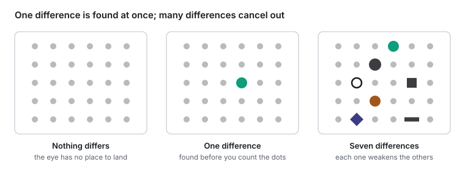

In the middle grid you find the accent dot without searching. In the right grid seven dots compete, and none of them wins.

### What goes wrong

- **Emphasis everywhere.** Bold, color, boxes and underlines on one page. Each addition lowers the contrast of the others.
- **Relying on hue.** Red on green of the same lightness disappears in grayscale, on a weak projector and for a color-blind viewer.
- **The accidental focal point.** A dark logo, a heavy table border or a saturated photo in a corner outshouts the content. The squint test finds these.
- **Fighting the reading direction for no reason.** The story starts at the bottom right of an English poster, and nobody finds the beginning.

### Exercise 1.1: squint at five pieces (10 minutes)

1. Collect five things: a figure from a paper, a poster in the hallway, a manga page, a web page and one of your photographs.
2. Squint at each.
3. Note the first landing spot and the number of big shapes.
4. For two of them, decide whether the landing spot is what the author wanted.

What you should find: in each piece your eye lands first on the spot that differs most from its surroundings, and a strong design usually shows three to five big shapes. Where the landing spot is not what the author wanted, the squint test may have found an accidental focal point, such as a dark logo, a heavy table border or a saturated photo in a corner, that outshouts the content.

## Chapter 2. Grouping: the Gestalt principles

Viewers decide what belongs together from spacing, likeness, enclosure and alignment before they read any label. Your grouping cues must therefore agree with your content.

### The idea

Gestalt psychologists, starting in the 1920s, described how the eye turns separate marks into units, and later researchers added more. Six principles do most of the work in layout.

| Principle | What the eye assumes | Where you use it |
| --- | --- | --- |
| Proximity | Things close together belong together | A caption under its figure; a label beside its panel |
| Similarity | Things that look alike are the same kind | One heading style; one color per condition across panels |
| Common region | Things inside one boundary belong together | A tinted box around the conclusion |
| Continuity | Things on one line or curve form one sequence | Aligned edges; a row of panels |
| Closure | Incomplete outlines are completed into whole shapes | A column of text reads as a rectangle with no drawn border |
| Figure and ground | One shape is the object and the rest is background | A subject against a backdrop; white space as a shape |

When cues conflict, a boundary or a connecting line usually wins over spacing and likeness. Between spacing and likeness, the larger difference wins. The safe rule: never let them disagree.

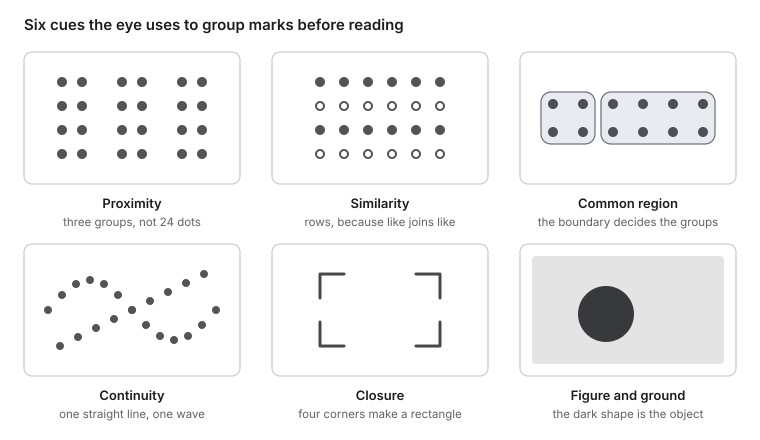

The first four panels use the same plain dots. Only the spacing, the fill, the boundary or the path changes, and the grouping changes with it. The last two need no dots: four corners that the eye completes into a rectangle, and a dark shape that reads as the object against its ground.

### How to do it

1. List the groups your content has: this caption with that plot, these three bullets under that heading.
2. For each group, check that its members are closer to each other than to anything outside the group.
3. Check that things of one kind share one look, and that nothing of a different kind borrows it.
4. Add a boundary only where spacing cannot do the job.

### What goes wrong

- **Equal spacing everywhere.** A heading that sits midway between two paragraphs belongs to neither.
- **Labels nearer the wrong thing.** A panel letter floating between two panels, or an axis title closer to the neighboring plot.
- **One look, two meanings.** Blue is the wild type in panel A and the treated sample in panel C. Viewers assume the same look means the same thing.
- **Boxes around everything.** Enclosure is the strongest cue. Spent on every block, it can no longer mark the one group that matters, and every border is one more line to process.
- **Near-misses.** Two edges that almost align read as one line with a kink in it.

### Exercise 2.1: check the grouping in two figures (15 minutes)

1. Take one multi-panel figure you admire and one you find confusing.
2. For every label, check whether it sits closer to its own panel than to any other.
3. Check that each color means one thing.
4. Write two sentences on why the confusing figure confuses, using the six terms.

What you should find: in the confusing figure, at least one grouping cue disagrees with its content, for example a panel letter floating between two panels, an axis title closer to the neighboring plot, or one color with two meanings. Viewers decide what belongs together from spacing, likeness, enclosure and alignment before they read any label, which is why the disagreement confuses.

## Chapter 3. Visual hierarchy

Hierarchy is the ranked list from Chapter 0 made visible: one element wins, a few come second, and the rest stay quiet.

### The idea

Three levels are enough for almost any page. Six tools create them, and all six work by contrast with the surroundings.

| Tool | Reads as more important | Reads as less important |
| --- | --- | --- |
| Size | Larger | Smaller |
| Weight | Bold type, thick lines | Regular type, thin lines |
| Value | Far from the background's lightness | Close to it, such as gray on white |
| Color | The only saturated accent | Gray, or one color among many |
| Position | Top, center, start of the reading path | Bottom, corners, end of the path |
| Isolation | Surrounded by empty space | Packed among neighbors |

### How to do it

1. Set everything in the level-3 style: one size, regular weight, quiet.
2. Promote the level-1 element with two tools, for example size and position.
3. Promote the level-2 elements with one tool each.
4. Make every step obvious. If you have to check whether two sizes differ, they do not differ enough.
5. Squint. You should be able to count three levels.

Demoting is as useful as promoting. Shrinking the logos and graying the references makes the title stronger without touching it.

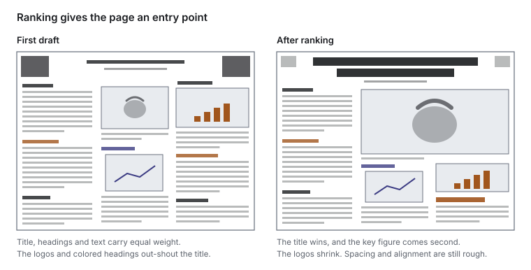

Squint at both. On the left the two logo blocks win, the colored headings and bars come next, and the title is a thin line between them. On the right you see a title, then one large figure, then everything else.

### What goes wrong

- **A flat page.** Title, headings and body differ by a point or two, so the viewer has no entry.
- **Shouting.** Everything is promoted, which is the same as nothing being promoted.
- **The wrong winner.** The institution logo or a decorative photo is the largest, darkest thing on the page.
- **Too many levels.** Five heading styles that nobody can rank. Merge them into three.
- **Hierarchy by decoration.** Underlines, shadows and outlines used where size or space would do. They add marks without adding rank.

### Exercise 3.1: redraw your piece as gray boxes (15 minutes)

1. Take the ranked list from Chapter 0.
2. Redraw the piece as a small sketch using only gray boxes: one large dark box for level 1, medium boxes for level 2, thin pale boxes for level 3. Do not write any words.
3. Show it to someone for five seconds and ask which box is the most important.

What you should find: with no words to go on, the person picks the large dark box, your level-1 element. The sketch is the ranked list from Chapter 0 made visible: one element wins, a few come second, and the rest stay quiet.

## Chapter 4. Proximity and white space

On a page, spacing is the main grouping tool: the gap inside a group must be clearly smaller than the gap between groups. White space is the material those gaps are built from, so it is not waste.

### The idea

A page has only a few kinds of gap: between lines, between a heading and its text, between sections, between columns, and the outer margin. If the kinds are equal, the page is a gray slab. If each kind is clearly larger than the one before, the structure shows without a single drawn line.

### How to do it

1. **Pick a spacing unit,** for example the height of one line of body text.
2. **Build a scale from it:** half a unit inside a group (caption to figure, heading to its text), two units between groups, three or more for the outer margin.
3. **Attach every label to its owner.** A heading sits closer to the text below it than to the text above it. A caption touches its figure.
4. **Make room by cutting, not by shrinking.** Remove words until the gaps fit. Text that nobody reads is not content.
5. **Keep the margin clear.** Nothing but background inside the outer margin.

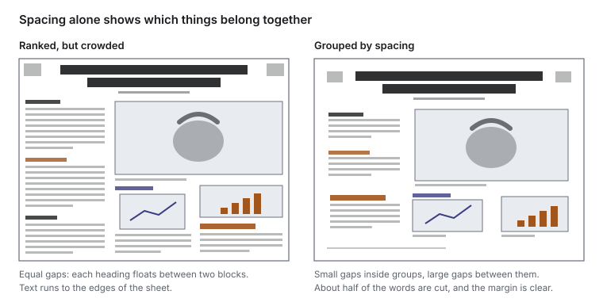

No type size or color changed between the two versions. The gaps changed, the pictures gave up a little width to clear the margin, and about half of the words were cut to make room.

### What goes wrong

- **Equal gaps.** The heading floats midway between two sections, and viewers cannot tell what it heads.
- **Filling every hole.** An empty area is treated as a problem and plugged with a logo or a bigger font. The empty space was doing work: it isolated what sits next to it.
- **Trapped white space.** A hole in the middle of the page, enclosed on all sides, pushes the blocks apart. Space works best when it connects to the margins.
- **Thin margins.** Content running to the edge makes the whole page feel crowded, however tidy the inside is.
- **Shrinking type to fit.** Body text below a readable size keeps the words and loses the readers.

### Exercise 4.1: fix a crowded slide with spacing alone (15 minutes)

1. Open a slide of yours that feels crowded.
2. Without changing any size or color, improve it using spacing alone: move each label next to its owner, double the gaps between groups, and delete words until it fits.
3. Compare the two versions at thumbnail size.

What you should see: at thumbnail size the groups in the new version show, though you drew no line and changed no size or color. Spacing did the grouping: the gap inside each group is now clearly smaller than the gap between groups.

## Chapter 5. Alignment and the grid

Every element should share an edge or a center line with at least one other element. A grid is the set of those shared lines, decided in advance.

### The idea

The eye follows edges; this is continuity from Chapter 2. When the left edges of five blocks fall on one invisible line, the five read as one column and the page looks calm. When they fall on five slightly different lines, the eye has five things to resolve. The page looks messy even if the viewer cannot say why.

### How to do it

1. **Choose the columns.** Three or four equal columns suit a landscape poster; two or three suit a figure or a slide. Leave a gutter between them of about two spacing units.
2. **Snap every block to the columns.** A block may span one, two or three columns, but its edges sit on column edges.
3. **Align the tops.** The first element of every column starts on the same horizontal line.
4. **Prefer one alignment for text.** Left-aligned text has a hard edge that other things can align to. Centered text has no edge; keep it for a single short line.
5. **Align across groups.** Panel labels on one line, axis titles on one line, figure bottoms on one line.
6. **Break the grid once, on purpose.** An element that crosses the columns gains emphasis only if everything else obeys them.

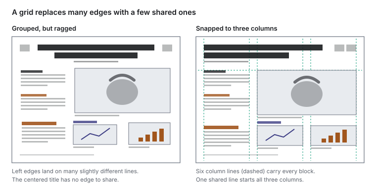

Nothing was added or removed. Each block moved or stretched a few millimeters onto a column line, the title moved from the center to the left edge, and the two logos moved together to the right.

### What goes wrong

- **Near-misses.** Edges two millimeters apart. Either align them or separate them clearly.
- **Centering everything.** Centered title, centered headings, centered blocks: no edge anywhere, so nothing connects to anything.
- **Mixed alignments.** Left, centered and right text on one page, each chosen locally.
- **Panels of arbitrary size.** Each plot exported at its default size, so no two share a width or a baseline.
- **Trusting the hand over the tool.** Use guides and the align and distribute commands. Placing by hand is how near-misses happen.

### Exercise 5.1: count the lines (15 minutes)

1. Take a poster or a multi-panel figure.
2. Draw a line along every vertical edge and every horizontal edge you can find, and count the lines.
3. Redraw the piece as boxes on a three-column grid and count again.

What you should find: a lower count on the grid version. A tidy page has few lines, each shared by many elements, and every near-miss adds one line to the count and one more thing for the eye to resolve.

## Chapter 6. Contrast and repetition

Things with different roles should look clearly different, and things with the same role should look exactly the same. Contrast makes the hierarchy visible; repetition makes the page one piece.

### The idea

Both principles come from similarity in Chapter 2. The viewer assumes that the same look means the same role, so every style on the page is a promise: this weight means heading, this color means the finding. Keep the promises and the viewer learns the page in seconds. Break them and every element has to be read to be understood.

### How to do it

1. **Write a style list with as few entries as possible:** title, heading, body, caption, accent. Five is usually enough.
2. **Separate the entries by a clear step.** Two sizes one point apart look like a mistake. Make differences large or remove them.
3. **Choose one accent color and give it one meaning.** Spend it on the level-1 and level-2 items only. Everything else stays neutral.
4. **Repeat without exception.** Every heading in the heading style, every caption in the caption style, the same line weights and colors in every panel.
5. **Check in grayscale.** The accent must also differ in lightness, not only in hue.

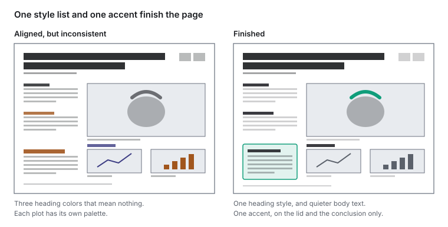

The right-hand poster is the finished layout. Compare it with the first draft in Figure 3: the title, the figures and the sections are the same, about half of the words are gone, and each change came from one of four chapters.

### What goes wrong

- **Timid contrast.** 11-point next to 12-point, dark gray next to black. The viewer sees inconsistency, not hierarchy.
- **Color as decoration.** A different color for each section heading. The colors mean nothing, and the real accent drowns.
- **Style drift.** Three slightly different heading styles, because the sections were written on different days.
- **Inconsistent panels.** The same condition drawn in different colors, fonts or line weights across plots.
- **Too many typefaces.** One family with two weights covers nearly everything. A second family needs a reason.

### Exercise 6.1: one meaning per style (15 minutes)

1. Open your most recent slide deck or poster.
2. List every distinct text style and every color you used, and what each one means.
3. Merge until no two entries mean the same thing and no entry means two things.
4. Apply the merged list to one slide.
5. Compare it with the slide as it was.

What you should see: a short merged list in which each entry has one meaning; five entries (title, heading, body, caption, accent) are usually enough. Next to the slide as it was, the restyled slide has a visible hierarchy and reads as one piece, because every style keeps its promise: a viewer learns it in seconds instead of reading every element to understand it.

## Chapter 7. The frame: focal point and value structure

A picture reads when its lights and darks gather into a few big shapes and the strongest contrast sits on the subject. This is hierarchy again, built from tone instead of type.

### The idea

- **Value means lightness,** from white to black, ignoring hue. It is what a black-and-white photograph keeps.
- **A picture is first seen as three to five value shapes:** sky, ground, a building, a figure. If those shapes are clear, the picture reads at thumbnail size.
- **The focal point is where contrast peaks:** the lightest light against the darkest dark, the sharpest edge, the only saturated color, or the only face.
- **Everything else supports.** Supporting areas keep their values close together so that they stay quiet.

### How to do it

1. **Name the subject** and what the picture says about it, as in Chapter 0.
2. **Draw a three-value thumbnail** about five centimeters wide: white, mid gray and black. No outlines, only shapes. Two minutes.
3. **Place the strongest contrast at the subject.** Put a dark subject against the lightest area, or a light subject against the darkest.
4. **Merge the rest.** Join neighboring shapes of similar value into one mass, and lower the contrast inside the masses.
5. **Add one accent** if the subject needs it: a single warm light, or one saturated color.
6. **Squint at the thumbnail.** If the subject is still the first thing you see, enlarge the sketch and add detail.

Photographers do the same with position and exposure: move until the subject stands against a plain area that is much lighter or darker than it is.

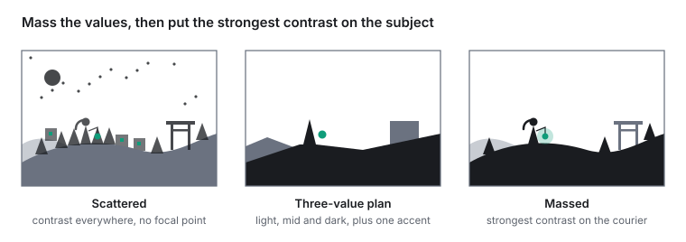

The left and right frames hold the same hill, gate and courier. The middle frame is the plan that connects them: three values and one accent, with no detail. On the right the moon, the stars and the houses are gone, the gate has faded to a mid gray, and the trees have merged into the hill, so the courier and her lantern are the first thing you see.

### What goes wrong

- **Scattered contrast.** Small lights and darks all over the frame, like confetti. The eye bounces and settles nowhere.
- **A subject that matches its background.** A dark figure in front of dark trees. Move the figure, the light or the camera.
- **Equal amounts of everything.** The same area of light, mid and dark. Let one value dominate; a picture that is mostly dark with a little light has a mood.
- **Detail everywhere.** Every leaf and brick drawn with the same sharpness. Detail is contrast, so spend it at the focal point.
- **A brighter spot elsewhere.** A white sign or a patch of sky near the edge that outshines the subject. Crop it, darken it or cover it.

### Exercise 7.1: draw four pictures in three values (15 minutes)

1. Choose three images you admire: a film still, a manga panel and a photograph.
2. Draw each as a three-value thumbnail in two minutes, and mark the focal point with a cross.
3. Do the same for one of your own photographs.
4. Compare how clearly the shapes separate in your own photograph and in the three you admire.

What you should find: each image you admire reduces to three to five clear value shapes, your cross lands on the subject where contrast peaks, and the supporting areas stay close in value. Your own photograph's shapes separate as clearly only if its lights and darks gather into a few big shapes; if they scatter like confetti, the eye bounces and settles nowhere.

## Chapter 8. Placement, balance and the eye path

Where the subject sits in the frame, and what leads to it, changes what the picture says. The center is calm and formal, off-center with space ahead suggests movement, and the edge suggests leaving.

### The idea

- **The frame is part of the picture.** Its four edges and its center pull on whatever you place inside.
- **Visual weight.** Large, dark, saturated, detailed or isolated things are heavy. A small heavy thing far from the center can balance a large quiet thing near it, like a seesaw.
- **Direction.** Lines, gazes, pointing shapes and movement send the eye along them. A figure looks or walks toward something, and the viewer follows.
- **Depth.** Overlap, size change and a dark foreground against a pale distance turn a flat arrangement into space.

### How to do it

1. **Start off-center.** Divide the frame into thirds each way and try the subject on one of the four crossings. This rule of thirds is a starting point, not a law.
2. **Give the subject room in the direction it faces or moves.** More space ahead than behind.
3. **Place the horizon high or low,** not through the middle, unless you want symmetry.
4. **Build a path.** Choose where the eye enters, what it follows and where it stops. A road, a row of lamps, an arm or a gaze can each carry it. End the path on the subject.
5. **Balance the weights.** Cover half the frame with your hand. If the picture tips or one half feels dead, move or resize something.
6. **Check the edges.** Nothing important touches the frame, and no strong line runs exactly into a corner.
7. **Use three layers** when you want depth: something near, the subject, something far.

Use the center on purpose. A centered, symmetrical subject reads as formal and still, which is right for a portrait that stares back or a gate that blocks the way.

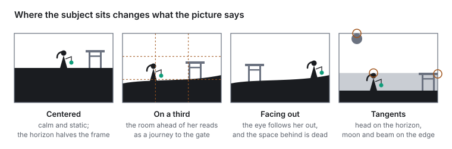

All four frames hold the same courier, gate and ground, and the last adds a moon. Otherwise only the positions differ, and the reading changes from stillness, to a journey, to a departure, to a set of distractions. The dashed lines mark the thirds; the rings mark the tangents.

### What goes wrong

- **Centered by default.** The subject sits in the middle because that is where the camera's focus point is.
- **Walking out of the frame.** The subject faces the near edge, so the eye follows it out and the space behind is dead.
- **Tangents.** Two outlines that just touch: a head resting on the horizon, a hand kissing the frame edge. Overlap them clearly or separate them clearly.
- **Lines that lead out.** A road or a railing that carries the eye off the edge instead of to the subject.
- **A line through the head.** A horizon, a pole or a window frame that cuts through the subject's head or neck.
- **Everything at one distance.** No overlap and no size change, so the picture stays flat.

### Exercise 8.1: photograph one subject six ways (15 minutes)

1. Take one simple subject, such as a cup on a table or a person at a window.
2. Photograph it six ways: centered, on a third facing into the frame, on a third facing out, at the very edge, with a foreground object, and from very low.
3. Put the six side by side.
4. Write one word under each for the feeling it gives.

What you should see: the words change while the subject stays the same. Where the subject sits changes what the picture says: centered, it reads as calm and formal; on a third facing into the frame, with space ahead, it suggests movement; on a third facing out, it leads the eye out of the frame, and the space behind it is dead; at the very edge, it suggests leaving. The foreground object adds a near layer, which gives the picture depth.

## Chapter 9. Sequences: manga pages, multi-panel figures and slides

When a piece has several frames, the layout must also control order and pace. Panel size sets emphasis and time, and the path between panels sets the order.

### The idea

- **A page is composed twice:** each panel as a frame (Chapters 7 and 8), and the page as a layout (Chapters 3 to 6). Japanese has a word for each: 構図 (kōzu) for the picture inside one panel, and コマ割り (koma-wari) for the division of the page into panels.
- **Size is emphasis and time.** A large panel is important and slow. A run of small panels is quick.
- **The reading path must be unbroken.** In manga it runs from the top right to the bottom left; in a Western figure, from the top left to the bottom right. Every panel hands the eye to the next.
- **Gaps steer the order.** This is proximity from Chapter 2. Manga keeps the gap between side-by-side panels narrow and the gap between rows wide, so the eye finishes a row before it drops to the next.

### How to do it: a manga page

Artists settle all of this in the ネーム (name), a rough draft of the page with panels, balloons and sketchy figures, drawn before any finished art.

1. **List the beats** of the page in order. About five panels makes a comfortable page, and more than eight is crowded.
2. **Pick the key beat** and give it the largest panel.
3. **Divide the page into rows.** Vary the number of panels per row so that the rhythm changes.
4. **Set the gaps:** narrow between neighbors in a row, about twice as wide between rows.
5. **Place the speech balloons along the reading path.** Readers move from balloon to balloon, so the balloons are the path.
6. **Aim the figures.** Gazes and movement point toward the next panel, not off the page.
7. **Plan in spreads.** Readers see two facing pages at once. End the last panel before a page turn on a hook (ヒキ, literally a pull): a question, a look, an open door. The answer waits on the other side of the turn (めくり).

The gap widths and panel counts follow [Shogakukan's manga course on Clip Studio](https://www.clipstudio.net/oekaki/archives/149462), which gives 4 to 6 mm between neighbors and 8 to 10 mm between rows.

### How to do it: a multi-panel figure

1. **One message for the whole figure** (Chapter 0) and one sub-claim per panel.
2. **Order the panels as the argument runs:** a, b, c along the reading path. The reader should never hunt for panel d.
3. **Give the key panel more area.** Equal panels say that all the data are equally important.
4. **Share what can be shared:** axes, scales, colors and label positions (Chapter 6). Align the plot areas, not only the outer boxes (Chapter 5).
5. **Keep the gap inside a panel smaller than the gap between panels,** so that each label stays with its own plot.

Slides follow the same rules over time: one message per slide, and the same element in the same place on every slide.

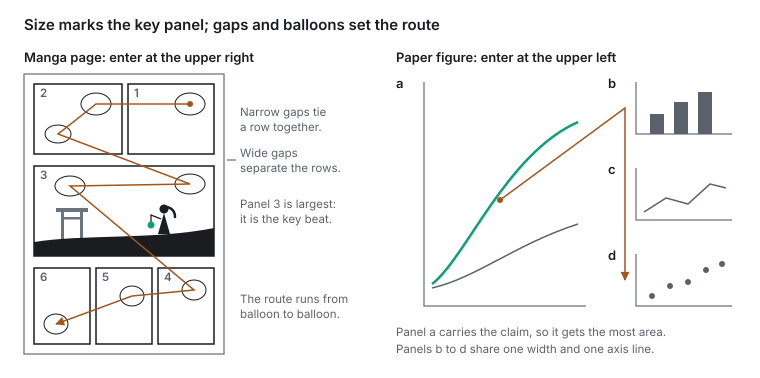

On the manga page the route follows the balloons: right to left along each row, then down. In the paper figure the large panel is read first, then the three small ones from the upper one down.

### What goes wrong

- **Ambiguous order.** Four panels in a square, where the reader cannot tell whether to go across or down. Change the gaps or the sizes so that only one route works.
- **All panels the same size.** No beat is marked as important, and the pace never changes.
- **Balloons against the flow.** The reply sits before the question on the reading path, so the conversation reads backwards.
- **A figure looking off the page,** taking the reader's eye with it.
- **The crowded figure.** Eight panels because eight experiments were done. Move four to the supplement and enlarge the one that carries the claim.

### Exercise 9.1: trace two reading paths (20 minutes)

1. Take one page of a manga you like.
2. Copy only its layout: panel borders, balloons as ovals, and one arrow for each figure's gaze.
3. Draw the path your eye takes as a single line.
4. Do the same for a figure from a paper.
5. Note where each author made the path easy and where you hesitated.

What you should find: on the manga page your line runs from the top right to the bottom left, from balloon to balloon, finishing each row before it drops to the next, and a gaze arrow that points toward the next panel runs the same way. On the paper figure your line runs from the top left to the bottom right. The path is easy wherever a panel hands the eye to the next. You hesitate where one does not, as with a figure looking off the page, which takes your eye with it, or four panels in a square, where you cannot tell whether to go across or down.

## Chapter 10. Thumbnails: hold the content fixed and vary the arrangement

The first arrangement you think of is rarely the best, and you cannot tell until you see it next to others. Thumbnails make alternatives cheap: small, fast sketches of the whole piece, compared side by side.

### The idea

This is a controlled experiment for layout. The content stays fixed and one thing varies: the arrangement. Each sketch takes two minutes and shows no detail, so you judge the structure alone and do not get attached to any one version.

### How to do it

1. **Draw six small frames** in the proportions of the final piece, each about five centimeters wide.
2. **Use the ranked list** from Chapter 0. Level 1 is a dark box, level 2 is mid gray, level 3 is pale lines.
3. **Make each frame different on purpose.** Move the level-1 element: left, right, top, center, full width. Change the column count. Try one version that breaks your habit.
4. **Stop at two minutes each.** No words, no detail.
5. **Step back and squint.** Cross out the frames where level 1 does not win. From the rest, choose the one with the clearest path.
6. **Refine the winner** at twice the size, then build it.

A generator can make the variants for you. Ask for six layouts of the same content, rank them yourself, and write one sentence on why the winner wins. The ranking and the sentence are the practice.

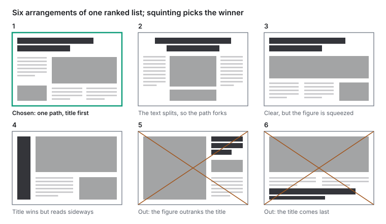

Frames 5 and 6 fail the squint test, because the title does not win. Of the rest, frame 1 gives one unbroken path, and it is the layout that Chapters 3 to 6 built.

### What goes wrong

- **One thumbnail.** A single sketch is a plan, not a comparison.
- **Six copies.** Variants that differ by a nudge. Force large differences; the small ones come later.
- **Too large, too detailed.** At full size you start polishing and stop judging.
- **Choosing the familiar.** The frame that looks like your last poster feels right because you have seen it before. Ask which one serves the message.
- **Skipping the step under time pressure.** Twelve minutes of thumbnails saves an hour of rearranging finished elements.

### Exercise 10.1: thumbnail your next piece (15 minutes)

1. Take the next thing you need to make: a slide, a figure or a page.
2. Draw six thumbnails before opening any software.
3. Photograph the sheet.
4. After you finish the real piece, look at the photograph again.
5. Check whether you would still choose the same frame.

What you should find: six frames that differ on purpose, not by a nudge, and a winner you could pick only by seeing them side by side, because the first arrangement you think of is rarely the best. Each thumbnail showed no detail, so you judged the structure alone; the photograph shows whether that judgment still holds once the real piece is finished.

## Chapter 11. Review and revise

A layout is finished when it survives a set of quick tests, each of which asks one question. Run them in the same order every time, fix what fails, and run them again.

### The tests

| Test | How | The question it answers |
| --- | --- | --- |
| Squint | Blur your eyes, or shrink the piece to thumbnail size | Do three to five big shapes remain, and is level 1 the strongest? |
| Grayscale | Photograph it with a black-and-white filter | Does the hierarchy survive without hue? |
| Flip | Mirror the image, or hold the paper up to a light from behind | Is it balanced? A mirrored image looks new, so you see what habit has hidden. |
| Five seconds | Show it to someone for five seconds, then hide it | What did they see first, and what do they think it says? |
| Distance | View it from where the audience will stand, or at the size it will be printed | Is the smallest text that matters still readable? |
| Edges | Trace the frame edge and every place where two outlines meet | Does anything touch that should overlap or separate? |
| Cover | Hide one element with a finger | Did the piece get worse? If not, remove the element. |

### How to do it

1. **Rest first.** Leave the piece for an hour, or overnight. You cannot see what you have just made.
2. **Run the tests in the order above,** and write down every failure before fixing any.
3. **Fix the biggest structural problem first.** Hierarchy and grouping before alignment; alignment before color and type.
4. **Change one thing at a time** and repeat the squint test.
5. **Stop when the five-second answer matches your message** from Chapter 0.

### Directing someone else, including an AI

The same vocabulary turns a vague request into a brief, and a vague reaction into a correction.

| Instead of | Say |
| --- | --- |
| "Make it look better" | "The key figure is level 2: make it the largest element after the title, top left, spanning two columns" |
| "It feels cluttered" | "Double the space between sections and attach each caption to its panel" |
| "Something is off" | "The conclusion and the logo have equal weight; shrink the logo and move it to a bottom corner" |
| "Make it pop" | "Use the accent color only on the closed lid and the conclusion; keep everything else neutral" |

When a result comes back, run the tests on it exactly as you would on your own work. A generated layout is usually tidy, and tidy is not the same as correct. Check that the element it made largest is the one you ranked first.

### What goes wrong

- **Reviewing at full zoom.** You check details and miss that the page has no entry point.
- **Asking "do you like it?"** People answer politely. Ask what they saw first and what they think it says.
- **Explaining before they look.** Once you have told a viewer the message, they will see it whether or not the layout shows it.
- **Fixing symptoms.** Changing the color of a heading that is in the wrong place.
- **Never stopping.** Once the five-second answer matches the message, further changes are taste. Ship it.

### Exercise 11.1: review the piece you ranked (20 minutes)

1. Run all seven tests on the piece you ranked in Chapter 0.
2. List the failures.
3. Fix the largest one.
4. Run the tests again.
5. Keep the before and after together.

What you should find: the second run tells you whether the piece is finished. It is finished once it survives the tests and the five-second answer matches your message from Chapter 0; after that, further changes are taste. Kept together, the before and after are the first entry in your own collection of worked examples.

## Going deeper

Chapters 0 to 11 are the core: with them you can plan, build and check a layout or a picture. The six chapters in this group add what a core course leaves out. They cover the two raw materials of every page (type and color), the building blocks of every picture (line, shape and depth), a catalog of proven arrangements, and the remaining textbook principles.

Each chapter names the core chapters it extends. After Chapter 11 you can read these six chapters in any order.

## Chapter 12. Type: the texture of a page

Most of a page is text, so the size, length and spacing of its lines decide how the page looks before anyone reads it. Three numbers do most of the work. This chapter extends Chapters 3 to 6.

### The idea

- **Text is seen as texture first.** From a distance a paragraph is a gray rectangle. An even, open gray looks easy to read. A dark, cramped one looks like work, and viewers skip it.
- **Three numbers set the texture:** the type size, the line length and the line spacing.
- **A scale of sizes carries the hierarchy** from Chapter 3. A few sizes with clear steps are enough.

### How to do it

1. **Set the body size for the viewing distance.** Use the table below, then test at the real distance.
2. **Keep lines to about 45 to 90 characters,** spaces included. On a poster or slide stay near the short end, because readers are standing.
3. **Set the line spacing to 120 to 145 percent of the type size.** Longer lines need the larger value.
4. **Build a scale of at most four sizes:** caption, body, heading and title. Make each step obvious, with a heading around 1.5 times the body and a title at twice or more.
5. **Align text left** and leave the right edge ragged. Justify only with hyphenation turned on. Center only a short title.
6. **Emphasize with one tool,** bold or the accent color. Avoid underlining, and keep capitals to less than one line.
7. **Use one typeface family in two weights.** Journals ask for sans-serif faces in figures, and they are the safe choice for posters and slides.

| Medium | Body text | Source or test |
| --- | --- | --- |
| Printed document | 10 to 12 pt | [Practical Typography](https://practicaltypography.com/summary-of-key-rules.html) |
| Web page | 15 to 25 px | Practical Typography |
| Journal figure | 5 to 7 pt at final size, with 8 pt bold panel labels | [Nature's final-submission guide](https://www.nature.com/nature/for-authors/final-submission); other journals differ |
| Poster | 24 pt at the very least | [Erren and Bourne, Rule 7](https://pmc.ncbi.nlm.nih.gov/articles/PMC1876493), then the arm's-length test in Chapter 19 |
| Slide | Large enough to read from the back row | Test in the room, or stand well back from your screen |

The line length, the line spacing and the print and web sizes are Matthew Butterick's figures in Practical Typography.

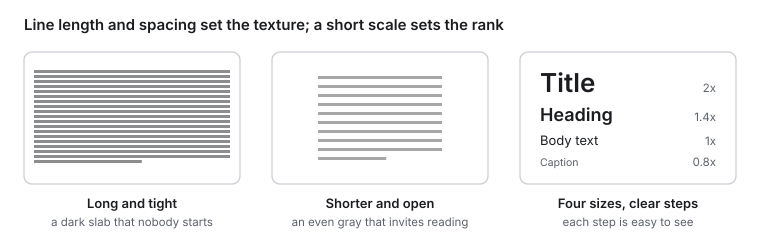

The left block is what a full-width paragraph looks like from across the room. The middle block is the same kind of text with shorter lines and more space between them. The right panel is set in real sizes, with their ratios to the body text.

### What goes wrong

- **Lines too long.** Full-width paragraphs on a poster or slide. The eye loses its place on the way back to the next line.
- **Lines too tight.** Spacing at the software default or below, so the block turns dark and heavy.
- **Too many sizes.** Seven sizes that differ slightly. Merge them into four that differ clearly.
- **Centered paragraphs.** Both edges are ragged, so every line starts in a new place and nothing can align with the block.
- **Justified text without hyphenation.** Wide gaps open between words and run down the block like rivers.
- **Emphasis by capitals or underline.** Long runs of capitals are slow to read, and underlines cut through the letters.
- **Shrinking the type to fit.** Cut words instead, as in Chapter 4.
- **Text on a busy image.** Move it to a plain area or give it a plain backing.

### Exercise 12.1: reset one block of text (15 minutes)

1. Take one text-heavy slide or one section of a poster.
2. Count the characters in a typical line, divide the line spacing by the type size, and count the distinct sizes.
3. Reset the block with lines of 45 to 75 characters, spacing near 130 percent and at most four sizes.
4. Compare the two versions at thumbnail size.

What you should see: at thumbnail size the new version is an even, open gray, which looks easy to read. If the old version used the software's default line spacing or less, it is darker and heavier, a texture that looks like work and that viewers skip.

## Chapter 13. Color: three jobs and one accent

Color does three jobs for data: it labels kinds, it shows amounts, and it shows deviation from a midpoint. Its fourth job is to point, as an accent. Give every color one job, and check that the design still works without hue. This chapter extends Chapters 1, 6 and 7.

### The idea

- **A color has three dimensions.** Hue is which color it is, value is how light it is, and saturation is how vivid it is.
- **Each dimension does different work.** Value carries structure and legibility, as in Chapter 1. Saturation attracts the eye. Hue labels.
- **Warm, light, saturated colors come forward,** and cool, gray ones fall back. Painters use this for depth, and you can use it for emphasis.

| Job | Palette | Typical use |
| --- | --- | --- |
| Label kinds | Categorical: a few distinct hues of similar strength | Chains of a complex, experimental conditions, characters |
| Show amounts | Sequential: one hue running from light to dark | Density, conservation, expression level |
| Show deviation | Diverging: two hues that meet at a neutral midpoint | Up- and downregulation, difference maps |
| Point | Accent: one saturated color against neutrals | The level-1 and level-2 items of Chapter 6 |

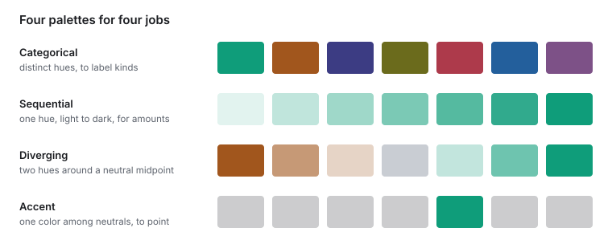

Read each strip for its order. The categorical strip has none, the sequential strip runs one way, the diverging strip runs two ways from the middle, and the accent strip has a single exception.

### How to do it

1. **Start in grayscale.** Get the value structure right first, as in Chapters 1 and 7, and add color afterwards.
2. **Give each color one job and one meaning,** and keep that meaning on every panel and page.
3. **Keep categorical palettes small.** Beyond about six to eight hues, direct labels work better than a legend of colors.
4. **For amounts, use a scale that gets steadily darker.** A rainbow scale has no natural order, and it creates boundaries that the data do not have.
5. **Choose pairs that survive red-green color blindness.** It affects as many as 8 percent of men and 0.5 percent of women of Northern European ancestry. Replacing red with magenta, or green with turquoise, keeps a pair distinguishable.
6. **Let one color dominate.** A large quiet area, a smaller secondary color and a small accent read as a decision. Equal amounts of three colors read as noise.
7. **Check twice:** in grayscale, and with a color-blindness simulator.

The prevalence figures and the magenta and turquoise substitutions come from [Bang Wong's column in Nature Methods](https://doi.org/10.1038/nmeth.1618), which also gives an eight-color palette that stays distinct for color-blind readers. [ColorBrewer](https://colorbrewer2.org) offers tested sequential, diverging and qualitative palettes, with a color-blind-safe filter.

### What goes wrong

- **Rainbow scales for amounts.** The yellow band looks like a feature of the data.
- **Red against green as the only difference.** As many as one man in twelve cannot tell them apart.
- **Color without a job.** A different color for each heading, or for bars that are already labeled.
- **Too many hues.** Ten categories in ten colors, and a legend the reader must consult for every point.
- **Everything saturated.** When every color is vivid, none of them points. Gray down the supporting colors.
- **One color, two meanings.** The same blue for the receptor in one figure and the ligand in the next.
- **Hue carrying the structure.** Colored text on a colored ground of the same lightness.

### Exercise 13.1: name each color's job (15 minutes)

1. Take one of your figures that uses color.
2. List each color and write its job beside it: label, amount, deviation or accent.
3. Convert the figure to grayscale and run it through a color-blindness simulator.
4. Change one thing so that it passes both checks.

What you should find: one job beside each color, and, after your change, a figure whose structure holds in grayscale and whose colors stay distinct in the simulator. If the figure failed in grayscale, hue was carrying the structure that value should carry.

## Chapter 14. Line and shape

Every picture is built from lines and shapes before it is built from things. Their directions and forms carry feeling on their own, so choose them on purpose. This chapter extends Chapters 7 and 8.

### The idea

- **Line direction sets the mood.** Horizontal lines read as rest. Vertical lines read as upright and formal. Diagonals read as movement or instability. Curves read as flow.
- **Lines can be implied.** A gaze, a pointing arm, a row of lamps or the edge of a shadow leads the eye as a drawn line does.
- **Shapes have character.** Round shapes feel soft and safe, square shapes feel solid and dependable, and pointed shapes feel fast or dangerous. Character designers build whole casts on this.
- **A silhouette is the shape that survives.** Filled in solid, a good subject is still recognizable, and so is what it is doing.
- **Sizes need variety.** One large shape, a few medium ones and several small ones hold interest. Equal shapes at equal spacing look like a fence.

### How to do it

1. **Pick the dominant direction** for the mood you want, and let most lines agree with it. Add one line against it where you want attention.
2. **Trace the implied lines.** Check where gazes, arms, roads and edges point, and aim them at the subject, as in Chapter 8.
3. **Test the silhouette.** Fill the subject with one flat tone. If the action disappears, open the pose: move the arm away from the body, turn the head into profile, show the prop against the background.
4. **Choose a shape family** for each character or object, and repeat it in the details.
5. **Vary the sizes.** Name the big shape, the medium shapes and the small ones. If two are nearly equal, change one.
6. **Keep the hardest edge at the focal point.** Soften or lose the edges elsewhere.

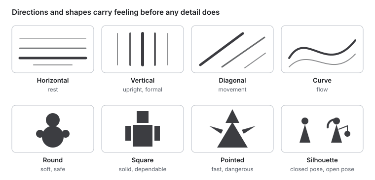

The upper frames hold nothing but lines, and each already has a mood. In the lower row one simple figure is built from three shape families. The last frame shows what an open pose explains and a closed pose hides.

### What goes wrong

- **Every line parallel to the frame.** Static, unless stillness is the point.
- **Diagonals in every direction.** Movement everywhere, which reads as confusion.
- **A closed silhouette.** The hands in front of the body and the prop in front of the chest, so the outline is a blob.
- **Equal sizes at equal gaps.** Three trees of one height, evenly spaced.
- **One line weight everywhere.** The outline of the hero and the outline of a pebble drawn alike.
- **Shapes that contradict the content.** A gentle character built from spikes, with no reason in the story.

### Exercise 14.1: test the silhouette (15 minutes)

1. Take five characters or objects from a manga, a film or a game, and fill each in solid black.
2. Note which ones you still recognize, and why.
3. Draw the silhouette of one subject of your own three ways.
4. Choose the one that explains the action best.

What you should find: a good subject is still recognizable in solid black, and so is what it is doing; where the hands sit in front of the body and the prop in front of the chest, the outline is a blob. Of your own three silhouettes, the one that explains the action best has an open pose, with the arm away from the body, the head in profile or the prop against the background.

## Chapter 15. Composition patterns: a catalog

Most strong pictures rest on one of a small number of simple arrangements. Learn nine and you have a starting point for any frame, and a vocabulary for studying other people's work. This chapter extends Chapter 8.

### The idea

A pattern is the skeleton of big shapes and main lines under a picture. Painters call it the armature. You choose it for the feeling it gives, then fit the subject to it.

| Pattern | Structure | It says | Typical use |
| --- | --- | --- | --- |
| Thirds | The subject sits on a crossing of the third lines | Natural, unforced | The default for most subjects |
| Symmetry | Two mirrored halves around a central axis | Formal, still, monumental | Architecture, ritual, confrontation |
| Diagonal | The main masses follow one diagonal | Movement, effort, speed | Action, slopes, travel |
| Triangle | Three points with a broad base | Stability and rank; upside down, tension | Groups, portraits, mountains |
| L-frame | A tall mass at one side and a base along the bottom | Shelter, a quiet view outward | Landscapes; a figure beside a tree or a wall |
| S-curve | A winding path from the foreground into the distance | A slow, graceful journey | Roads, rivers, a line of figures |
| Radial | Lines converge on one point | Focus, impact, sudden attention | Reveals, one-point perspective, manga focus lines (集中線) |
| Frame within a frame | The subject is seen through an opening | Intimacy, watching, depth | Doorways, windows, branches |
| Steelyard | A large mass near the center balanced by a small one far away | Balance with tension | A subject and its goal, or its threat |

Many books add the golden section: a division at about 0.62 of the frame instead of the 0.67 of thirds. The difference is small, and claims that viewers prefer it are disputed. Treat both as ways of getting off center.

The centered subject is a pattern too. Japanese calls it 日の丸構図, the hinomaru composition, after the disc at the center of the flag. Use it when you mean it, as Chapter 8 says.

### How to do it

1. **Decide the feeling,** as in Chapter 0, and pick two candidate patterns from the table.
2. **Thumbnail both** in three values, as in Chapters 7 and 10.
3. **Put the focal point on the pattern's strong spot:** a crossing of thirds, the apex of the triangle, the point where the lines converge, or the far end of the curve.
4. **Let the secondary shapes follow the pattern's lines.**
5. **Choose the format to match.** A wide frame suits journeys and horizons. A tall frame suits height and single figures. A square suits centered, symmetrical subjects.
6. **Loosen it.** Shift something slightly off the pattern so that the picture does not look ruled.

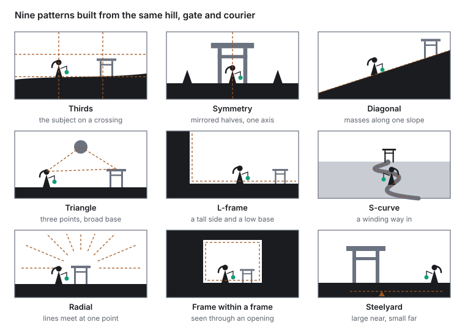

The dashed lines are the armature of each frame. Cover the captions and try to name each pattern from its skeleton alone.

### What goes wrong

- **A pattern with no subject.** A fine diagonal that leads to nothing.
- **Two patterns at once.** Half symmetry and half thirds, so that neither reads.
- **Thirds for everything.** It is a safe default, which is why a whole portfolio of it looks the same.
- **Forcing the content.** A calm scene bent onto a diagonal because diagonals are exciting.
- **Guides treated as rules.** The subject nailed to the exact crossing while a better position is two steps away.

### Exercise 15.1: find the nine patterns (20 minutes)

1. Collect nine images, one for each pattern, from photographs, film stills, paintings and manga panels.
2. Draw the armature of each in five lines or fewer.
3. Compose one subject of your own in three different patterns.
4. Note how the feeling changes.

What you should find: under each image lies one skeleton of big shapes and main lines, simple enough to draw in five lines or fewer. Your own subject takes on the feeling of each pattern you fit it to, so its three versions say three different things, as the table's "It says" column describes.

## Chapter 16. Depth, viewpoint and shot size

A flat surface shows depth only through cues, and the position of the camera decides how the viewer feels about the subject. Both are choices to make before you draw or shoot. This chapter extends Chapters 8 and 9.

### The idea: depth cues

| Cue | What the eye assumes | How to use it |
| --- | --- | --- |
| Overlap | Whatever covers something else is nearer | Let near shapes cut across far ones; it is the strongest cue |
| Size | Smaller means farther | Repeat a known shape at three sizes |
| Height in the frame | On the ground, higher means farther | Raise the bases of distant objects toward the horizon |
| Atmosphere | Paler, grayer and softer means farther | Lower the contrast of each layer as it recedes |
| Converging lines | Parallel lines meet in the distance | Aim roads, walls and floors at a vanishing point |
| Focus and detail | Sharp means the point of interest | Detail the subject and simplify the rest |

### The idea: viewpoint

| Camera position | Effect on the subject |
| --- | --- |
| Eye level | Neutral; the viewer meets the subject as an equal |
| High, looking down | The subject looks small, weak or watched, and the layout of a place becomes clear |
| Low, looking up | The subject looks powerful, tall or threatening |
| Tilted | Unease, as if the world were off balance |

### The idea: shot size

| Shot | Shows | Use it for |
| --- | --- | --- |
| Extreme wide | The place, with figures tiny | Where the scene is set; scale; loneliness |
| Wide | The whole figure in its setting | Action, and how the figure relates to the place |
| Medium | The figure from the waist up | Conversation and gesture |
| Close-up | The face | Emotion |
| Detail | An eye, a hand, an object | Emphasis and tension |

### How to do it

1. **Decide what the viewer needs:** the place, the action or the feeling. That sets the shot size.
2. **Choose the height of the camera** for the relationship you want. Stay at eye level unless you have a reason to leave it.
3. **Build three layers:** something near, the subject, something far. Overlap them.
4. **Fade with distance.** Each layer back is paler and simpler than the one in front.
5. **In a sequence, vary the shots.** Establish the place with a wide shot, then move in. Keep a character moving in one direction across neighboring panels, unless the change is the point.
6. **With a camera or a renderer, choose the lens on purpose.** A wide lens close to the subject exaggerates depth. A long lens from far away flattens it. An orthographic view removes perspective, which is what you want when sizes must be compared.

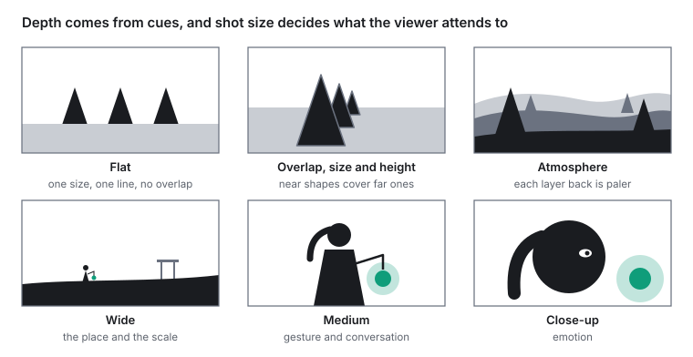

The upper row shows trees with no depth cue, with three cues, and with atmosphere added. The lower row moves the camera in on the courier, and the subject of the picture changes from where she is, to what she is doing, to how she feels.

### What goes wrong

- **Everything at one distance.** Objects side by side like a lineup, with no overlap.
- **Your own eye level by default.** Every picture taken from standing height.
- **One shot size throughout.** A page of medium shots has no rhythm and no emphasis.
- **A background as sharp as the subject.** Nothing recedes, so the subject does not come forward.
- **Accidental distortion.** A wide lens close to a face, or a perspective view of a structure that makes one distance look longer than an equal one.
- **A change of direction between panels.** She walks left, then right, and the reader thinks she turned back.

### Exercise 16.1: shoot nine frames, tally twenty shots (20 minutes)

1. Photograph one object from three distances and three heights, nine frames in all.
2. Write one word under each frame for the feeling it gives.
3. Take a scene from a manga or a film and tally the shot sizes of twenty consecutive panels or shots.

What you should find: the words change with the height and the distance of the camera, because its position decides how the viewer feels about the subject. From above, the object looks small, weak or watched; from below, powerful, tall or threatening; at eye level, neutral. Moving in changes what the picture is about. The tally shows several shot sizes, because one shot size throughout has no rhythm and no emphasis.

## Chapter 17. Balance, rhythm and unity

Textbooks list the principles of design under about a dozen names. This chapter extends Chapters 6 and 8. It adds the kinds of balance, teaches the three principles not yet covered, and maps every textbook term to the chapter that treats it.

### The map

| Textbook term | Meaning | Where it is taught |
| --- | --- | --- |
| Emphasis, dominance, focal point | One thing wins | Chapters 3 and 7 |
| Contrast | Visible difference | Chapters 1 and 6 |
| Hierarchy | Ranked importance | Chapters 0 and 3 |
| Proximity, grouping | Closeness shows belonging | Chapters 2 and 4 |
| Alignment | Shared edges | Chapter 5 |
| Repetition, pattern | Same role, same look | Chapter 6 |
| White space, negative space | Emptiness as material | Chapter 4 |
| Movement | The path of the eye | Chapters 8 and 9 |
| Balance | The distribution of visual weight | Chapter 8 and this chapter |
| Rhythm | Repetition with intervals | This chapter |
| Proportion, scale | Relations between sizes | This chapter |
| Unity, variety, harmony | Parts that belong together without being identical | This chapter |

### The idea

- **Balance has three main forms.** Symmetrical balance mirrors the two halves and reads as formal. Asymmetrical balance sets a large quiet mass against a small strong one, and reads as natural. Radial balance arranges everything around a center.
- **Visual weight is what gets balanced.** Size, darkness, saturation, detail, isolation and faces all add weight. So does distance from the center, as on a seesaw.
- **Rhythm is repetition with intervals.** Equal intervals are calm and mechanical, alternating ones are livelier, and steadily changing ones suggest movement or depth. A break in the rhythm is an accent.
- **Proportion is the relation between sizes.** Clearly unequal divisions, such as one third to two thirds, look intended. Nearly equal ones look undecided.
- **Unity and variety pull against each other.** Unity comes from shared traits: one palette, one shape family, one grid. Variety comes from deliberate exceptions. All unity is dull, and all variety is noise.

### How to do it: a five-point audit

1. **Balance.** Cover each half of the piece in turn. Name the kind of balance you intended, and check that you got it.
2. **Rhythm.** Find a repeated element. Decide whether its intervals should be equal, alternating or progressive, and put the accent where the rhythm breaks.
3. **Proportion.** Estimate the ratios between the main areas. Change any that are close to equal, unless you want symmetry.
4. **Unity.** List what the parts share. If the list is empty, give them one palette, one shape family or one alignment.
5. **Variety.** Find the one deliberate exception. If there is none, make one at the focal point.

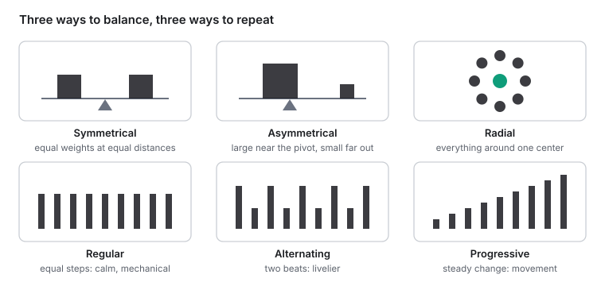

In the first frame the pivot sits in the middle. In the second it has moved toward the heavy block, and the small block balances it from far out. In the third, everything is arranged around one center. The lower row repeats one bar in three rhythms.

### What goes wrong

- **Accidental symmetry.** Almost centered, almost equal. Commit to symmetry or leave it clearly.
- **Equal divisions.** The frame cut into two equal parts, or into three equal bands.
- **Rhythm with no accent.** Wallpaper.
- **Unity by sameness.** Every element the same size, value and spacing.
- **Variety everywhere.** Each element in its own style.
- **Weight on one side by accident.** A heavy corner with nothing to answer it.

### Exercise 17.1: draw a weight map (15 minutes)

1. Take one page or picture you admire.
2. Draw a weight map: a circle for each main element, sized by how strongly it pulls your eye.
3. Mark the center and judge the balance.
4. Name the kind of rhythm you see, and the one exception that breaks it.

What you should find: the circles balance about the center in one of the three main forms. In symmetrical balance the two halves mirror each other. In asymmetrical balance a large quiet mass sits near the center and a small strong one balances it from far out, as on a seesaw. In radial balance everything is arranged around one center. The rhythm repeats at equal, alternating or progressive intervals, and the one exception that breaks it is the accent.

## Applications

The principles do not change between media, but each medium has its own sizes, habits and traps. The four chapters in this group apply the core to the things you are most likely to make: a scientific figure, a poster or a slide, a photograph or a render, and a manga page. Each is a workflow with the numbers that matter, and many steps point back to the chapters they use.

## Chapter 18. Scientific figures

A figure is an argument in one image: one claim, the evidence for it, and nothing that weakens either. Build it at its printed size from the start.

### The idea

- **A figure makes one claim,** and each panel makes one supporting point, as in Chapters 0 and 9.
- **It is read small.** Nature's standard figures are 89 mm or 183 mm wide, with text of 5 to 7 pt, panel labels of 8 pt bold and lines of 0.25 to 1 pt ([final-submission guide](https://www.nature.com/nature/for-authors/final-submission)). Other journals differ, so check the guide for authors before you start.
- **A visual choice is a scientific claim.** Size, color and perspective all assert something about the data, so the layout must not say more than the data do.

### How to do it

1. **Write the claim** as the first sentence of the legend (Chapter 0).
2. **List the panels the claim needs,** rank them, and give the key panel the most area (Chapter 9).
3. **Thumbnail at true size.** Draw a frame 89 or 183 mm wide on paper, and sketch the panels inside it (Chapter 10).
4. **Fix one style sheet for the whole paper:** typeface, sizes, line weights and palette (Chapters 6, 12 and 13).
5. **Build on a grid.** Align the plot areas, and share an axis wherever panels share a scale (Chapter 5).
6. **Label directly.** Put each label on or beside its data instead of in a legend box (Chapter 4).
7. **Keep one color for one thing** across every panel and every figure (Chapter 6).
8. **Remove ink that carries no data:** boxes, gridlines, 3D effects and repeated tick labels.
9. **Test at 100 percent.** Print the figure at its final size, then run the squint, grayscale and color-blindness checks (Chapters 11 and 13).

### Structure figures

1. **Choose the view for the claim.** Rotate until the interface, the pocket or the moving element is unobstructed and near the focal point.
2. **Keep one orientation across panels.** When you must rotate, say by how much and about which axis.
3. **Use an orthographic view when sizes or distances are compared.** Perspective makes near things larger and exaggerates depth.
4. **Color by role, the same way everywhere,** and gray out whatever is not under discussion.
5. **Simplify with distance from the point:** surface or cartoon for context, and sticks only at the site.
6. **Separate overlapping chains** with outline edges, depth fading or soft contact shadows. Avoid hard cast shadows, which can read as features of the molecule.
7. **Label residues beside the atoms,** with leader lines that do not cross, in the same type sizes as the rest of the figure.
8. **Compare states at one scale.** Align the structures, crop them identically and place them side by side.

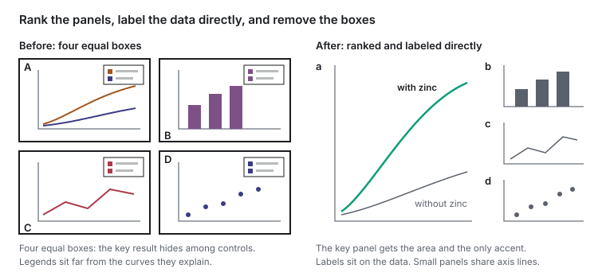

Both versions hold the same four data sets. On the left you have to read all four boxes to find the claim. On the right the claim is the first thing you see.

### What goes wrong

- **Designed at screen size.** The figure is shrunk for print, and the text lands at 3 pt.
- **Equal panels for unequal evidence.** The key result is the same size as a control.
- **A legend box far from the data.** The eye travels back and forth to decode every curve.
- **Colors that change meaning** between panels or figures.
- **The same molecule in a new orientation** in each panel, with no notice.
- **Perspective where distances are compared.**
- **Decoration.** Drop shadows, gradients and a heavy box around every panel.

### Exercise 18.1: test your latest figure at final width (20 minutes)

1. Print your most recent figure at its final width.
2. Run the squint, grayscale and five-second tests on the print.
3. Redraw the layout as gray boxes on a grid.
4. Fix the largest problem.
5. Keep the before and after.

What you should find: if you designed the figure at screen size, its text lands at 3 pt on the print. The gray boxes show whether the key panel has the most area, as on the right of Figure 17, or is the same size as a control, as on the left.

## Chapter 19. Posters and slides

A poster has about ten seconds to earn a conversation, and a slide has to make its point while the audience is listening to you. Both need one message, large type and less text than feels safe.

### The idea

- **A poster is an advertisement for a conversation,** not a paper on a wall. Erren and Bourne's second rule for posters is to sell your work in ten seconds.
- **A slide supports a speaker.** People cannot read and listen well at the same time, so every word on the slide competes with your voice.
- **Both are read from a distance,** so the type scale of Chapter 12 moves up.

### How to do it: a poster

1. **Write the title as the finding** (Chapter 0).
2. **Rank the content and draw six thumbnails** (Chapter 10).
3. **Use a grid.** Three columns is a dependable choice for a landscape poster (Chapter 5).
4. **Set the type large:** 24 pt as the floor for any text, with clear steps up to the headings and the title (Chapter 12).
5. **Leave generous margins and gaps** (Chapter 4), and cut text until they fit.
6. **Show the reading order.** Number the sections, or make the column flow obvious.
7. **Put the key figure and the conclusion at eye level,** in the upper half of the sheet.
8. **Run the arm's-length test.** Print the poster on one letter-size sheet. If you can read it at arm's length, the type is large enough.

### How to do it: a slide

1. **One idea per slide.** Split anything larger across slides that build on each other.
2. **Write the title as the conclusion** you want the audience to reach, not as a label.
3. **Show one piece of evidence,** as large as the slide allows.
4. **Remove what you will say aloud.** Keep short keywords and labels.
5. **Keep every element in the same place** on every slide: title, evidence, source line (Chapter 6).
6. **Budget about one minute per slide.**
7. **Run the distracted-viewer test.** Someone who looks up for five seconds should still get the point of the slide.

The poster numbers come from [Erren and Bourne's ten rules](https://pmc.ncbi.nlm.nih.gov/articles/PMC1876493) and the [Better Posters blog](https://betterposters.beehiiv.com/p/ten-simple-rules-for-conference-posters-21-10-25). The slide steps follow [Naegle's ten rules for slides](https://journals.plos.org/ploscompbiol/article?id=10.1371%2Fjournal.pcbi.1009554).

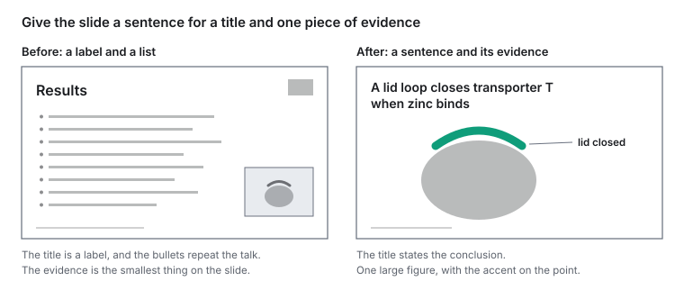

The right-hand slide passes the distracted-viewer test: someone who has just looked up reads one sentence, sees one picture and knows the point.

### What goes wrong

- **A paper pasted on a board.** Abstract, introduction, methods, results and discussion at full length.
- **A title that names a topic** instead of stating the finding.
- **A key figure the size of a postcard.**
- **No reading order.** Blocks placed wherever they fit.
- **Bullet lists read aloud.** The audience finishes reading before you finish speaking.
- **A slide titled "Results".** The title is the most valuable line on the slide, and it says nothing.
- **Four figures on one slide,** copied from the paper with their 6 pt labels.
- **Elements that jump** from one position to another between slides.

### Exercise 19.1: test a poster, retitle five slides (20 minutes)

1. Print your last poster on one letter-size sheet.
2. Run the arm's-length test.
3. Take five slides from a recent talk and rewrite each title as a sentence that states the conclusion.
4. On the same slides, delete every word you would say aloud anyway.

What you should find: if you can read the print at arm's length, the type is large enough. On each slide the title, the most valuable line, now states the conclusion you want the audience to reach, and the rest of the text is short keywords and labels. That is less text than feels safe, but every word you deleted was competing with your voice.

## Chapter 20. Photographs and renders

A camera, real or virtual, records everything in front of it with equal care. Composition is what you decide before the shutter: the subject, the light, the background, and only then the frame.

### The idea

- **A photographer composes by moving.** Feet, height, lens and timing replace the pencil.
- **A render is a photograph with full control.** You place the camera, the lights and the materials, so every chapter of this part applies and nothing can be blamed on the location.
- **Decide in a fixed order:** subject, light, background, frame.

### How to do it: a photograph

1. **Name the subject and the feeling** (Chapter 0).
2. **Read the light first.** Find where light and dark separate, and put the subject there (Chapter 7).
3. **Clean the background.** Move sideways, up or down until nothing bright, sharp or colorful competes. A wide aperture blurs what you cannot remove.
4. **Choose the distance and the lens** for the shot size you want (Chapter 16).
5. **Place the subject** with a pattern from Chapter 15, and leave room ahead of it (Chapter 8).
6. **Check the four edges and corners** before you press the shutter (Chapter 8).
7. **Shoot variations:** horizontal and vertical, one step closer, one step lower (Chapter 10).
8. **Finish the values afterwards.** Crop to the pattern, then lighten the subject or darken the edges slightly to strengthen the focal point.

### How to do it: a render

1. **Set the camera first:** viewpoint, focal length and framing. Use an orthographic camera for figures in which sizes are compared (Chapter 16).
2. **Light for separation.** A key light from the side gives form, a weaker fill keeps the shadows readable, and a light from behind draws an edge that lifts the subject off the background.
3. **Keep the background plain,** and lower in contrast than the subject.
4. **Spend saturation once.** Use one accent material and keep everything else quieter (Chapter 13).
5. **Add depth sparingly:** a little fog or a shallow focus, never both at full strength.
6. **Judge small.** Render at thumbnail size, squint, and check in grayscale before the final render.
7. **Vary one setting at a time.** Render a row of tiles that differ only in the angle of the key light, then in the fill, then in the focal length, and compare them side by side.

### What goes wrong

- **Centered at eye level by default.** The camera's habits, not your decision.
- **A busy background** that is as sharp and bright as the subject.
- **The brightest thing is not the subject.** A window, a sign or a white shirt at the edge.
- **Limbs cut at the joints.** Crop between joints, not at the wrist, knee or ankle.
- **A horizon that tilts by accident.**
- **Flat light.** A key light at the camera position removes the shadows that describe form.
- **Every effect at once.** Depth of field, fog, glow and a vignette together.

### Exercise 20.1: one subject, twelve frames (20 minutes)

1. Take one subject and make twelve frames, changing one thing each time: three distances, three heights, three directions of light and three backgrounds.
2. Lay them out as a contact sheet.
3. Choose the best, and write one sentence on why.

What you should see: twelve frames of one subject, each one change apart. A key light at the camera position removes the shadows that describe form, one from the side gives form, and a light from behind draws an edge that lifts the subject off the background. A busy background that is as sharp and bright as the subject competes with it. Figures 7, 8, 14 and 15 show what to look for when you choose.

## Chapter 21. A manga page from beats to name

A page is planned in four passes: beats, panels, balloons and figures. This chapter walks one page through all four. The page has the panel layout of Figure 9, and it uses the gap and panel rules of Chapter 9.

### The scene

Kaede, the lantern courier, reaches the gate at dusk and finds it closed. One page, six panels.

### Pass 1: beats

Write the page as a list of moments. Mark the key beat and the hook, and give each beat a shot size from Chapter 16.

| Panel | Beat | Shot | Size on the page |
| --- | --- | --- | --- |
| 1 | Kaede hurries along the ridge at dusk | Wide | Small |
| 2 | She checks the delivery tag: "Almost there." | Medium | Small |
| 3 | The gate, closed. She stops short. | Wide | Largest: the key beat |
| 4 | Her face | Close-up | Small |
| 5 | The lantern flickers | Detail | Small |
| 6 | A voice from behind the gate: "You're late." | Medium, from behind her | Small: the hook |

### Pass 2: panels

1. Group the beats into rows: two, one, three.
2. Give the key beat a full-width row and the most height.
3. Set narrow gaps inside each row and wide gaps between rows.
4. Check the rhythm: small, small, large, then three quick panels. The large panel is the pause.

### Pass 3: balloons

1. Place the balloons before the figures, along the reading route.
2. Put the first words of a panel toward its upper right.
3. Keep the key panel almost silent, so that the picture carries it.
4. Trim each line of dialogue until it fits its balloon with room to spare.

### Pass 4: figures and values

1. Sketch the figures as silhouettes (Chapter 14), facing along the route.
2. Give each panel a value plan (Chapter 7). In the key panel the gate stands dark against a pale sky, and Kaede is small on a third (Chapter 8).
3. Spend the accent once per panel at most. Here it is the lantern.
4. Draw the route as one line and squint at the page. The key panel should be the first thing you see, and the hook the last.

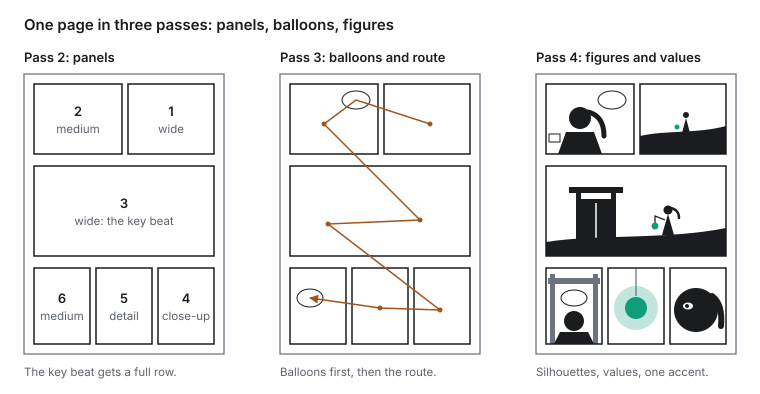

Pass 1 is the table of beats above. Each later pass adds one layer and leaves the earlier ones alone, so a problem found late can be traced to the pass that caused it.

### What goes wrong

- **Drawing panel 1 in full before planning panel 6.** The page runs out of room where the key beat should be.
- **No establishing shot.** The reader does not know where the characters are.
- **A squeezed key beat.** The moment the page exists for gets the same space as a glance.
- **Balloons added last.** They land on faces and hands, and the route breaks.
- **Too many words.** A balloon that needs small type needs fewer words.
- **A page that ends on a full stop.** Nothing pulls the reader to the next page.

### Exercise 21.1: six beats, four passes (30 minutes)

1. Write six beats for a one-page scene of your own.
2. Do the four passes on paper in thirty minutes.
3. Hand the page to someone and ask them to tell the story back to you.
4. Where their story differs from yours, look for the cause in the layout first.

What you should find: at the end of pass 4, when you squint at the page, the key panel is the first thing you see and the hook the last. When a difference in the story told back to you comes from the layout, you can trace it to the pass that caused it, because each later pass adds one layer and leaves the earlier ones alone. For example, if the reader does not know where the characters are, the cause may be a missing establishing shot.

## Appendix A. One-page checklist

Run this list on any piece before you call it finished. Each line names the chapter that explains it.

**Before arranging**

- The message is one sentence, and it is a statement (Chapter 0).
- The viewer, the distance and the time available are written down (Chapter 0).
- Every element is ranked 1, 2 or 3, with exactly one at level 1 (Chapter 0).
- Six thumbnails were drawn before the real piece (Chapter 10).

**The page**

- Squinting shows three levels, and level 1 wins (Chapters 1 and 3).
- Each label is closer to its owner than to anything else (Chapters 2 and 4).
- Gaps inside groups are clearly smaller than gaps between groups (Chapter 4).
- The outer margin is empty (Chapter 4).
- Every edge is shared with another element, and there are no near-misses (Chapter 5).
- Each style and each color has one meaning (Chapter 6).
- The accent appears only on level 1 and level 2 (Chapter 6).
- The hierarchy survives grayscale (Chapters 1 and 6).

**Type and color**

- Body lines run 45 to 90 characters, with line spacing of 120 to 145 percent (Chapter 12).
- There are at most four type sizes, with clear steps between them (Chapter 12).
- Each color has one job, and the palette passes a color-blindness check (Chapter 13).

**The frame**

- The picture reads as three to five value shapes (Chapter 7).
- The strongest contrast is on the subject (Chapter 7).
- The subject has room in the direction it faces (Chapter 8).
- Nothing important touches the frame, and there are no tangents (Chapter 8).
- There is a path in, and it ends on the subject (Chapter 8).

**Shape, pattern and depth**

- The silhouette of the subject still reads when it is filled in solid (Chapter 14).
- The picture rests on one named pattern (Chapter 15).
- There are three layers, and the viewpoint and shot size were chosen on purpose (Chapter 16).
- The balance is the kind you intended, and no division is accidentally equal (Chapter 17).

**The sequence**

- The reading order has only one possible route (Chapter 9).
- The key panel is the largest (Chapter 9).
- Balloons or panel labels follow the reading path (Chapter 9).

**Last**

- A stranger's five-second answer matches the message (Chapter 11).

## Appendix B. Glossary

The terms used in the chapters, and a few more that you will meet in books and tutorials, in alphabetical order. Japanese is given where you are likely to meet the word in manga or art writing.

| Term | Meaning |
| --- | --- |
| Accent | The single color or mark reserved for the most important items |
| Alignment | Placing elements so that they share an edge or a center line |
| Armature | The skeleton of big shapes and main lines under a picture; a composition pattern |
| Atmospheric perspective | Distant things look paler, grayer and softer |
| Balance | The distribution of visual weight across the frame |
| Bleed (タチキリ) | A panel or image that runs off the edge of the page |
| Categorical palette | A few distinct hues, for labeling kinds |
| Centered composition (日の丸構図) | The subject in the middle of the frame |
| Close-up (アップ) | A shot filled by the face or by one detail |
| Closure | The eye's habit of completing a whole shape from parts |
| Common region | Grouping by a shared boundary |
| Composition (構図) | The arrangement of elements inside one frame |
| Continuity | The eye's habit of following a line or curve |
| Contrast | A visible difference between two things; the source of all emphasis |
| Diverging palette | Two hues that meet at a neutral midpoint, for values above and below it |
| Eye path (視線誘導) | The route the eye takes through a piece. The Japanese term names the craft of guiding it |
| Figure and ground (図と地) | The object, and the background it is seen against |
| Focal point | The spot of strongest contrast, where the eye lands first |
| Focus lines (集中線) | Radial lines that converge on the point of attention |
| Grid | The shared lines on which elements are placed |
| Gutter (間白) | The gap between panels or columns |
| Hierarchy | The order of importance, made visible |
| Hook and reveal (ヒキ, めくり) | The last panel before a page turn, and what waits after it |
| Hue | Which color something is: red, blue, green |
| Layout (レイアウト) | The arrangement of elements on a page or screen |
| Line length (measure) | The number of characters in one line of text |
| Line spacing (leading) | The distance from one line of text to the next |
| Long shot or wide shot (ロング) | A shot that shows the whole figure in its setting |
| Name (ネーム) | The rough draft of a manga page: panels, balloons and sketchy figures |
| Notan (濃淡) | A study in two or three values of light and dark |
| Orthographic view | A view with no perspective, in which equal sizes stay equal at any depth |
| Panel layout (コマ割り) | Dividing a manga page into panels |
| Proportion | The relation between the sizes of parts |
| Proximity | Grouping by closeness |
| Repetition | Giving the same role the same look everywhere |
| Rhythm | Repetition with intervals |
| Saturation (彩度) | How vivid a color is, from gray to pure |
| Sequential palette | One hue from light to dark, for amounts |
| Shot size | How much of the subject and its setting the frame includes |
| Silhouette (シルエット) | The outline of a subject, filled in solid |
| Similarity | Grouping by likeness |
| Speech balloon (フキダシ) | The outlined area that holds dialogue |
| Spread (見開き) | Two facing pages seen together |
| Steelyard | A large mass near the center balanced by a small one far away |
| Tangent | Two outlines that touch without overlapping |
| Thumbnail | A small, fast sketch of the whole piece |
| Unity | The sense that the parts belong to one piece |
| Value (明度) | Lightness from white to black, ignoring hue |
| Vanishing point | The point where parallel lines appear to meet |
| Visual weight | How strongly an element attracts the eye |
| White space (余白) | Empty area; it isolates and groups what surrounds it |

## Appendix C. An eight-week practice plan

Ten minutes a day for eight weeks covers this whole part. The daily task trains the eye, and the weekly piece puts the chapters to use on your own work. Weeks 1 to 4 are the core, so do them first.

| Week | Chapters | Ten minutes a day | By the end of the week |
| --- | --- | --- | --- |
| 1 | 0 to 2 | Squint at one thing you see, such as a figure, a poster or a page. Note the first landing spot and the grouping cues. | One ranked list for a piece of your own |
| 2 | 3 to 6 | Redraw one slide or figure as gray boxes on a grid | One slide or figure of yours revised, with the before and after kept |
| 3 | 7 to 9 | Draw one three-value thumbnail of an image you admire | One manga page and one paper figure copied as layout only |
| 4 | 10 and 11 | Draw six thumbnails for something you need to make | One finished piece that passes the seven tests |
| 5 | 12 and 13 | Fill in one analysis sheet from Appendix E, with attention to type and color | One page of yours reset with a four-size scale and a palette with one accent |
| 6 | 14 and 15 | Draw the armature of one image in five lines | One subject composed in three different patterns |
| 7 | 16 and 17 | Tally the shot sizes of one scene, or draw one weight map | Nine photographs of one object: three distances by three heights |
| 8 | 18 to 21 | Work on one real project | One real figure, poster, talk, photograph set or manga page taken through its workflow |

After week 8, keep one habit: one analysis sheet or one set of six thumbnails a day. Keep every before-and-after pair in one folder.

### How to tell that you are improving

- **You predict the first landing spot** before you test, and you are right more often.
- **Your six thumbnails differ more** from each other than they used to.
- **A stranger picks your "after"** over your "before" in five seconds, without being told which is which.
- **You can name the problem** in a draft in the vocabulary of the chapters, instead of saying that something is off.
- **Your notes get more specific.** "Nice colors" becomes "one accent, on the only face".
- **You revise in fewer rounds,** because the first round fixes the structure.

Expect your eye to improve before your hand does. For a while you will see problems that you cannot yet fix. That gap is normal, and it is a sign that the practice is working.

## Appendix D. Further reading

These sources go deeper than this part. The first two books are the ones to read first. Most of the linked items are free to read online; the link for マンガの原理 leads to the publisher's page for the book, and Bang Wong's column is behind the Nature Methods paywall.

| Title | Author | Use it for |
| --- | --- | --- |
| *The Non-Designer's Design Book* | Robin Williams | Layout on the page; the quickest companion to Chapters 3 to 6 |
| *Picture This: How Pictures Work* | Molly Bang | Composition shown with cut-paper shapes; one evening; Chapters 7 and 8 |
| *Framed Ink* | Marcos Mateu-Mestre | Composition for visual storytelling; Chapters 7 to 9 and 14 to 16 |
| *Making Comics* | Scott McCloud | Choosing moments, frames and flow; Chapters 9 and 21 |
| [マンガの原理](https://www.kadokawa.co.jp/product/322312000330/) | 大場渉, 森薫, 入江亜季 (KADOKAWA, 2025) | In Japanese: panel layout, eye guidance and the page turn, from an editor and two manga artists; Chapters 9 and 21 |
| [見やすいコマ割りをしよう!](https://www.clipstudio.net/oekaki/archives/149462) | Shogakukan manga course, on Clip Studio | In Japanese: five rules of panel layout; the source for the gap widths in Chapter 9 |
| *The Photographer's Eye* | Michael Freeman | Composition for photographs; Chapters 8, 15 and 20 |
| [Practical Typography](https://practicaltypography.com/summary-of-key-rules.html) | Matthew Butterick | Type size, line length and line spacing; the source for the numbers in Chapter 12 |
| [Points of view: Color blindness](https://doi.org/10.1038/nmeth.1618) | Bang Wong, Nature Methods, 2011 | Color choices that survive color blindness; Chapter 13 |
| [ColorBrewer](https://colorbrewer2.org) | Cynthia Brewer and Mark Harrower | Tested sequential, diverging and qualitative palettes; Chapter 13 |
| [Ten Simple Rules for Better Figures](https://pmc.ncbi.nlm.nih.gov/articles/PMC4161295) | Rougier, Droettboom and Bourne, PLOS Computational Biology, 2014 | Scientific figures; twenty minutes; Chapter 18 |
| [Final submission guide](https://www.nature.com/nature/for-authors/final-submission) | Nature | Figure widths, type sizes and line weights; Chapter 18 |
| *The Visual Display of Quantitative Information* | Edward Tufte | Data graphics; Chapter 18 |
| [Ten Simple Rules for a Good Poster Presentation](https://pmc.ncbi.nlm.nih.gov/articles/PMC1876493) | Erren and Bourne, PLOS Computational Biology, 2007 | Posters; Chapter 19 |
| [Ten simple rules for effective presentation slides](https://journals.plos.org/ploscompbiol/article?id=10.1371%2Fjournal.pcbi.1009554) | Naegle, PLOS Computational Biology, 2021 | Slides; Chapter 19 |
| [Ten simple rules for conference posters](https://betterposters.beehiiv.com/p/ten-simple-rules-for-conference-posters-21-10-25) | The Better Posters blog, 2021 | Poster layout and the arm's-length test; Chapter 19 |

## Appendix E. Analysis sheet

Use this sheet to study any picture or page in ten minutes. One sheet a day teaches more than an hour of looking, because every step makes you name what you see.

| Step | What to do | Minutes |
| --- | --- | --- |
| 1. Squint | Draw the three to five value shapes as a thumbnail (Chapter 7) | 2 |
| 2. Focal point | Mark where your eye lands first, and write why: contrast, a face, isolation or an accent (Chapters 1 and 3) | 1 |
| 3. Path | Draw the route of your eye as one line, and note what carries it (Chapters 8 and 9) | 1 |
| 4. Skeleton | Name the pattern of a picture (Chapter 15), or draw the grid of a page (Chapter 5) | 2 |
| 5. Groups | List the groups and what binds each: spacing, likeness or a boundary (Chapter 2) | 1 |
| 6. Color and type | Note the job of each color (Chapter 13) and, on a page, the type sizes (Chapter 12) | 1 |
| 7. Space | For a picture, note the depth cues, the viewpoint and the shot size (Chapter 16) | 1 |
| 8. Verdict | Write two sentences: what the piece says, and the one decision you would borrow | 1 |

Keep the sheets in one folder. After thirty sheets, look through them for the decisions you borrowed most often. They show what your own taste is.
